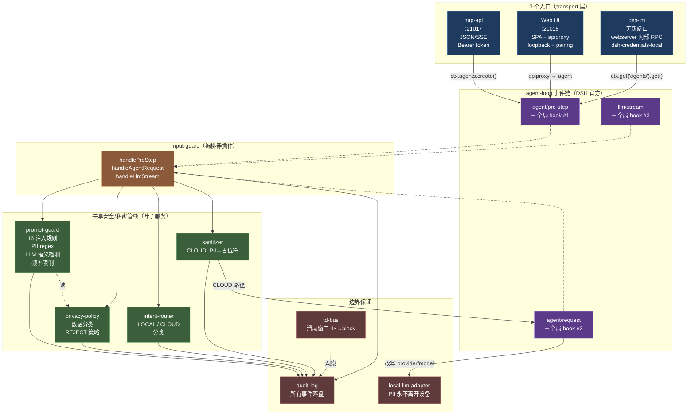
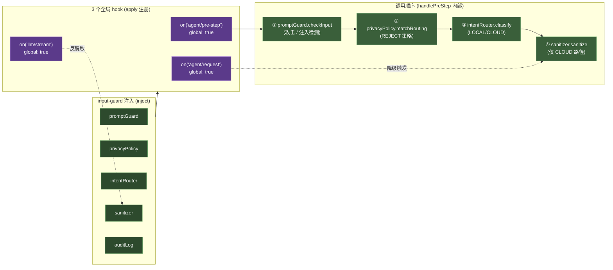

# input-guard 接入点架构图

> **状态**：Canonical · 2026-08-29
> **目的**：可视化 `input-guard` 在 agent-loop 事件链上的接入点，证明三入口（http-api / Web UI / dsh-im）共用同一套安全/私密管线
> **关联**：[input-guard-design.md](./input-guard-design.md) · [architecture.md](./architecture.md) · [dual-entry-architecture.md](./dual-entry-architecture.md) · [threat-model.md](./threat-model.md)

---

## 1. 核心结论（TL;DR）

`input-guard` 把自己注册为 agent-loop 事件链上的 **3 个全局 hook**：

| Hook | 时机 | 触发逻辑 |
|---|---|---|
| `agent/pre-step` | 正向 | 每个 agent-step 进入前：攻击检测 → 策略判定 → 路由分类 → 脱敏 |
| `agent/request`  | 路由 | agent-loop 组装 LLM 请求时：sanitize 失败则 CLOUD → LOCAL |
| `llm/stream`     | 反向 | LLM 流式输出 text-delta：占位符实时还原为 PII |

**3 个入口（http-api :21017、Web UI :21018、dsh-im 无端口）→ 3 个 hook → 同一套管线（prompt-guard + privacy-policy + intent-router + sanitizer + audit-log + td-bus）。**

谁也绕不过。新加入口（CLI / SDK / gRPC / WebSocket）只要最终进 `agent-loop`，零代码自动获益。

---

## 2. 系统架构图 — 入口与共享层的关系



**阅读要点**：
- **左列三入口** —— 三个完全不同的 transport 形态（HTTP REST / 浏览器 SPA / IM 频道）
- **中列三 hook** —— 同一个 agent-loop 事件链上的全局节点（虚线表示 hook 由 input-guard 注册）
- **右列共享管线** —— 6 个独立插件，单一接入点
- **底列边界保证** —— audit-log 落盘 / td-bus 滑动窗口 / local-llm-adapter（PII 不出设备）

---

## 3. 时序图 — 单次请求过 hook 的完整链路

```mermaid
sequenceDiagram
    autonumber
    actor U as 用户<br/>(http-api / Web UI / dsh-im)
    participant T as transport<br/>(3 个入口之一)
    participant A as agent-loop
    participant G as input-guard<br/>(orchestrator)
    participant SVC as 叶子服务<br/>(PG + PP + IR + SA)
    participant L as LLM<br/>(local-qwen3 / cloud-deepseek)
    participant AUD as audit-log

    U->>T: 输入 PII 消息
    T->>A: 路由到 ctx.agents.create()

    rect rgb(60, 40, 90)
        Note over A,G: agent/pre-step — hook #1
        A->>G: handlePreStep(payload, next)
        G->>SVC: 1. prompt-guard.checkInput (攻击检测)
        G->>SVC: 2. privacy-policy.matchRouting (策略)
        G->>SVC: 3. intent-router.classify (LOCAL/CLOUD)
        G->>SVC: 4. sanitizer.sanitize (CLOUD: PII→占位符)
        G->>AUD: 审计 (input-guard.*)
        G-->>A: decision (含改写后的 messages)
    end

    rect rgb(60, 40, 90)
        Note over A,L: agent/request — hook #2
        A->>G: handleAgentRequest(payload, seed, next)
        G-->>A: provider/model (可能改写为 LOCAL)
    end

    A->>L: stream (脱敏后文本)

    rect rgb(60, 40, 90)
        Note over L,A: llm/stream — hook #3
        L-->>G: text-delta chunks (含 [PHONE_1])
        G->>SVC: sanitizer.desanitize (占位符→PII)
        G->>AUD: 审计
        G-->>A: 流式还原后的 chunks
    end

    A-->>T: 还原后的响应
    T-->>U: 显示给用户
```



**关键不变量**：
1. 三入口在 **第 1 步** 之后路径完全相同（都进 agent-loop）
2. 三个 hook **串行触发**，但都是全局的（任何 agent 都会过）
3. **降级路径**：第 4 步 sanitize 失败 → 第 7 步把 CLOUD 改写成 LOCAL → 原始 PII 留本地
4. **审计无死角**：每次判定都写 audit-log，包括 fail-open / fail-closed

---

## 4. 插件组合图 — input-guard 编排什么



**实现位置**：`src/dsh-adapter/input-guard.ts:677-702`

```ts
// input-guard.ts:677-702 (节选)
const d1 = on('agent/pre-step', async (payload, next) => {
  return service.handlePreStep(payload, next)
}, { global: true })   // ← 全局：所有 agent 都过

const d2 = on('llm/stream', (options, next) => {
  return service.handleLlmStream(options, next)
}, { global: true })

const d3 = on('agent/request', async (payload, seed, next) => {
  return service.handleAgentRequest(payload ?? {}, seed ?? {}, async () => next())
}, { global: true })
```

---

## 5. 三个 hook 的具体职责对照

| Hook | 触发点 | 输入 | 内部动作 | 输出 | 失败语义 |
|---|---|---|---|---|---|
| `agent/pre-step` | agent-loop 每步进入 | `(payload, next)` | 1. prompt-guard.checkInput<br/>2. privacy-policy.matchRouting<br/>3. intent-router.classify<br/>4. sanitizer.sanitize | `decision` (可能改写 messages 或返回 reject) | 攻击/REJECT → `kind:'reject'`；sanitize 失败 → 标记 `downgraded` |
| `agent/request` | agent-loop 组装 LLM 请求 | `(payload, seedConfig, next)` | 检查 `stepState.downgraded`，若 true 则改写为 LOCAL | `AgentRequestConfig` | 不改写 → pass-through |
| `llm/stream` | LLM 流式输出 text-delta | `(options, next()) → AsyncIterable<chunk>` | 跨 chunk 累积占位符前缀，flush 后 desanitize | 流式 chunk | 还原失败 → yield 原 chunk（fail-open on stream） |

**跨 hook 状态**：`stepState = Map<sessionId, { sanitized, replacements, downgraded, originalProvider/Model/Realm }>`
（不能用 WeakMap<object> —— pre-step 的 session 对象和 llm/stream 的 sessionId 字符串不是同一个引用）

---

## 6. 三入口在共享管线上的实际路径

| 入口 | 进 agent-loop 的代码 | 第 1 个 hook | 第 2 个 hook | 第 3 个 hook |
|---|---|---|---|---|
| **http-api** | `http-api.ts:1010 ctx.agents.create()` | ✅ pre-step | ✅ request | ✅ stream |
| **Web UI** | webserver `apiproxy` → `ctx.agents.create()` | ✅ pre-step | ✅ request | ✅ stream |
| **dsh-im**  | `harness-session-coordinator.mjs:11 ctx.get('agents').get()` | ✅ pre-step | ✅ request | ✅ stream |

> **dsh-im 的特别说明**（cordis.patch.yml:388-393）：
> 不监听新端口；不引入新鉴权面；Channel 凭据由 webui 的「设置 → IM机器人」页面录入，存储到 `dsh-credentials-local` 受保护的本地凭据存储。

---

## 7. 加新入口意味着什么

假设未来要加一个 CLI 入口：

```ts
// 假设的 cli.ts
import { agents } from 'ctx'
await agents.create({ ... })   // ← 就这一行
// 自动获得：prompt-guard + privacy-policy + intent-router + sanitizer
//          + audit-log + td-bus + web-search-guard
//          + 3 个 hook 的所有保护
```

**无需**在 CLI 里再写一遍攻击检测 / 脱敏 / 审计 —— 因为它们都挂在 agent-loop 上，**transport 无关**。

这就是 input-guard "who-calls-what 不重要，谁都绕不过" 的具体兑现。

---

## 8. 验证方法

```bash
# 1. 确认 input-guard 已在 apply 里注册 3 个全局 hook
grep -n "agent/pre-step\|agent/request\|llm/stream" src/dsh-adapter/input-guard.ts

# 2. 启动后确认 input-guard service 注入成功
dsh --dump-config | grep -A2 input-guard

# 3. 三入口过同一套管线的运行时证据
#   - http-api: 看 POST /v1/chat 的 audit 日志
#   - Web UI:   看 webui 发起的请求在 audit 日志里 source 标记一致
#   - dsh-im:   看飞书消息的 audit 日志，kind 含 input-guard.*
tail -f ~/.dsh-edge-agent/audit/audit.plain.jsonl | grep input-guard
```

---

## 9. 变更记录

| 日期 | 变更 | 作者 |
|---|---|---|
| 2026-08-29 | 初版：3 入口 + 3 hook + 共享管线 | edge-agent team |