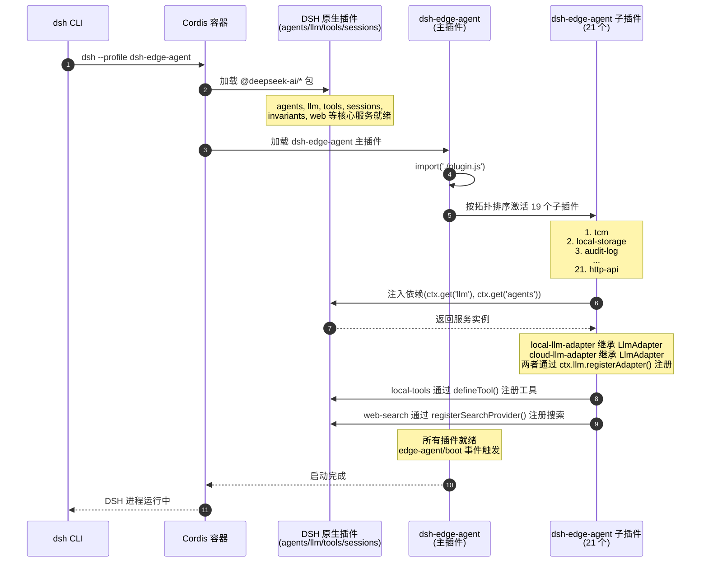
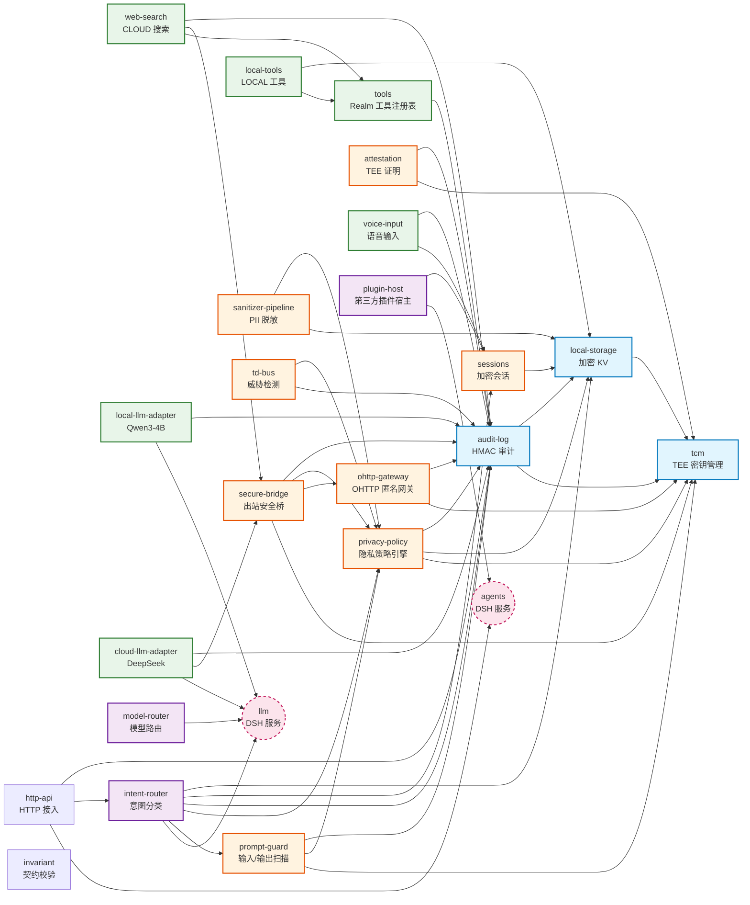
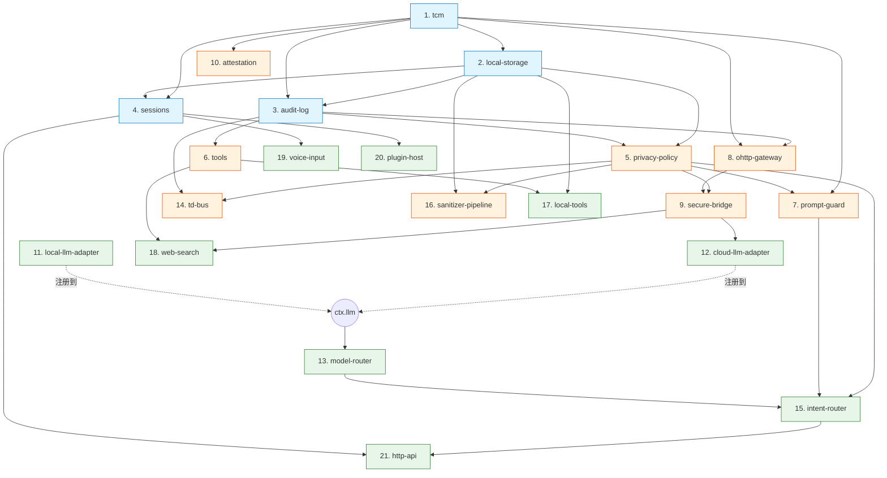
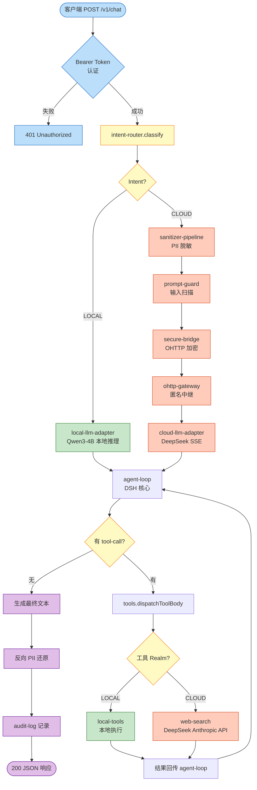
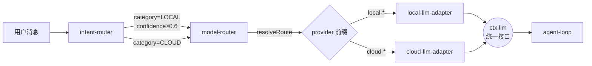
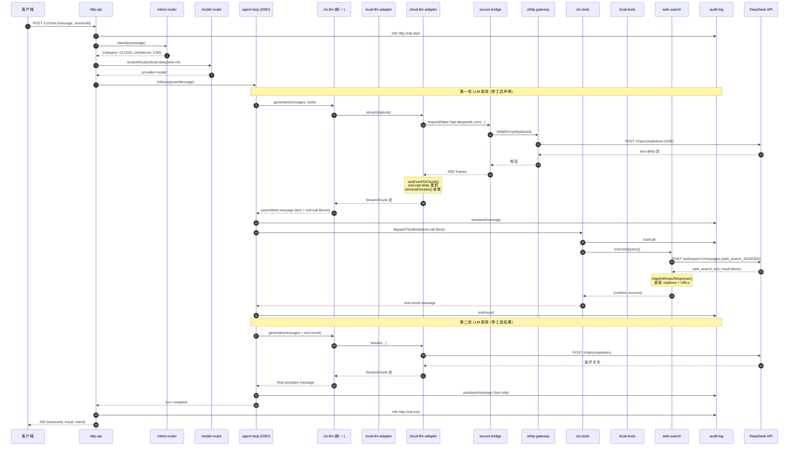
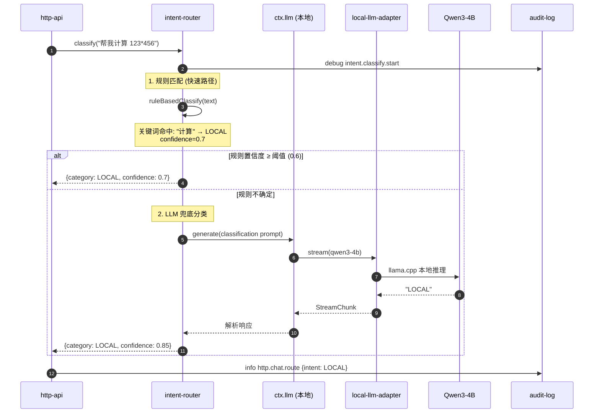
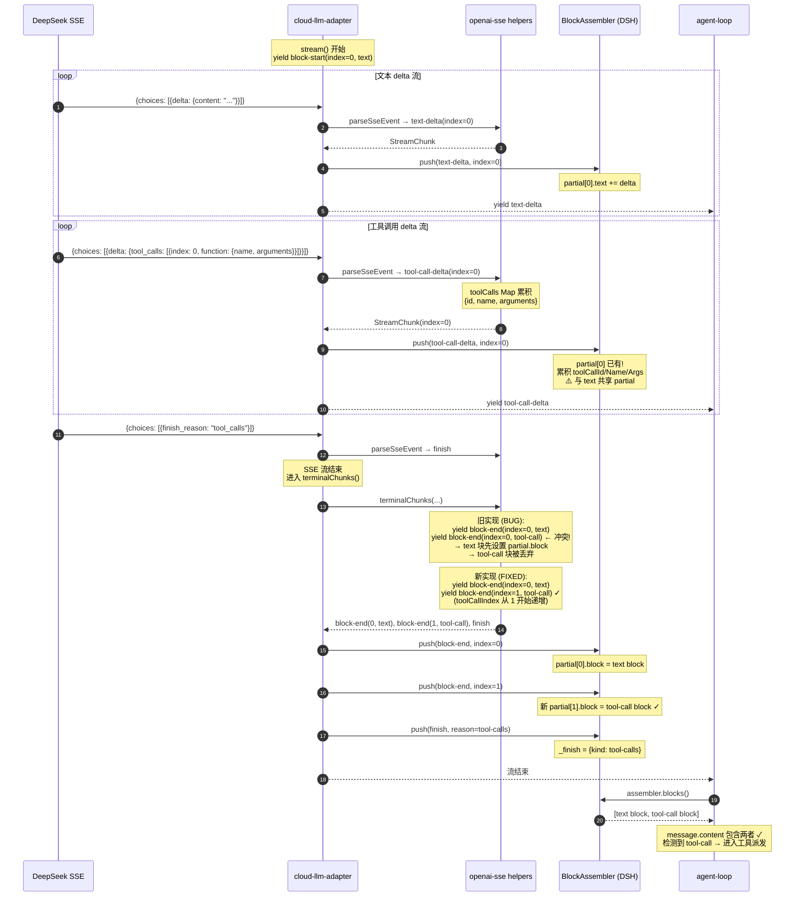
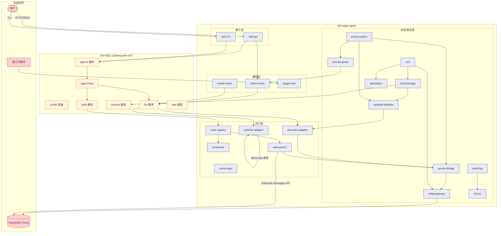
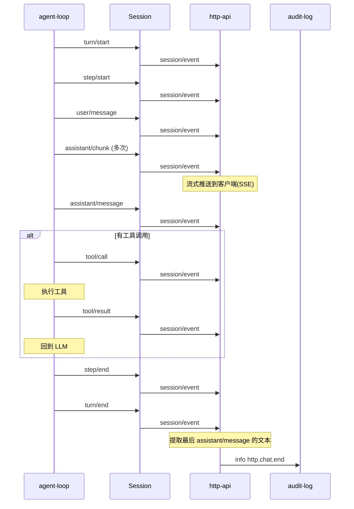

# 插件架构与 DSH 调用关系

> 生成时间: 2026-08-21  
> 基于代码 `src/dsh-adapter/` 与 `cordis.yml` 的实际依赖分析

---

## 0. 插件分类:DSH 原生 vs dsh-edge-agent

### DSH 原生插件 (Core DSH Services)

来自 `@deepseek-ai/*` 包,是 DSH 框架的核心服务,由 Cordis 容器直接提供:

| 服务 | 包名 | 作用 | 提供者 |
|------|------|------|--------|
| `agents` | `@deepseek-ai/dsh-agent` | Agent 生命周期管理,创建 AgentHandle | DSH 核心 |
| `llm` | `@deepseek-ai/dsh-llm` | 统一 LLM 接口,adapter 注册,流式生成 | DSH 核心 |
| `tools` | `@deepseek-ai/dsh-tools` | 工具注册表,dispatchToolBody 派发 | DSH 核心 |
| `sessions` | `@deepseek-ai/dsh-session` | 会话管理,事件总线 | DSH 核心 |
| `web` | `@deepseek-ai/dsh-web` | 出站 HTTP 客户端,搜索工具接口 | DSH 核心 |
| `invariants` | `@deepseek-ai/dsh-invariants` | 契约校验,类型安全 | DSH 核心 |
| `cordis` | `@deepseek-ai/cordis` | 插件容器,Service 基类,依赖注入 | DSH 核心 |
| `schemastery` | `@deepseek-ai/schemastery` | Config schema DSL | DSH 核心 |

**DSH 原生工具插件** (直接使用,无需重新实现):

| 工具 | 包名 | 作用 |
|------|------|------|
| `bash` | `@deepseek-ai/dsh-tool-bash` | Bash 命令执行,沙箱,后台 jobs |
| `read/write/edit` | `@deepseek-ai/dsh-tool-fs` | 文件系统工具(读取/写入/编辑/图像) |
| `web_search/web_fetch` | `@deepseek-ai/dsh-tool-web` | Web 搜索和 URL 抓取 |
| 搜索提供者 | `@deepseek-ai/dsh-web-search-deepseek` | DeepSeek 原生搜索 API |

**关键特性**:
- 由 DSH 团队维护,版本跟随 DSH 发布周期
- 提供基础抽象接口(如 `LlmAdapter`, `StreamChunk`, `BlockAssembler`)
- 通过 `ctx.get('serviceName')` 访问
- **工具插件已经过生产验证,功能完整,直接复用**

---

### dsh-edge-agent 插件 (Edge Plugins)

位于 `src/dsh-adapter/`,是 dsh-edge-agent 仓库的自研插件,扩展 DSH 以支持边缘侧私有 AI 代理:

#### 安全/隐私层 (8 个)

| 插件 | 文件 | 依赖的 DSH 服务 | 作用 |
|------|------|----------------|------|
| **tcm** | `tcm.ts` | 无 | TEE 密钥管理,AES-256-GCM 加解密,密封,远程证明 |
| **local-storage** | `local-storage.ts` | tcm | AES-256-GCM 加密的 SQLite KV 存储 |
| **audit-log** | `audit-log.ts` | tcm, localStorage | HMAC 链接的防篡改审计日志,JSONL 持久化 |
| **sessions** | `sessions.ts` | localStorage | 加密会话生命周期管理(扩展 DSH sessions) |
| **privacy-policy** | `privacy-policy.ts` | tcm, localStorage, auditLog | 热加载的隐私策略引擎 |
| **prompt-guard** | `prompt-guard.ts` | tcm, privacyPolicy, auditLog | 输入/输出安全扫描(MVP:4 条规则) |
| **ohttp-gateway** | `ohttp-gateway.ts` | tcm, auditLog | RFC 9458 OHTTP 匿名网关 |
| **secure-bridge** | `secure-bridge.ts` | tcm, ohttp, privacyPolicy, auditLog | 出站安全桥(OHTTP/TLS 模式) |
| **attestation** | `attestation.ts` | tcm, auditLog | TEE 证明 token 生成/验证 |
| **sanitizer-pipeline** | `sanitizer-pipeline.ts` | localStorage, privacyPolicy | PII 正向/反向脱敏 |
| **td-bus** | `td-bus.ts` | auditLog, privacyPolicy | 威胁检测总线(速率/模式异常) |

#### LLM 适配层 (3 个)

| 插件 | 文件 | 依赖的 DSH 服务 | 作用 |
|------|------|----------------|------|
| **local-llm-adapter** | `local-llm-adapter.ts` | llm, auditLog | 本地 Qwen3-4B 推理(llama.cpp),继承 `LlmAdapter` |
| **cloud-llm-adapter** | `cloud-llm-adapter.ts` | llm, secureBridge, auditLog | DeepSeek Chat Completions(SSE),继承 `LlmAdapter` |
| **model-router** | `model-router.ts` | llm | 模型路由,统一 `ctx.llm` 表面 |

#### 工具层 (已复用 DSH 原生工具)

| 插件 | 文件 | 依赖的 DSH 服务 | 作用 |
|------|------|----------------|------|
| **tools** | `tools.ts` | auditLog | Realm 工具注册表配置,为 DSH 原生工具添加 Realm 标记 |

> **工具复用**: dsh-edge-agent 不再自行实现工具插件,而是直接复用 DSH 原生工具:
> - `@deepseek-ai/dsh-tool-bash` — Bash 执行
> - `@deepseek-ai/dsh-tool-fs` — 文件系统(read/write/edit/read_image)
> - `@deepseek-ai/dsh-tool-web` — Web 搜索和抓取
> - `@deepseek-ai/dsh-web-search-deepseek` — DeepSeek 搜索提供者

#### 编排层 (3 个)

| 插件 | 文件 | 依赖的 DSH 服务 | 作用 |
|------|------|----------------|------|
| **intent-router** | `intent-router.ts` | llm, promptGuard, privacyPolicy, auditLog, sessions, localStorage | 意图分类 → LOCAL/CLOUD 路由 |
| **plugin-host** | `plugin-host.ts` | agents, sessions | 第三方插件宿主(Community Consensus grant) |
| **http-api** | `http-api.ts` | agents, intentRouter, auditLog | HTTP 接入(POST /v1/chat, SSE 流) |

#### 辅助插件 (2 个)

| 插件 | 文件 | 依赖的 DSH 服务 | 作用 |
|------|------|----------------|------|
| **voice-input** | `voice-input.ts` | sessions, auditLog | Whisper-tiny 语音输入 |
| **invariant** | `contract.ts` | invariants | 启动时上游 DSH 契约校验 |

---

### 关键区别

| 维度 | DSH 原生插件 | dsh-edge-agent 插件 |
|------|-------------|---------------------|
| **来源** | `@deepseek-ai/*` npm 包 | `src/dsh-adapter/*.ts` 本地代码 |
| **维护方** | DSH 团队 | dsh-edge-agent 团队 |
| **版本管理** | 跟随 DSH 发布 | 跟随本项目发布 |
| **职责** | 提供核心抽象(agent/llm/tools/sessions) | 实现边缘侧私有 AI 代理的具体功能 |
| **注册方式** | Cordis 容器自动加载 | 通过 `apply()` 手动调用子插件 |
| **扩展方式** | 继承基类(如 `LlmAdapter`) | 实现接口(如 `IntentRouter`, `AuditLogService`) |
| **数据存储** | 内存(由 DSH 管理) | 本地加密存储(local-storage) |
| **网络请求** | 无(或抽象接口) | OHTTP 匿名/secure-bridge 加密 |
| **隐私策略** | 无 | privacy-policy 引擎,Realm 隔离 |

---

### 插件加载流程



---

## 1. 整体架构

dsh-edge-agent 是一个基于 DSH Cordis 插件机制的边缘侧私有 AI 代理。整体架构分为四层:

```
┌─────────────────────────────────────────────────────────────────────┐
│                        外部接入层 (Entry)                            │
│  HTTP API  ·  CLI (dsh --profile)  ·  WebSocket (未来)              │
└───────────────────────────────┬─────────────────────────────────────┘
                                │
┌───────────────────────────────▼─────────────────────────────────────┐
│                       编排层 (Orchestration)                         │
│  intent-router  ·  model-router  ·  plugin-host                     │
│  ↓ 决定走 LOCAL(本地) 还是 CLOUD(云端),以及工具注册                    │
└───────────────────────────────┬─────────────────────────────────────┘
                                │
┌───────────────────────────────▼─────────────────────────────────────┐
│                       安全/隐私层 (Privacy)                          │
│  tcm  ·  local-storage  ·  privacy-policy  ·  prompt-guard          │
│  sanitizer-pipeline  ·  ohttp-gateway  ·  secure-bridge              │
│  attestation  ·  td-bus                                             │
│  ↓ TEE 密钥管理、AES-256-GCM 加密存储、OHTTP 匿名请求               │
└───────────────────────────────┬─────────────────────────────────────┘
                                │
┌───────────────────────────────▼─────────────────────────────────────┐
│                       执行层 (Execution)                             │
│  local-llm-adapter   →  本地 Qwen3-4B (llama.cpp)                  │
│  cloud-llm-adapter   →  DeepSeek Chat Completions (SSE)             │
│  local-tools         →  LOCAL realm 工具 (文件/计算)                 │
│  web-search          →  CLOUD realm 工具 (Anthropic Messages API)   │
│  sessions / audit-log / voice-input                                 │
└─────────────────────────────────────────────────────────────────────┘
                                │
                                ▼
              ┌───────────────────────────────────┐
              │  DSH 核心服务 (上游 Cordis 生态)    │
              │  @deepseek-ai/cordis              │
              │  @deepseek-ai/dsh-agent           │
              │  @deepseek-ai/dsh-llm             │
              │  @deepseek-ai/dsh-session         │
              │  @deepseek-ai/dsh-tools           │
              │  @deepseek-ai/dsh-web-search-deepseek │
              │  ...                              │
              └───────────────────────────────────┘
```

---

## 2. 插件依赖关系图 (Plugin Dependency Graph)

箭头表示 "depends-on" 方向(被依赖方在右):



---

## 3. 启动顺序 (Boot Order)

Cordis Loader 按拓扑排序激活插件。实际启动顺序如下(从 `plugin.ts` 注释提取):



---

## 4. 请求处理流程 (Request Flow)

### 4.1 HTTP Chat 请求整体流程



### 4.2 模型路由细节



---

## 5. 核心序列图 (Sequence Diagrams)

### 5.1 完整 Chat 请求序列(含工具调用)



### 5.2 意图分类序列



### 5.3 工具调用生命周期 (BlockAssembler 视角)

这是近期修复的核心流程 —— tool-call block 索引冲突问题:



---

## 6. 插件与 DSH 上游服务的交互接口

| 插件 | 使用的 DSH 服务 | 接口方式 |
|------|----------------|----------|
| `local-llm-adapter` | `ctx.llm` | 继承 `LlmAdapter`,注册 `stream()` |
| `cloud-llm-adapter` | `ctx.llm` | 继承 `LlmAdapter`,注册 `stream()` |
| `model-router` | `ctx.llm` | 调用 `resolveRoute()`,选择 adapter |
| `intent-router` | `ctx.llm` | 调用 `generate()` 做意图分类 |
| `http-api` | `ctx.agents`, `ctx.sessions` | 调用 `agents.create()`, `agent.followup()` |
| `http-api` | `ctx.on('session/event')` | 订阅所有 session 事件 |
| `local-tools` | `ctx.tools` (edgeTools) | 调用 `defineTool()` 注册 LOCAL 工具 |
| `web-search` | `ctx.web` | 调用 `registerSearchProvider()` |
| `plugin-host` | `ctx.agents`, `ctx.sessions` | 管理第三方插件 grant |
| `sessions` (edge) | `ctx.localStorage` | 加密会话元数据 |
| `audit-log` | `ctx.tcm` | HMAC 链接 |
| `privacy-policy` | `ctx.localStorage` | 持久化策略缓存 |
| `secure-bridge` | `ctx.ohttp`, `ctx.privacyPolicy` | 出站请求加密 + 域名过滤 |

**关键抽象边界**:
- `LlmAdapter` (来自 `@deepseek-ai/dsh-llm`) — 本地/云端适配器都继承此类,`stream()` 返回 `AsyncIterable<StreamChunk>`
- `StreamChunk` — 统一的流式数据单元 (`text-delta`, `tool-call-delta`, `block-end`, `finish` 等)
- `BlockAssembler` — DSH 内部把 chunk 流组装成完整 message block
- `ctx.tools` — Realm-aware 工具注册表,`local-tools` 和 `web-search` 都通过它暴露工具给 agent-loop

---

## 7. 数据流向总览



---

## 8. 关键 Realm 模型

dsh-edge-agent 通过 **Realm** 概念隔离工具和数据:

| Realm | 含义 | 典型工具 | 数据路径 |
|-------|------|---------|---------|
| **LOCAL** | 本地私有数据/计算 | `local-tools` (文件读写, 数学计算) | 不出设备, AES-256-GCM 加密存储 |
| **CLOUD** | 公网知识/服务 | `web-search`, `cloud-llm-adapter` | OHTTP 匿名中继, PII 脱敏 |
| **SANITIZED** | 经脱敏可上云的数据 | `sanitizer-pipeline` 处理后的内容 | 正向脱敏 → 云 → 反向还原 |

`intent-router` 的意图分类决定请求走 LOCAL 还是 CLOUD;`tools` 插件的 Realm 注册表决定工具调用路由。

---

## 9. 与 DSH 上游包的依赖关系

```mermaid
flowchart LR
    Edge[dsh-edge-agent<br/>本仓库]

    Edge --> Cordis[@deepseek-ai/cordis<br/>插件容器 + Service 基类]
    Edge --> Schema[@deepseek-ai/schemastery<br/>Config schema DSL]
    Edge --> Agent[@deepseek-ai/dsh-agent<br/>Agent / AgentHandle]
    Edge --> LLM[@deepseek-ai/dsh-llm<br/>LlmAdapter / StreamChunk / BlockAssembler]
    Edge --> Session[@deepseek-ai/dsh-session<br/>Session / SessionId / SessionEvent]
    Edge --> Tools[@deepseek-ai/dsh-tools<br/>defineTool / createSuccessResult]
    Edge --> Web[@deepseek-ai/dsh-web-search-deepseek<br/>DeepSeekSearchProvider]
    Edge --> WebCore[@deepseek-ai/dsh-web<br/>WebError / ctx.web]

    classDef edge fill:#e3f2fd,stroke:#1565c0;
    classDef dsh fill:#fff8e1,stroke:#f57f17;
    class Edge edge;
    class Cordis,Schema,Agent,LLM,Session,Tools,Web,WebCore dsh;
```

**关键交互点**:
- **`LlmAdapter` 继承**: `local-llm-adapter` 和 `cloud-llm-adapter` 都继承自 `LlmAdapter`,通过 `ctx.llm.registerAdapter()` 注册,由 `model-router` 选择
- **`StreamChunk` 契约**: 适配器返回的 chunk 流必须遵循 DSH 定义的类型(`text-delta`, `tool-call-delta`, `block-end`, `finish` 等),由 `BlockAssembler` 组装
- **`defineTool` 注册**: 本地工具和搜索工具通过 `defineTool()` 暴露给 `ctx.tools`,agent-loop 在生成 tool-call 时自动派发
- **`SessionEvent` 订阅**: `http-api` 通过 `ctx.on('session/event', ...)` 监听所有 session 事件,实现响应流式返回

---

## 10. 附录:插件速查表

| 插件 | 来源 | 作用 | 依赖 | 注册的服务/接口 |
|------|------|------|------|----------------|
| **tcm** | 🟦 Edge | TEE 密钥管理、AES-256-GCM 加解密、密封、远程证明 | 无 | `ctx.tcm` |
| **local-storage** | 🟦 Edge | AES-256-GCM 加密的 SQLite KV | tcm | `ctx.localStorage` |
| **audit-log** | 🟦 Edge | HMAC 链接的防篡改审计日志,JSONL 持久化 | tcm, localStorage | `ctx.auditLog` |
| **sessions** | 🟦 Edge | 加密会话生命周期管理 | localStorage | 扩展 `ctx.sessions` |
| **privacy-policy** | 🟦 Edge | 热加载的隐私策略引擎 | tcm, localStorage, auditLog | `ctx.privacyPolicy` |
| **tools** | 🟦 Edge | Realm-aware 工具注册表(LOCAL/CLOUD/SANITIZED) | auditLog | `ctx.tools` / `ctx.edgeTools` |
| **prompt-guard** | 🟦 Edge | 输入/输出安全扫描(MVP:4 条规则) | tcm, privacyPolicy, auditLog | `ctx.promptGuard` |
| **intent-router** | 🟦 Edge | 意图分类 → LOCAL/CLOUD 路由 | llm, promptGuard, privacyPolicy, auditLog, sessions, localStorage | `ctx.intentRouter` |
| **model-router** | 🟦 Edge | 模型路由,统一 `ctx.llm` 表面 | llm | 扩展 `ctx.llm.resolveRoute()` |
| **local-llm-adapter** | 🟦 Edge | 本地 Qwen3-4B 推理(llama.cpp) | llm, auditLog | 注册到 `ctx.llm` |
| **cloud-llm-adapter** | 🟦 Edge | DeepSeek Chat Completions(SSE) | llm, secureBridge, auditLog | 注册到 `ctx.llm` |
| **sanitizer-pipeline** | 🟦 Edge | PII 正向/反向脱敏 | localStorage, privacyPolicy | `ctx.sanitizer` |
| **ohttp-gateway** | 🟦 Edge | RFC 9458 OHTTP 匿名网关 | tcm, auditLog | `ctx.ohttp` |
| **secure-bridge** | 🟦 Edge | 出站安全桥(OHTTP/TLS 模式) | tcm, ohttp, privacyPolicy, auditLog | `ctx.secureBridge` |
| **attestation** | 🟦 Edge | TEE 证明 token 生成/验证 | tcm, auditLog | `ctx.attestation` |
| **td-bus** | 🟦 Edge | 威胁检测总线(速率/模式异常) | auditLog, privacyPolicy | `ctx.tdBus` |
| **local-tools** | 🟦 Edge | LOCAL realm 工具(文件/计算) | tools, localStorage | 注册到 `ctx.tools` |
| **web-search** | 🟦 Edge | CLOUD 搜索(DeepSeek Anthropic API) | tools, secureBridge, auditLog | 注册到 `ctx.web` |
| **voice-input** | 🟦 Edge | Whisper-tiny 语音输入 | sessions, auditLog | `ctx.voiceInput` |
| **plugin-host** | 🟦 Edge | 第三方插件宿主(Community Consensus grant) | agents, sessions | `ctx.pluginHost` |
| **http-api** | 🟦 Edge | HTTP 接入(POST /v1/chat, SSE 流) | agents, intentRouter, auditLog | HTTP 服务器 |
| **invariant** | 🟦 Edge | 上游 DSH 契约校验 | invariants | 启动时 drift check |

**图例**: 🟦 Edge = dsh-edge-agent 自研插件 (src/dsh-adapter/)  
所有 19 个子插件都是 dsh-edge-agent 的自研插件,它们依赖 DSH 原生服务(如 `agents`, `llm`, `tools`, `sessions`)。

---

## 11. 关键事件流 (Session Events)

agent-loop 和 session 服务发出的事件,`http-api` 订阅:



---

**文档维护**: 此文档应随插件增删同步更新。修改 `cordis.yml` 或新增 `src/dsh-adapter/*.ts` 后,请重新生成依赖图。
