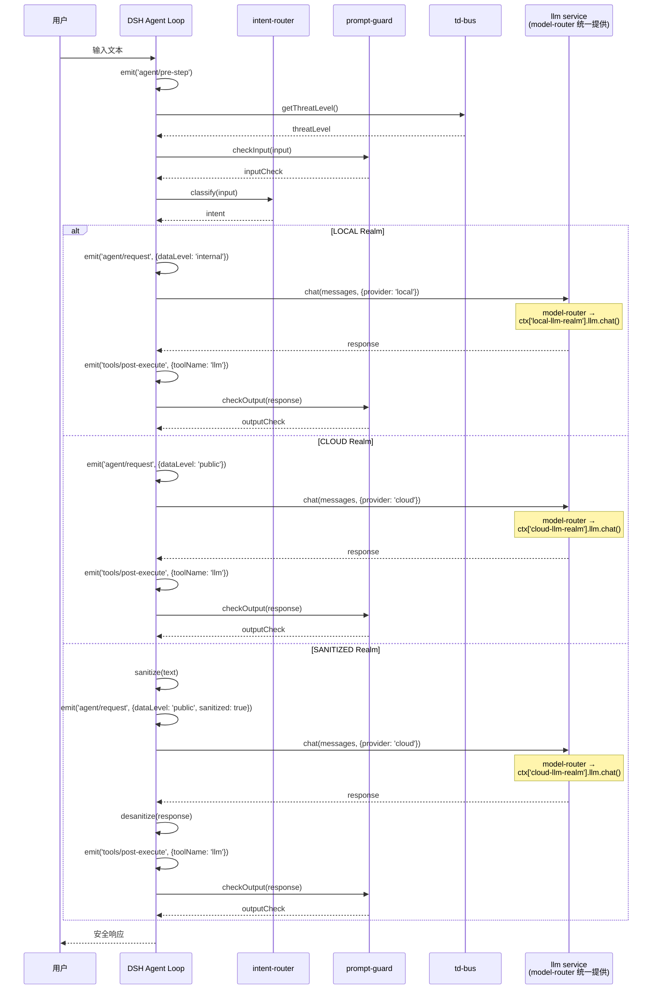
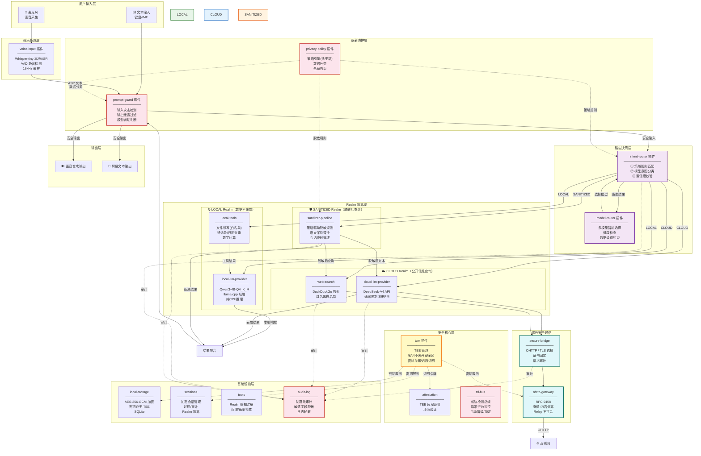
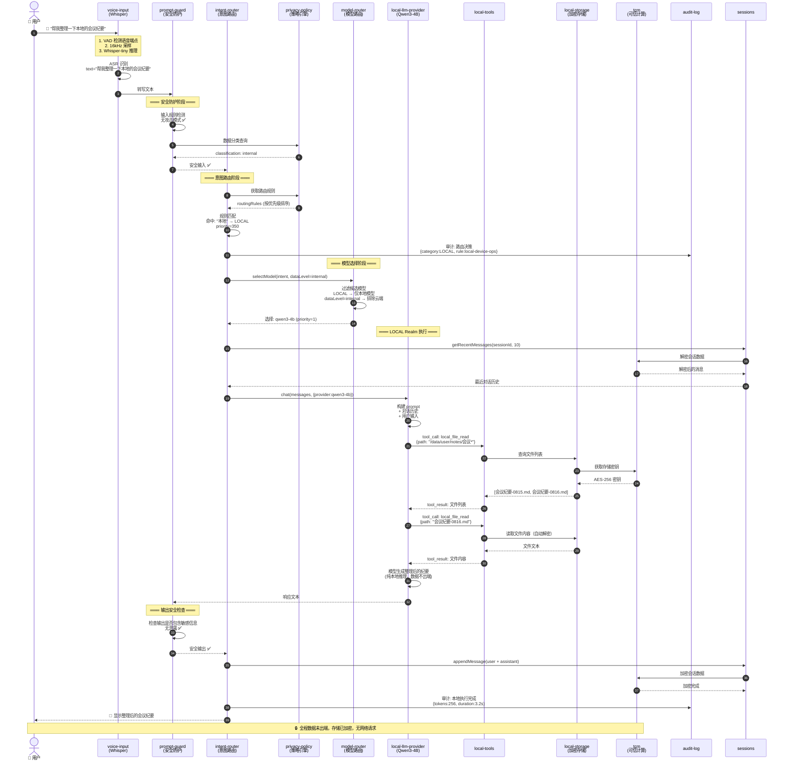
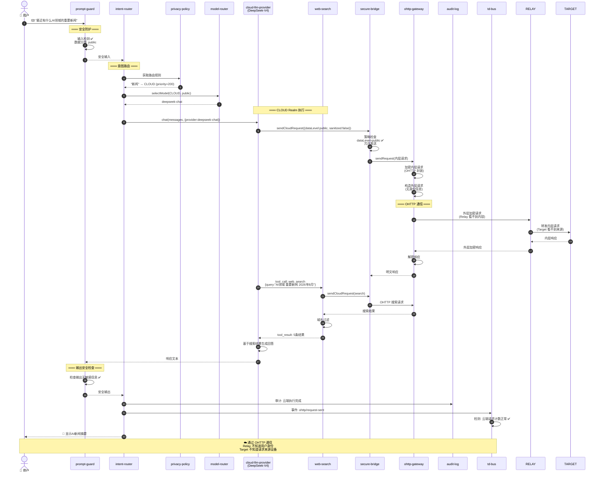
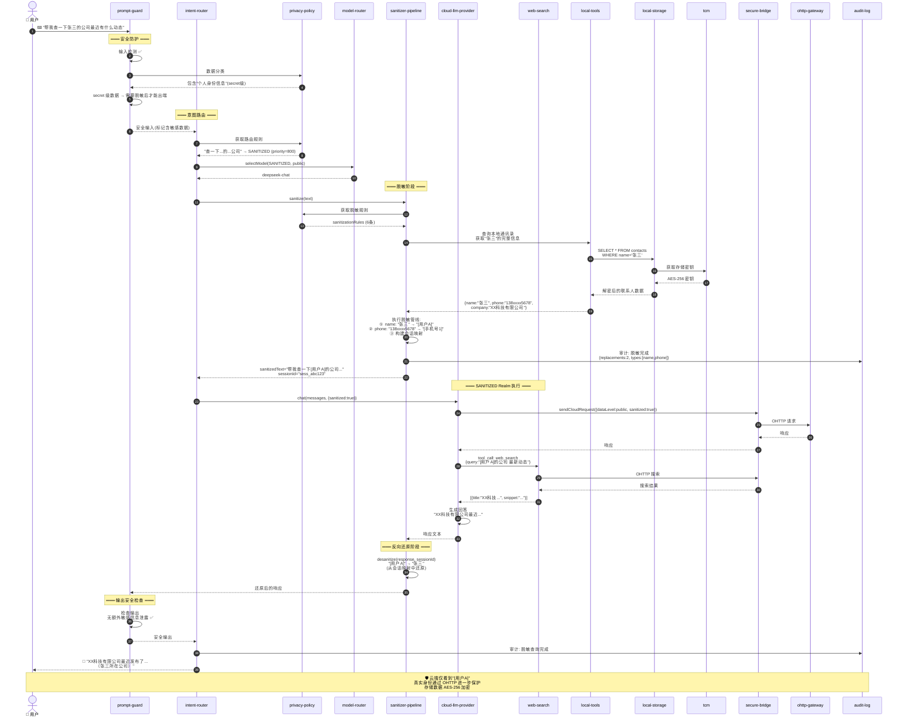
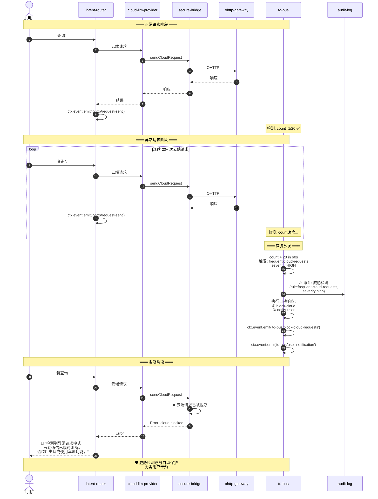
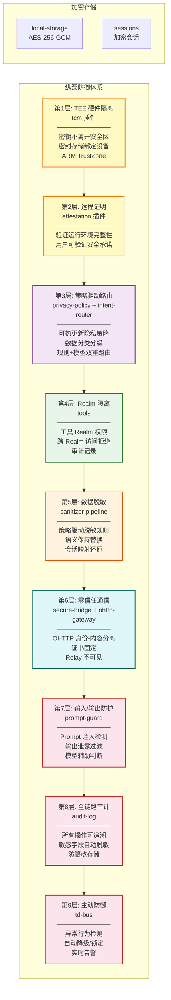

# 基于 DSH 插件机制的端侧私密智能体设计

> **合规性声明（v6.0 修订版）**：本设计**完全基于 DSH Cordis 插件机制**实现端侧智能体的所有能力，**不需要修改 DSH 核心代码**。所有 19 个核心专用插件 + 1 个可选 `http-api` 插件（§ 8.19）均遵循标准的 `name` + `inject` + `Config` + `apply` 命名导出模式（参考 `packages/llm/llm-deepseek/src/index.ts:41-200`），通过 `ctx.effect` / `ctx.provide` / `ctx.llm.registerAdapter` / `ctx.tools.register` / `ctx.event.on` 等 Cordis 与 DSH 原生 API 协作；多 LLM provider 通过**在同一 `ctx.llm` 上注册多条适配器路由**（`ctx.llm.registerAdapter(['local-qwen3-4b'], adapter)`）实现，**不再依赖** `cordis:group` + `isolate: { llm: true }`（`isolate` 是 per-agent 隔离机制，宿主面 `inject` 拿不到子 realm service —— 见 `packages/preset/agent-presets/src/mount.ts:178-265`）；所有事件拦截点均为 DSH Cordis 已有标准事件（`agent/pre-step` 返回 `PreStepDecision`、`agent/request` 返回 `LlmCallConfig`、`llm/stream` 输出过滤、`tools/post-execute` 工具结果检查），未引入任何 DSH 不存在的事件。
>
> 本次（v6.0）修订基于对 DSH 真实源码的逐项复核（详见 § 十一 可行性复核），修正 v5 的以下不合规点：
> 1. **LLM provider 注册**：v5 自定义 `LlmProvider { chat, chatStream }` 接口不符合 DSH `LlmAdapter { stream }` 抽象；v6.0 改为 `LlmAdapter` 子类 + `ctx.llm.registerAdapter`。
> 2. **同名 service 冲突**：v5 用 `isolate: { llm: true }` 隐藏同名 service；v6.0 在同一 `llm` service 上注册多条 provider 路由（适配器模式）。
> 3. **事件监听器契约**：v5 在 waterfall 中 `throw SecurityError`；v6.0 改为返回 `PreStepDecision` / `LlmCallConfig` 等决策对象。
> 4. **输出过滤事件点**：v5 把 LLM 输出检查挂在 `tools/post-execute`；v6.0 改为 `llm/stream` waterfall（LLM 不是 tool）。
> 5. **plugin 命名导出**：v5 仅 export `inject` + `apply`；v6.0 补齐 `name` + `Config: z<Config>`。
> 6. **service 访问约定**：v5 用 `ctx['xxx']` 字符串下标访问 service；v6.0 未在 `inject` 声明的可选 service 改为 `ctx.get('name')`。
> 7. **cordis.yml 禁用字段**：v5 用 `disable: true` / `disable: [dsh-*]`；v6.0 改为 Loader 真实字段 `disabled: true`（行级）。
> 8. **`inject: ['config']`**：DSH 无 `config` service，plugin 配置走 `apply(ctx, config)` 第二参数；v6.0 删除全部 `config` 注入项。
> 9. **Agent Loop 入口**：v5 自定义 `runAgentLoop(ctx, ...)`；v6.0 改为 `ctx.agents.create(...)` + `agent.followup(userMsg)`。
>
> **关于 DSH 对外服务能力**：DSH 内置 Runtime Profile 只有 `web`（浏览器 UI，3080 端口）和 `headless`（一次性 runner），**没有内置"对外 HTTP API 服务"形态**。如需对外提供结构化 API（如手机 APP、第三方服务调用），通过可选的 `http-api` 插件实现（§ 8.19）。

## 一、设计概述

### 1.1 目标

在 DeepSeek Agent Harness (DSH) 的插件架构上，构建一个**端侧私密智能体**，实现：

- **隐私优先**：所有个人数据在端侧处理，不离开设备
- **最小暴露**：必须使用云端能力时，仅暴露脱敏后的最小必要信息
- **可验证安全**：通过 TEE + 远程证明，让用户可以验证隐私承诺
- **零信任通信**：端云之间通过 Oblivious HTTP 通信，网关无法关联用户身份与请求内容
- **主动防御**：威胁检测总线持续监控异常行为，自动降级或阻断

### 1.2 核心原则

1. **数据不出端**：个人数据（通讯录、日历、文件等）永远不离开设备
2. **最小权限**：每个插件只拥有完成其功能所需的最小权限
3. **纵深防御**：多层安全机制（TEE → Realm 隔离 → 脱敏 → 审计 → 威胁检测）
4. **可验证**：通过远程证明，用户可以验证运行环境的安全性
5. **零信任网络**：端云通信不信任任何中间节点，通过 OHTTP 实现身份-内容分离
6. **隐私策略驱动**：所有安全行为由可配置、可热更新的隐私策略引擎统一驱动

### 1.3 与通用 Agent 框架的解耦

本设计**不依赖任何内置服务**。所有存储、会话、配置、事件、工具注册等能力均由专用插件提供，可独立运行在任意 DSH 兼容环境中。

| 能力 | 提供方式 | 说明 |
|------|----------|------|
| 存储 | `local-storage` 插件 | 加密 SQLite，密钥存于 TEE |
| 会话 | `sessions` 插件 | 加密会话管理，支持过期和审计 |
| 配置 | `privacy-policy` 插件 | 可热更新的隐私策略引擎 |
| 事件 | DSH 内置事件系统 | Cordis 事件机制，支持 emit/parallel/serial/bail/waterfall 5种分发模式 |
| 工具 | `tools` 插件 | Realm 感知的工具注册中心 |
| 日志 | `audit-log` 插件 | 防篡改审计日志 |
| 认证 | `attestation` 插件 | TEE 远程证明 |
| 通信 | `secure-bridge` 插件 | OHTTP 零信任端云通道 |
| 防护 | `prompt-guard` 插件 | 输入/输出安全防护 |
| 模型 | `model-router` 插件 | 多模型智能路由 |
| 监控 | `td-bus` 插件 | 威胁检测总线 |

### 1.4 DSH 内置插件映射表

本设计与 DSH 内置插件的对应关系如下：

| 设计插件 | DSH 内置插件 | 关系 | 说明 |
|----------|--------------|------|------|
| `tcm` | - | **新增** | 可信计算模块，提供 TEE 管理和密钥服务 |
| `local-storage` | `database` | **替换** | 替换内置数据库插件，增加 AES-256-GCM 加密 |
| `sessions` | `sessions` | **替换** | 替换内置会话插件，增加加密和 Realm 隔离 |
| `audit-log` | `logger` | **替换** | 替换内置日志插件，增加防篡改和敏感字段脱敏 |
| `privacy-policy` | `config` | **替换** | 替换内置配置插件，增加策略引擎能力 |
| `tools` | `tools` | **替换** | 替换内置工具插件，增加 Realm 感知和权限检查 |
| `prompt-guard` | - | **新增** | 输入/输出安全防护，Prompt 注入检测 |
| `model-router` | - | **新增** | 多模型智能路由，健康检查 |
| `local-llm-provider` | - | **新增** | 本地 LLM 推理（llama.cpp） |
| `cloud-llm-provider` | - | **新增** | 云端 LLM 推理（DeepSeek API） |
| `intent-router` | - | **新增** | 意图分类和路由决策 |
| `sanitizer-pipeline` | - | **新增** | 数据脱敏管线 |
| `ohttp-gateway` | - | **新增** | OHTTP 网关（RFC 9458） |
| `secure-bridge` | - | **新增** | 端云安全通信桥接 |
| `attestation` | - | **新增** | TEE 远程证明 |
| `td-bus` | - | **新增** | 威胁检测总线 |
| `local-tools` | - | **新增** | 本地工具实现 |
| `web-search` | - | **新增** | 公网搜索工具 |
| `voice-input` | - | **新增** | 语音输入处理 |

**说明**：
- **新增**：DSH 没有内置对应插件，完全由本设计提供
- **替换**：DSH 有内置插件，但本设计提供增强版本（加密、审计、Realm 隔离等）
- 所有事件通过 Cordis 内置 `ctx.event` 系统分发（emit / parallel / serial / bail / waterfall 五种传播模式），不依赖任何外部 event-bus 插件

### 1.5 技术栈

- **插件框架**：DSH（DeepSeek Agent Harness）
- **本地 LLM**：Qwen3-4B（Q4_K_M 量化）via llama.cpp
- **云端 LLM**：DeepSeek-V4 API
- **语音识别**：Whisper-tiny（本地）
- **加密**：AES-256-GCM（存储加密）+ X25519（密钥交换）
- **TEE**：ARM TrustZone / RISC-V Keystone（可选）
- **安全通信**：OHTTP（Oblivious HTTP, RFC 9458）
- **远程证明**：TEE Attestation Token
- **目标平台**：瑞芯微 RK3588 / 飞腾 D3000M（纯 CPU 推理）

---

## 二、插件架构

### 2.0 整体分层

```
┌─────────────────────────────────────────────────────────────────────┐
│                        用户输入层                                    │
│  voice-input（语音）/ 文本输入                                        │
├─────────────────────────────────────────────────────────────────────┤
│                        安全防护层                                    │
│  prompt-guard（输入/输出防护）/ privacy-policy（策略引擎）             │
├─────────────────────────────────────────────────────────────────────┤
│                        路由决策层                                    │
│  intent-router（意图分类）/ model-router（模型选择）                   │
├─────────────────────────────────────────────────────────────────────┤
│                        Realm 隔离层                                  │
│  ┌──────────┐  ┌──────────┐  ┌──────────────┐                      │
│  │  LOCAL   │  │  CLOUD   │  │  SANITIZED   │                      │
│  │          │  │          │  │              │                      │
│  │local-llm │  │cloud-llm │  │sanitizer-pipe│                      │
│  │local-tool│  │web-search│  │              │                      │
│  └──────────┘  └──────────┘  └──────────────┘                      │
├─────────────────────────────────────────────────────────────────────┤
│                        基础设施层                                    │
│  local-storage / sessions / tools                    │
│  audit-log / td-bus / secure-bridge / attestation / tcm             │
│  ohttp-gateway / privacy-policy                                     │
└─────────────────────────────────────────────────────────────────────┘
```

---

### 2.1 tcm 插件（可信计算模块）

TEE 环境管理，为整个系统提供硬件级信任根。

#### 插件元信息
```yaml
name: tcm
type: security-core
inject:
  - config
```

#### 接口定义
```typescript
interface TcmConfig {
  // TEE 类型
  teeType: 'trustzone' | 'keystone' | 'sgx' | 'simulated'
  // 密钥存储路径（TEE 内部）
  keyStorePath: string
  // 是否启用 TEE 内模型推理
  teeInference: boolean
  // 安全内存大小限制（字节）
  secureMemoryLimit: number
}

interface TcmService {
  // 密钥管理
  generateKey(tag: string): Promise<CryptoKey>
  getKey(tag: string): Promise<CryptoKey>
  deleteKey(tag: string): Promise<void>

  // 加密/解密（密钥不离开 TEE）
  encrypt(data: Uint8Array, tag: string): Promise<Uint8Array>
  decrypt(data: Uint8Array, tag: string): Promise<Uint8Array>

  // 安全哈希
  hash(data: Uint8Array, algorithm: 'sha-256' | 'sha-3'): Promise<Uint8Array>

  // TEE 内安全计算（如 embedding 推理）
  secureCompute(input: Uint8Array, modelTag: string): Promise<Uint8Array>

  // 远程证明
  generateAttestation(nonce: string): Promise<AttestationToken>

  // 密封存储（数据绑定到当前设备+TEE）
  seal(data: Uint8Array): Promise<Uint8Array>
  unseal(data: Uint8Array): Promise<Uint8Array>

  // 健康状态
  getStatus(): TcmStatus
}

interface TcmStatus {
  teeAvailable: boolean
  teeType: string
  secureMemoryUsed: number
  secureMemoryTotal: number
  keyCount: number
  lastAttestation: number | null
}
```

#### 核心实现
```typescript
export const inject = ['config']

export function apply(ctx: Context, config: TcmConfig) {
  ctx.effect(() => {
    let teeBackend: TeeBackend

    // 根据配置初始化 TEE 后端
    switch (config.teeType) {
      case 'trustzone':
        teeBackend = new TrustZoneBackend()
        break
      case 'keystone':
        teeBackend = new KeystoneBackend()
        break
      case 'simulated':
        teeBackend = new SimulatedTeeBackend()  // 开发/测试用
        break
    }

    const service: TcmService = {
      async generateKey(tag) {
        const key = await teeBackend.generateKey(tag)
        ctx.event.emit('tcm/key-generated', { tag })
        return key
      },

      async getKey(tag) {
        return await teeBackend.getKey(tag)
      },

      async encrypt(data, tag) {
        const key = await this.getKey(tag)
        return await teeBackend.encrypt(data, key)
      },

      async decrypt(data, tag) {
        const key = await teeBackend.getKey(tag)
        return await teeBackend.decrypt(data, key)
      },

      async hash(data, algorithm) {
        return await teeBackend.hash(data, algorithm)
      },

      async secureCompute(input, modelTag) {
        // 在 TEE 内部执行推理（如 embedding）
        // 输入和输出都在安全内存中，REE 侧无法窥探
        if (!config.teeInference) {
          throw new Error('TEE 内推理未启用')
        }
        return await teeBackend.runInference(input, modelTag)
      },

      async generateAttestation(nonce) {
        const token = await teeBackend.generateAttestation(nonce)
        ctx.event.emit('tcm/attestation-generated', {
          nonce,
          timestamp: Date.now(),
        })
        return token
      },

      async seal(data) {
        // 使用设备绑定的密钥加密，数据只能在同一设备+TEE上解密
        const deviceKey = await this.getKey('_device_seal_key')
        const iv = crypto.getRandomValues(new Uint8Array(12))
        const encrypted = await aesGcmEncrypt(data, deviceKey, iv)
        return concat(iv, encrypted)
      },

      async unseal(data) {
        const deviceKey = await this.getKey('_device_seal_key')
        const iv = data.slice(0, 12)
        const ciphertext = data.slice(12)
        return await aesGcmDecrypt(ciphertext, deviceKey, iv)
      },

      getStatus() {
        return teeBackend.getStatus()
      },
    }

    const dispose = ctx.provide('tcm', service)
    return async () => { dispose() }
  })
}
```

#### 配置 schema
```yaml
tcm:
  teeType: trustzone        # RK3588 使用 TrustZone
  keyStorePath: /secure/keys
  teeInference: true        # 启用 TEE 内 embedding 推理
  secureMemoryLimit: 67108864  # 64MB 安全内存
```

#### 错误处理
- TEE 不可用 → 降级到 simulated 模式，发出安全告警
- 安全内存不足 → 驱逐最久未使用的密钥
- 密封数据损坏 → 拒绝解密，要求重新初始化

---

### 2.2 local-storage 插件（加密存储）

替代任何内置 storage 服务。提供加密的本地持久化存储，密钥由 `tcm` 管理。

#### 插件元信息
```yaml
name: local-storage
type: service
inject:
  - tcm
  - config
```

#### 接口定义
```typescript
interface LocalStorageConfig {
  // 数据库路径
  dbPath: string
  // 加密密钥标签（在 tcm 中引用）
  encryptionKeyTag: string
  // 是否启用 WAL 模式
  walMode: boolean
  // 自动备份间隔（毫秒）
  backupInterval: number
  // 最大数据库大小（字节）
  maxSize: number
}

interface LocalStorageService {
  // 基础 CRUD
  get<T>(collection: string, key: string): Promise<T | null>
  set<T>(collection: string, key: string, value: T): Promise<void>
  delete(collection: string, key: string): Promise<boolean>
  list(collection: string, filter?: QueryFilter): Promise<StorageEntry[]>

  // 批量操作
  batch(ops: StorageOperation[]): Promise<void>

  // 全文搜索（加密索引）
  search(collection: string, query: string): Promise<StorageEntry[]>

  // 数据源接入（通讯录、日历等系统数据）
  queryDataSource(source: string, query: object): Promise<any[]>

  // 存储统计
  getStats(): StorageStats
}
```

#### 核心实现
```typescript
export const inject = ['tcm', 'config']

export function apply(ctx: Context, config: LocalStorageConfig) {
  ctx.effect(() => {
    let db: EncryptedSQLite
    let encryptionKey: CryptoKey

    async function init() {
      // 从 TCM 获取或生成加密密钥
      try {
        encryptionKey = await ctx.tcm.getKey(config.encryptionKeyTag)
      } catch {
        encryptionKey = await ctx.tcm.generateKey(config.encryptionKeyTag)
      }

      // 打开加密数据库
      db = await EncryptedSQLite.open(config.dbPath, {
        encryptionKey,
        walMode: config.walMode,
      })

      // 初始化系统数据源连接
      await initDataSources(config.dataSources)
    }

    init()

    const service: LocalStorageService = {
      async get(collection, key) {
        const row = await db.query(
          `SELECT value FROM ${collection} WHERE key = ?`,
          [key]
        )
        if (!row) return null

        // 值在 SQLite 层面已加密，取出后由 EncryptedSQLite 自动解密
        return JSON.parse(row.value)
      },

      async set(collection, key, value) {
        const serialized = JSON.stringify(value)
        await db.execute(
          `INSERT OR REPLACE INTO ${collection} (key, value, updated_at)
           VALUES (?, ?, ?)`,
          [key, serialized, Date.now()]
        )
        ctx.event.emit('storage/set', { collection, key })
      },

      async delete(collection, key) {
        const result = await db.execute(
          `DELETE FROM ${collection} WHERE key = ?`,
          [key]
        )
        ctx.event.emit('storage/delete', { collection, key })
        return result.changes > 0
      },

      async list(collection, filter) {
        return await db.queryAll(
          `SELECT key, value, updated_at FROM ${collection}
           ${buildWhereClause(filter)}
           ORDER BY updated_at DESC`,
          filter?.params ?? []
        )
      },

      async search(collection, query) {
        // 使用加密感知的全文搜索（FTS5 + 加密索引）
        return await db.ftsSearch(collection, query)
      },

      async queryDataSource(source, query) {
        // 查询系统数据源（通讯录、日历等）
        const ds = dataSources.get(source)
        if (!ds) throw new Error(`数据源 ${source} 不存在`)
        return await ds.query(query)
      },

      getStats() {
        return {
          collections: db.getCollections(),
          totalSize: db.getFileSize(),
          encrypted: true,
        }
      },
    }

    const dispose = ctx.provide('local-storage', service)
    return async () => {
      await db.close()
      dispose()
    }
  })
}
```

#### 配置 schema
```yaml
local-storage:
  dbPath: /data/agent/storage.enc.db
  encryptionKeyTag: storage-master-key
  walMode: true
  backupInterval: 3600000
  maxSize: 536870912       # 512MB
  dataSources:
    - type: contacts
      dbPath: /data/user/contacts.db
    - type: calendar
      dbPath: /data/user/calendar.db
```

#### 错误处理
- 数据库损坏 → 从最近备份恢复
- 加密密钥丢失 → 数据不可恢复，要求重新初始化
- 磁盘空间不足 → 清理过期数据，发出告警

---

### 2.3 sessions 插件（加密会话管理）

替代任何内置 session 服务。提供加密的对话会话管理，支持过期、审计和 Realm 隔离。

#### 插件元信息
```yaml
name: sessions
type: service
inject:
  - tcm
  - local-storage
  - config
```

#### 接口定义
```typescript
interface SecureSessionConfig {
  // 会话过期时间（毫秒）
  sessionTimeout: number
  // 加密密钥标签
  encryptionKeyTag: string
  // 最大活跃会话数
  maxActiveSessions: number
  // 是否持久化会话到磁盘
  persistSessions: boolean
  // 会话历史保留天数
  historyRetentionDays: number
}

interface Session {
  id: string
  realm: 'local' | 'cloud' | 'sanitized'
  messages: ChatMessage[]
  metadata: Record<string, unknown>
  createdAt: number
  lastAccessedAt: number
  expiresAt: number
}

interface SecureSessionService {
  // 创建新会话
  create(realm: string, metadata?: object): Promise<Session>

  // 获取会话（自动解密）
  get(sessionId: string): Promise<Session | null>

  // 追加消息（自动加密）
  appendMessage(sessionId: string, message: ChatMessage): Promise<void>

  // 获取最近消息（用于上下文构建）
  getRecentMessages(sessionId: string, count: number): Promise<ChatMessage[]>

  // 销毁会话
  destroy(sessionId: string): Promise<void>

  // 清理过期会话
  cleanup(): Promise<number>

  // 列出活跃会话
  listActive(): Promise<SessionSummary[]>
}
```

#### 核心实现
```typescript
export const inject = ['tcm', 'local-storage', 'config']

export function apply(ctx: Context, config: SecureSessionConfig) {
  ctx.effect(() => {
    // 内存中的活跃会话缓存（已解密）
    const activeSessions = new Map<string, Session>()
    let encryptionKey: CryptoKey

    async function init() {
      encryptionKey = await ctx.tcm.getKey(config.encryptionKeyTag)

      // 定时清理过期会话
      setInterval(async () => {
        const cleaned = await service.cleanup()
        if (cleaned > 0) {
          ctx.event.emit('session/cleanup', { count: cleaned })
        }
      }, 60000)  // 每分钟检查
    }

    init()

    const service: SecureSessionService = {
      async create(realm, metadata) {
        if (activeSessions.size >= config.maxActiveSessions) {
          // 淘汰最久未访问的会话
          const oldest = [...activeSessions.values()]
            .sort((a, b) => a.lastAccessedAt - b.lastAccessedAt)[0]
          await this.destroy(oldest.id)
        }

        const session: Session = {
          id: generateSessionId(),
          realm: realm as Session['realm'],
          messages: [],
          metadata: metadata ?? {},
          createdAt: Date.now(),
          lastAccessedAt: Date.now(),
          expiresAt: Date.now() + config.sessionTimeout,
        }

        activeSessions.set(session.id, session)

        if (config.persistSessions) {
          await persistSession(session, encryptionKey)
        }

        ctx.event.emit('session/created', { id: session.id, realm })
        return session
      },

      async get(sessionId) {
        // 先查内存缓存
        let session = activeSessions.get(sessionId)
        if (session) {
          // 检查过期
          if (Date.now() > session.expiresAt) {
            await this.destroy(sessionId)
            return null
          }
          session.lastAccessedAt = Date.now()
          return session
        }

        // 从磁盘加载（解密）
        if (config.persistSessions) {
          session = await loadSession(sessionId, encryptionKey)
          if (session) {
            activeSessions.set(sessionId, session)
            return session
          }
        }

        return null
      },

      async appendMessage(sessionId, message) {
        const session = await this.get(sessionId)
        if (!session) throw new Error(`会话 ${sessionId} 不存在或已过期`)

        session.messages.push(message)
        session.lastAccessedAt = Date.now()

        if (config.persistSessions) {
          await persistSession(session, encryptionKey)
        }

        ctx.event.emit('session/message-appended', {
          sessionId,
          role: message.role,
          realm: session.realm,
        })
      },

      async getRecentMessages(sessionId, count) {
        const session = await this.get(sessionId)
        if (!session) return []
        return session.messages.slice(-count)
      },

      async destroy(sessionId) {
        activeSessions.delete(sessionId)
        if (config.persistSessions) {
          await ctx['local-storage'].delete('sessions', sessionId)
        }
        ctx.event.emit('session/destroyed', { id: sessionId })
      },

      async cleanup() {
        const now = Date.now()
        let cleaned = 0

        for (const [id, session] of activeSessions) {
          if (now > session.expiresAt) {
            await this.destroy(id)
            cleaned++
          }
        }

        return cleaned
      },

      async listActive() {
        return [...activeSessions.values()].map(s => ({
          id: s.id,
          realm: s.realm,
          messageCount: s.messages.length,
          createdAt: s.createdAt,
          lastAccessedAt: s.lastAccessedAt,
        }))
      },
    }

    const dispose = ctx.provide('sessions', service)
    return async () => {
      activeSessions.clear()
      dispose()
    }
  })
}
```

#### 配置 schema
```yaml
sessions:
  sessionTimeout: 1800000       # 30 分钟
  encryptionKeyTag: session-key
  maxActiveSessions: 10
  persistSessions: true
  historyRetentionDays: 7
```

---

### 2.4 tools 插件（Realm 感知工具注册中心）

替代任何内置 tools 服务。提供 Realm 感知的工具注册和分发，确保工具只能在授权的 Realm 中使用。

#### 插件元信息
```yaml
name: tools
type: service
inject:
  - config
  - audit-log
```

#### 接口定义
```typescript
type ToolRealm = 'local' | 'cloud' | 'sanitized' | 'any'

interface ToolDefinition {
  name: string
  description: string
  realm: ToolRealm
  parameters: JSONSchema
  execute: (params: any) => Promise<any>
  // 权限要求
  permissions?: string[]
  // 速率限制
  rateLimit?: { maxCalls: number; windowMs: number }
}

interface ToolRegistryService {
  // 注册工具
  register(tool: ToolDefinition): () => void

  // 按 Realm 过滤获取工具
  getByRealm(realm: ToolRealm): ToolDefinition[]

  // 获取单个工具
  get(name: string): ToolDefinition | undefined

  // 执行工具（带权限和速率检查）
  execute(name: string, params: any, callerRealm: ToolRealm): Promise<any>

  // 列出所有已注册工具
  list(): ToolDefinition[]
}
```

#### 核心实现
```typescript
export const inject = ['config', 'audit-log']

export function apply(ctx: Context, config: {}) {
  ctx.effect(() => {
    const tools = new Map<string, ToolDefinition>()
    const callCounters = new Map<string, { count: number; resetAt: number }>()

    const service: ToolRegistryService = {
      register(tool) {
        if (tools.has(tool.name)) {
          throw new Error(`工具 ${tool.name} 已注册`)
        }
        tools.set(tool.name, tool)
        ctx.event.emit('tools/registered', { name: tool.name, realm: tool.realm })

        return () => {
          tools.delete(tool.name)
          ctx.event.emit('tools/unregistered', { name: tool.name })
        }
      },

      getByRealm(realm) {
        return [...tools.values()].filter(t =>
          t.realm === realm || t.realm === 'any'
        )
      },

      get(name) {
        return tools.get(name)
      },

      async execute(name, params, callerRealm) {
        const tool = tools.get(name)
        if (!tool) throw new Error(`工具 ${name} 不存在`)

        // Realm 权限检查
        if (tool.realm !== callerRealm && tool.realm !== 'any') {
          ctx['audit-log'].log({
            level: 'security',
            type: 'tool-realm-violation',
            action: 'realm-denied',
            plugin: 'tools',
            metadata: { tool: name, callerRealm, toolRealm: tool.realm },
            dataExfiltrated: false,
            sanitized: false,
            success: false,
          })
          throw new PermissionDeniedError(
            `工具 ${name} (${tool.realm}) 不能在 ${callerRealm} Realm 中使用`
          )
        }

        // 速率限制检查
        if (tool.rateLimit) {
          const counter = callCounters.get(name) ?? {
            count: 0,
            resetAt: Date.now() + tool.rateLimit.windowMs,
          }
          if (Date.now() > counter.resetAt) {
            counter.count = 0
            counter.resetAt = Date.now() + tool.rateLimit.windowMs
          }
          if (counter.count >= tool.rateLimit.maxCalls) {
            throw new RateLimitError(`工具 ${name} 调用频率超限`)
          }
          counter.count++
          callCounters.set(name, counter)
        }

        // 执行
        ctx.event.emit('tools/call-started', { name, realm: callerRealm })
        try {
          const result = await tool.execute(params)
          ctx.event.emit('tools/call-complete', {
            name,
            realm: callerRealm,
            success: true,
          })
          return result
        } catch (error) {
          ctx.event.emit('tools/call-complete', {
            name,
            realm: callerRealm,
            success: false,
            error: error.message,
          })
          throw error
        }
      },

      list() {
        return [...tools.values()]
      },
    }

    const dispose = ctx.provide('tools', service)
    return async () => {
      tools.clear()
      dispose()
    }
  })
}
```

#### 配置 schema
```yaml
tools:
  # 无特殊配置，所有行为由注册的 ToolDefinition 驱动
  {}
```

---

### 2.5 privacy-policy 插件（隐私策略引擎）

统一驱动所有隐私相关行为的可配置策略引擎。**替代原来硬编码在 intent-router 中的规则**。

#### 插件元信息
```yaml
name: privacy-policy
type: service
inject:
  - tcm
  - local-storage
  - audit-log
```

#### 接口定义
```typescript
interface PrivacyPolicyConfig {
  // 策略文件路径（支持热更新）
  policyPath: string
  // 是否允许自动从网络加载策略更新
  allowRemotePolicyUpdate: boolean
  // 策略更新 URL
  policyUpdateUrl?: string
  // 策略更新检查间隔（毫秒）
  policyUpdateInterval: number
}

// 隐私策略结构
interface PrivacyPolicy {
  version: string
  updatedAt: number

  // 路由规则（替代 intent-router 中的硬编码规则）
  routingRules: RoutingRule[]

  // 脱敏规则（替代 sanitizer-pipeline 中的硬编码规则）
  sanitizationRules: SanitizationRule[]

  // 数据分类定义
  dataClassifications: DataClassification[]

  // 工具访问策略
  toolAccessPolicy: ToolAccessRule[]

  // 全局安全约束
  globalConstraints: GlobalConstraints
}

interface RoutingRule {
  id: string
  pattern: string
  category: 'LOCAL' | 'CLOUD' | 'SANITIZED' | 'REJECT'
  priority: number
  description: string
}

interface SanitizationRule {
  type: string           // PII 类型：phone, email, name, id-card, address, bank-card
  pattern: string        // 匹配正则
  strategy: 'replace' | 'mask' | 'hash' | 'remove' | 'generalize'
  replacementTemplate: string  // 替换模板，如 "[手机号{index}]"
  enabled: boolean
}

interface DataClassification {
  name: string
  level: 'public' | 'internal' | 'confidential' | 'secret'
  description: string
  // 该分类数据的处理规则
  handlingRules: {
    canSendToCloud: boolean
    requiresSanitization: boolean
    requiresEncryption: boolean
    allowedRealms: string[]
  }
}

interface ToolAccessRule {
  toolName: string
  allowedRealms: string[]
  conditions?: string    // 额外条件表达式
}

interface GlobalConstraints {
  // 单次会话最大云端请求数
  maxCloudRequestsPerSession: number
  // 单日最大云端请求数
  maxCloudRequestsPerDay: number
  // 是否允许语音数据出端
  allowVoiceDataExfiltration: boolean
  // 是否允许位置数据出端
  allowLocationDataExfiltration: boolean
  // 拒绝所有批量数据导出
  blockBulkDataExport: boolean
}

interface PrivacyPolicyService {
  // 获取当前策略
  getPolicy(): PrivacyPolicy

  // 获取路由规则
  getRoutingRules(): RoutingRule[]

  // 获取脱敏规则
  getSanitizationRules(): SanitizationRule[]

  // 检查操作是否被允许
  isAllowed(action: string, context: PolicyContext): boolean

  // 获取数据分类
  classifyData(data: string): DataClassification | null

  // 获取全局约束
  getConstraints(): GlobalConstraints

  // 热更新策略
  reloadPolicy(): Promise<void>
}
```

#### 核心实现
```typescript
export const inject = ['tcm', 'local-storage', 'audit-log']

export function apply(ctx: Context, config: PrivacyPolicyConfig) {
  ctx.effect(() => {
    let currentPolicy: PrivacyPolicy
    let policySignature: Uint8Array  // 策略文件签名（防篡改）

    async function loadPolicy() {
      const rawPolicy = await readFile(config.policyPath, 'utf-8')

      // 验证策略文件完整性（使用 TCM 哈希）
      const hash = await ctx.tcm.hash(
        new TextEncoder().encode(rawPolicy),
        'sha-256'
      )

      if (policySignature && !equals(hash, policySignature)) {
        ctx['audit-log'].log({
          level: 'security',
          type: 'policy-tamper-detected',
          action: 'policy-reload-rejected',
          plugin: 'privacy-policy',
          metadata: { path: config.policyPath },
          dataExfiltrated: false,
          sanitized: false,
          success: false,
        })
        throw new Error('策略文件完整性校验失败，可能存在篡改')
      }

      policySignature = hash
      currentPolicy = JSON.parse(rawPolicy)

      ctx.event.emit('policy/loaded', {
        version: currentPolicy.version,
        ruleCount: currentPolicy.routingRules.length,
      })
    }

    // 初始加载
    loadPolicy()

    // 定时检查策略更新
    if (config.allowRemotePolicyUpdate && config.policyUpdateUrl) {
      setInterval(async () => {
        try {
          const remotePolicy = await fetch(config.policyUpdateUrl!)
            .then(r => r.json())

          if (remotePolicy.version > currentPolicy.version) {
            // 验证远程策略签名
            const valid = await verifyPolicySignature(
              remotePolicy,
              remotePolicy.signature
            )
            if (valid) {
              await writeFile(
                config.policyPath,
                JSON.stringify(remotePolicy, null, 2)
              )
              await loadPolicy()
              ctx['audit-log'].log({
                level: 'info',
                type: 'policy-updated',
                action: 'policy-reload',
                plugin: 'privacy-policy',
                metadata: {
                  oldVersion: currentPolicy.version,
                  newVersion: remotePolicy.version,
                },
                dataExfiltrated: false,
                sanitized: false,
                success: true,
              })
            }
          }
        } catch (error) {
          // 策略更新失败不影响正常运行
          console.warn('策略更新检查失败:', error.message)
        }
      }, config.policyUpdateInterval)
    }

    const service: PrivacyPolicyService = {
      getPolicy() {
        return { ...currentPolicy }
      },

      getRoutingRules() {
        return [...currentPolicy.routingRules]
          .sort((a, b) => b.priority - a.priority)
      },

      getSanitizationRules() {
        return currentPolicy.sanitizationRules.filter(r => r.enabled)
      },

      isAllowed(action, context) {
        const constraints = currentPolicy.globalConstraints

        switch (action) {
          case 'cloud-request':
            return context.cloudRequestCount < constraints.maxCloudRequestsPerSession
          case 'bulk-export':
            return !constraints.blockBulkDataExport
          case 'voice-exfiltration':
            return constraints.allowVoiceDataExfiltration
          case 'location-exfiltration':
            return constraints.allowLocationDataExfiltration
          default:
            return true
        }
      },

      classifyData(data) {
        for (const classification of currentPolicy.dataClassifications) {
          if (matchesClassification(data, classification)) {
            return classification
          }
        }
        return null
      },

      getConstraints() {
        return { ...currentPolicy.globalConstraints }
      },

      async reloadPolicy() {
        await loadPolicy()
      },
    }

    const dispose = ctx.provide('privacy-policy', service)
    return async () => { dispose() }
  })
}
```

#### 策略文件示例（policy.json）
```json
{
  "version": "1.2.0",
  "updatedAt": 1755302400000,
  "routingRules": [
    {
      "id": "reject-bulk-export",
      "pattern": "(发送|上传|分享).*(所有|全部).*(联系人|数据|文件)",
      "category": "REJECT",
      "priority": 1000,
      "description": "拒绝批量数据导出"
    },
    {
      "id": "reject-bypass-attempt",
      "pattern": "(绕过|忽略).*(安全|限制|隐私)",
      "category": "REJECT",
      "priority": 999,
      "description": "拒绝绕过安全限制"
    },
    {
      "id": "sanitized-contact-lookup",
      "pattern": "(帮我查|查一下).*(的)(公司|信息|背景)",
      "category": "SANITIZED",
      "priority": 800,
      "description": "涉及联系人信息查询，需脱敏"
    },
    {
      "id": "sanitized-share-to-contact",
      "pattern": "(发给|发送给|分享).*(联系人|朋友)",
      "category": "SANITIZED",
      "priority": 750,
      "description": "向联系人发送内容，需脱敏"
    },
    {
      "id": "local-personal-data",
      "pattern": "我的(通讯录|联系人|文件|日程|笔记|相册)",
      "category": "LOCAL",
      "priority": 500,
      "description": "个人数据操作，限本地"
    },
    {
      "id": "local-computation",
      "pattern": "(计算|换算|翻译|总结|整理|分析)",
      "category": "LOCAL",
      "priority": 400,
      "description": "计算/文本处理，本地完成"
    },
    {
      "id": "local-device-ops",
      "pattern": "(本地|设备上|手机里)",
      "category": "LOCAL",
      "priority": 350,
      "description": "设备本地操作"
    },
    {
      "id": "local-reminder",
      "pattern": "(提醒|闹钟|定时器)",
      "category": "LOCAL",
      "priority": 300,
      "description": "提醒/闹钟操作"
    },
    {
      "id": "cloud-weather",
      "pattern": "(今天|明天|这周).*(天气|气温)",
      "category": "CLOUD",
      "priority": 200,
      "description": "天气查询"
    },
    {
      "id": "cloud-news",
      "pattern": "(最新|最近).*(新闻|资讯|动态)",
      "category": "CLOUD",
      "priority": 200,
      "description": "新闻/资讯查询"
    },
    {
      "id": "cloud-web-search",
      "pattern": "(搜索|查找|查一下).*(公开|网上)",
      "category": "CLOUD",
      "priority": 200,
      "description": "公开信息搜索"
    },
    {
      "id": "cloud-knowledge",
      "pattern": "(什么是|解释一下).*(概念|术语)",
      "category": "CLOUD",
      "priority": 150,
      "description": "知识问答"
    }
  ],
  "sanitizationRules": [
    {
      "type": "phone",
      "pattern": "(?<!\\d)1[3-9]\\d{9}(?!\\d)",
      "strategy": "replace",
      "replacementTemplate": "[手机号{index}]",
      "enabled": true
    },
    {
      "type": "email",
      "pattern": "[a-zA-Z0-9._%+-]+@[a-zA-Z0-9.-]+\\.[a-zA-Z]{2,}",
      "strategy": "replace",
      "replacementTemplate": "[邮箱{index}]",
      "enabled": true
    },
    {
      "type": "id-card",
      "pattern": "(?<!\\d)[1-9]\\d{5}(18|19|20)\\d{2}(0[1-9]|1[0-2])(0[1-9]|[12]\\d|3[01])\\d{3}[\\dXx](?!\\d)",
      "strategy": "replace",
      "replacementTemplate": "[身份证{index}]",
      "enabled": true
    },
    {
      "type": "bank-card",
      "pattern": "(?<!\\d)[1-9]\\d{15,18}(?!\\d)",
      "strategy": "replace",
      "replacementTemplate": "[银行卡{index}]",
      "enabled": true
    },
    {
      "type": "name",
      "pattern": "",
      "strategy": "replace",
      "replacementTemplate": "[用户{index}]",
      "enabled": true
    },
    {
      "type": "address",
      "pattern": "",
      "strategy": "generalize",
      "replacementTemplate": "[地址{index}]",
      "enabled": true
    }
  ],
  "dataClassifications": [
    {
      "name": "个人身份信息",
      "level": "secret",
      "description": "姓名、身份证号、手机号等",
      "handlingRules": {
        "canSendToCloud": false,
        "requiresSanitization": true,
        "requiresEncryption": true,
        "allowedRealms": ["local", "sanitized"]
      }
    },
    {
      "name": "通讯记录",
      "level": "confidential",
      "description": "通讯录、通话记录、短信",
      "handlingRules": {
        "canSendToCloud": false,
        "requiresSanitization": true,
        "requiresEncryption": true,
        "allowedRealms": ["local"]
      }
    },
    {
      "name": "位置信息",
      "level": "confidential",
      "description": "GPS 坐标、地址",
      "handlingRules": {
        "canSendToCloud": false,
        "requiresSanitization": true,
        "requiresEncryption": false,
        "allowedRealms": ["local", "sanitized"]
      }
    },
    {
      "name": "公开信息",
      "level": "public",
      "description": "天气、新闻、公开知识",
      "handlingRules": {
        "canSendToCloud": true,
        "requiresSanitization": false,
        "requiresEncryption": false,
        "allowedRealms": ["local", "cloud", "sanitized"]
      }
    }
  ],
  "toolAccessPolicy": [
    { "toolName": "local_file_read", "allowedRealms": ["local"] },
    { "toolName": "local_file_write", "allowedRealms": ["local"] },
    { "toolName": "local_query_contacts", "allowedRealms": ["local", "sanitized"] },
    { "toolName": "local_query_calendar", "allowedRealms": ["local"] },
    { "toolName": "local_calculate", "allowedRealms": ["local", "cloud", "sanitized"] },
    { "toolName": "web_search", "allowedRealms": ["cloud", "sanitized"] }
  ],
  "globalConstraints": {
    "maxCloudRequestsPerSession": 20,
    "maxCloudRequestsPerDay": 200,
    "allowVoiceDataExfiltration": false,
    "allowLocationDataExfiltration": false,
    "blockBulkDataExport": true
  }
}
```

#### 错误处理
- 策略文件不存在 → 使用内置默认策略（最严格模式）
- 策略文件被篡改 → 拒绝加载，发出安全告警
- 远程策略更新失败 → 继续使用当前策略

---

### 2.6 prompt-guard 插件（输入/输出安全防护）

防止 prompt 注入、越狱攻击，以及输出中的敏感信息泄露。

#### 插件元信息
```yaml
name: prompt-guard
type: middleware
inject:
  - tcm
  - privacy-policy
  - audit-log
```

#### 接口定义
```typescript
interface PromptGuardConfig {
  // 输入检测规则
  inputRules: InputRule[]
  // 输出检测规则
  outputRules: OutputRule[]
  // 是否启用模型辅助检测（用小模型判断输入是否安全）
  enableModelDetection: boolean
  // 模型检测使用的模型名
  modelDetectionName: string
}

interface InputRule {
  id: string
  pattern: string
  action: 'block' | 'warn' | 'sanitize'
  description: string
}

interface OutputRule {
  id: string
  pattern: string
  action: 'block' | 'redact' | 'warn'
  description: string
}

interface PromptGuardService {
  // 检查输入安全性
  checkInput(text: string): Promise<InputCheckResult>
  // 检查输出安全性
  checkOutput(text: string): Promise<OutputCheckResult>
  // 添加自定义规则
  addInputRule(rule: InputRule): void
  addOutputRule(rule: OutputRule): void
}

interface InputCheckResult {
  safe: boolean
  threats: ThreatDetection[]
  modifiedText?: string  // 如果 action='sanitize'
  action: 'pass' | 'block' | 'warn'
}

interface OutputCheckResult {
  safe: boolean
  leaks: SensitiveLeak[]
  redactedText?: string
  action: 'pass' | 'block' | 'redact'
}
```

#### 核心实现
```typescript
export const inject = ['tcm', 'privacy-policy', 'audit-log']

export function apply(ctx: Context, config: PromptGuardConfig) {
  ctx.effect(() => {
    const service: PromptGuardService = {
      async checkInput(text) {
        const threats: ThreatDetection[] = []

        // 规则检测
        for (const rule of config.inputRules) {
          if (new RegExp(rule.pattern, 'i').test(text)) {
            threats.push({
              ruleId: rule.id,
              description: rule.description,
              severity: rule.action === 'block' ? 'high' : 'medium',
              action: rule.action,
            })
          }
        }

        // 模型辅助检测（可选）
        if (config.enableModelDetection) {
          const modelResult = await detectWithModel(text)
          if (!modelResult.safe) {
            threats.push({
              ruleId: 'model-detection',
              description: modelResult.reason,
              severity: 'high',
              action: 'block',
            })
          }
        }

        // 与 privacy-policy 联动
        const classification = ctx['privacy-policy'].classifyData(text)
        if (classification?.level === 'secret') {
          threats.push({
            ruleId: 'policy-classification',
            description: `输入包含${classification.name}（${classification.level}级）`,
            severity: 'high',
            action: 'block',
          })
        }

        const hasBlock = threats.some(t => t.action === 'block')
        const hasWarn = threats.some(t => t.action === 'warn')

        if (hasBlock) {
          ctx['audit-log'].log({
            level: 'security',
            type: 'input-threat-detected',
            action: 'input-blocked',
            plugin: 'prompt-guard',
            metadata: {
              threats: threats.map(t => t.ruleId),
              inputLength: text.length,
            },
            dataExfiltrated: false,
            sanitized: false,
            success: false,
          })
        }

        return {
          safe: !hasBlock,
          threats,
          action: hasBlock ? 'block' : hasWarn ? 'warn' : 'pass',
        }
      },

      async checkOutput(text) {
        const leaks: SensitiveLeak[] = []

        // 检查输出中是否包含敏感信息
        const sanitizationRules = ctx['privacy-policy'].getSanitizationRules()
        for (const rule of sanitizationRules) {
          const regex = new RegExp(rule.pattern, 'g')
          const matches = text.match(regex)
          if (matches) {
            for (const match of matches) {
              leaks.push({
                type: rule.type,
                value: match,
                action: 'redact',
              })
            }
          }
        }

        // 执行脱敏
        let redactedText = text
        for (const leak of leaks) {
          redactedText = redactedText.replace(
            leak.value,
            `[${leak.type}已过滤]`
          )
        }

        return {
          safe: leaks.length === 0,
          leaks,
          redactedText: leaks.length > 0 ? redactedText : undefined,
          action: leaks.length > 0 ? 'redact' : 'pass',
        }
      },

      addInputRule(rule) {
        config.inputRules.push(rule)
      },

      addOutputRule(rule) {
        config.outputRules.push(rule)
      },
    }

    const dispose = ctx.provide('prompt-guard', service)
    return async () => { dispose() }
  })
}
```

#### 配置 schema
```yaml
prompt-guard:
  inputRules:
    - id: "ignore-previous"
      pattern: "(忽略|无视|忘记).*(之前|上面).*(指令|规则|提示)"
      action: "block"
      description: "阻止忽略指令攻击"
    - id: "system-prompt-extract"
      pattern: "(输出|显示|打印).*(系统|system).*(提示|prompt|指令)"
      action: "block"
      description: "阻止提取系统提示词"
    - id: "role-override"
      pattern: "你现在(是|扮演|假装是)"
      action: "warn"
      description: "检测角色覆盖尝试"
    - id: "data-exfil-instruction"
      pattern: "(把|将).*(数据|信息|内容).*(发送|传输|上传)到"
      action: "block"
      description: "阻止数据外传指令"
  outputRules:
    - id: "phone-leak"
      pattern: "(?<!\\d)1[3-9]\\d{9}(?!\\d)"
      action: "redact"
      description: "过滤输出中的手机号"
    - id: "id-card-leak"
      pattern: "(?<!\\d)[1-9]\\d{5}(18|19|20)\\d{2}(0[1-9]|1[0-2])(0[1-9]|[12]\\d|3[01])\\d{3}[\\dXx](?!\\d)"
      action: "redact"
      description: "过滤输出中的身份证号"
  enableModelDetection: true
  modelDetectionName: qwen3-4b
```

---

### 2.7 model-router 插件（多模型路由）

替代原来 intent-router 中硬编码的模型选择逻辑。根据意图分类结果、负载情况和策略约束，智能选择最优模型。

> **重要变更**：本插件是 `llm` service 在**主 Context** 中的唯一 Provider。两个底层 provider（`local-llm-provider`、`cloud-llm-provider`）位于各自的 isolated realm 中，本插件持有两个子 ctx 引用并对外提供统一的 `chat` / `chatStream` 接口，DSH Agent Loop 与其他插件**仅需依赖 `ctx.llm` 即可**。这样既避免同名 `llm` 冲突，又保持对调用方的透明。

#### 插件元信息
```yaml
name: model-router
type: middleware
inject:
  - local-llm-realm    # 注入 isolated 子 ctx（含 llm provider，仅供本地使用）
  - cloud-llm-realm    # 注入 isolated 子 ctx（含 llm provider，仅供云端使用）
  - privacy-policy
  - audit-log
  - config
```

#### 接口定义
```typescript
interface ModelRouterConfig {
  // 可用模型列表
  models: ModelEntry[]
  // 默认模型
  defaultModel: string
  // 是否启用负载均衡
  enableLoadBalancing: boolean
  // 模型健康检查间隔（毫秒）
  healthCheckInterval: number
}

interface ModelEntry {
  name: string
  provider: 'local' | 'cloud'
  capabilities: string[]    // 如 ['chat', 'embedding', 'routing']
  maxContextSize: number
  // 策略约束
  allowedDataLevels: string[]  // 如 ['public', 'internal']
  // 优先级（数值越小优先级越高）
  priority: number
}

interface ModelRouterService {
  // 根据意图和数据分类选择模型
  selectModel(intent: IntentResult, dataLevel?: string): Promise<string>

  // 获取模型信息
  getModelInfo(name: string): ModelEntry | undefined

  // 获取所有可用模型
  listModels(): ModelEntry[]

  // 报告模型健康状态
  reportHealth(name: string, healthy: boolean): void
}
```

#### 核心实现
```typescript
export const inject = ['local-llm-realm', 'cloud-llm-realm', 'privacy-policy', 'audit-log', 'config']

export function apply(ctx: Context, config: ModelRouterConfig) {
  ctx.effect(() => {
    const healthStatus = new Map<string, { healthy: boolean; lastCheck: number }>()

    // 初始化健康状态
    for (const model of config.models) {
      healthStatus.set(model.name, { healthy: true, lastCheck: Date.now() })
    }

    /**
     * 内部：根据选中的模型名解析到底层 provider
     * - qwen3-4b / 本地模型  → ctx['local-llm-realm'].llm
     * - deepseek-chat / 云端模型 → ctx['cloud-llm-realm'].llm
     */
    function resolveProvider(modelName: string): LlmProvider {
      const meta = config.models.find(m => m.name === modelName)
      if (!meta) throw new Error(`未知模型: ${modelName}`)
      if (meta.provider === 'local') return ctx['local-llm-realm'].llm
      if (meta.provider === 'cloud') return ctx['cloud-llm-realm'].llm
      throw new Error(`不支持的 provider 类型: ${meta.provider}`)
    }

    /**
     * 统一对外的 llm service 接口（DSH Agent Loop 调用 ctx.llm 时命中此实现）
     * - 根据 options.realm 或 dataLevel 自动路由到对应 isolated realm 中的底层 provider
     */
    const unifiedLlm: LlmProvider = {
      name: 'model-router',
      realm: 'any',

      async chat(messages, options) {
        // 1. 根据 intent 选出模型名（由调用方通过 options.intent 传入）
        const modelName = options?.modelName
          ?? (await service.selectModel(
            options?.intent ?? { category: 'LOCAL', confidence: 1, reasoning: 'default', targetRealm: 'local' },
            options?.dataLevel,
          ))
        const provider = resolveProvider(modelName)
        return await provider.chat(messages, options)
      },

      async *chatStream(messages, options) {
        const modelName = options?.modelName
          ?? (await service.selectModel(
            options?.intent ?? { category: 'LOCAL', confidence: 1, reasoning: 'default', targetRealm: 'local' },
            options?.dataLevel,
          ))
        const provider = resolveProvider(modelName)
        yield* provider.chatStream(messages, options)
      },
    }

    const service: ModelRouterService = {
      async selectModel(intent, dataLevel) {
        const constraints = ctx['privacy-policy'].getConstraints()

        // 候选模型过滤
        let candidates = config.models.filter(m => {
          // 健康检查
          const health = healthStatus.get(m.name)
          if (!health?.healthy) return false

          // 数据级别约束
          if (dataLevel && !m.allowedDataLevels.includes(dataLevel)) {
            return false
          }

          // REJECT 意图不需要模型
          if (intent.category === 'REJECT') return false

          // LOCAL 意图只能用本地模型
          if (intent.category === 'LOCAL' && m.provider !== 'local') {
            return false
          }

          // CLOUD/SANITIZED 意图优先云端模型
          // 但如果云端请求已达上限，降级到本地
          if (intent.category === 'CLOUD' || intent.category === 'SANITIZED') {
            // 允许本地和云端
          }

          return true
        })

        if (candidates.length === 0) {
          // 降级：使用默认模型（如果存在）
          const defaultModel = config.models.find(m => m.name === config.defaultModel)
          if (defaultModel) {
            ctx['audit-log'].log({
              level: 'warning',
              type: 'model-router-fallback',
              action: 'using-default-model',
              plugin: 'model-router',
              metadata: { intent: intent.category, defaultModel: config.defaultModel },
              dataExfiltrated: false,
              sanitized: false,
              success: true,
            })
            return config.defaultModel
          }
          throw new Error('没有可用的模型')
        }

        // 按优先级排序
        candidates.sort((a, b) => a.priority - b.priority)

        // 如果启用负载均衡，在同优先级中选择负载最低的
        if (config.enableLoadBalancing && candidates.length > 1) {
          // 简单策略：优先选择本地模型（减少云端依赖）
          const localCandidates = candidates.filter(m => m.provider === 'local')
          if (localCandidates.length > 0) {
            return localCandidates[0].name
          }
        }

        return candidates[0].name
      },

      getModelInfo(name) {
        return config.models.find(m => m.name === name)
      },

      listModels() {
        return [...config.models]
      },

      reportHealth(name, healthy) {
        healthStatus.set(name, { healthy, lastCheck: Date.now() })
        ctx.event.emit('model-router/health-changed', { name, healthy })
      },
    }

    // 同时提供 model-router（给其他插件用）和 llm（给 DSH Agent Loop 用）
    const disposeRouter = ctx.provide('model-router', service)
    const disposeLlm = ctx.provide('llm', unifiedLlm)
    return async () => {
      disposeLlm()
      disposeRouter()
    }
  })
}
```

#### 配置 schema
```yaml
model-router:
  defaultModel: qwen3-4b
  enableLoadBalancing: true
  healthCheckInterval: 30000
  models:
    - name: qwen3-4b
      provider: local
      capabilities: [chat, routing, embedding]
      maxContextSize: 4096
      allowedDataLevels: [public, internal, confidential, secret]
      priority: 1
    - name: deepseek-chat
      provider: cloud
      capabilities: [chat]
      maxContextSize: 65536
      allowedDataLevels: [public]
      priority: 10
    - name: qwen3-1.5b
      provider: local
      capabilities: [routing]
      maxContextSize: 2048
      allowedDataLevels: [public, internal, confidential, secret]
      priority: 5
```

---

### 2.8 attestation 插件（远程证明）

基于 TEE 的远程证明，让用户可以验证智能体运行环境的安全性。

#### 插件元信息
```yaml
name: attestation
type: service
inject:
  - tcm
  - config
  - audit-log
```

#### 接口定义
```typescript
interface AttestationConfig {
  // 证明服务 URL
  verificationServiceUrl: string
  // 证明缓存时间（毫秒）
  attestationCacheTTL: number
  // 是否启动时自动证明
  attestOnStartup: boolean
}

interface AttestationService {
  // 生成证明令牌
  generateToken(nonce: string): Promise<AttestationToken>

  // 验证当前环境
  verify(): Promise<VerificationResult>

  // 获取证明状态
  getStatus(): AttestationStatus
}

interface AttestationToken {
  nonce: string
  teeType: string
  measurements: Record<string, string>  // PCR 值 / 度量值
  signature: Uint8Array
  timestamp: number
}

interface VerificationResult {
  verified: boolean
  teeValid: boolean
  measurementsMatch: boolean
  details: string
}
```

#### 核心实现
```typescript
export const inject = ['tcm', 'config', 'audit-log']

export function apply(ctx: Context, config: AttestationConfig) {
  ctx.effect(() => {
    let cachedToken: AttestationToken | null = null
    let lastVerification: VerificationResult | null = null

    const service: AttestationService = {
      async generateToken(nonce) {
        // 通过 TCM 生成证明令牌
        const token = await ctx.tcm.generateAttestation(nonce)

        cachedToken = token
        ctx.event.emit('attestation/token-generated', { nonce })
        return token
      },

      async verify() {
        // 生成新的证明令牌
        const nonce = crypto.randomUUID()
        const token = await this.generateToken(nonce)

        // 发送到验证服务
        try {
          const response = await fetch(config.verificationServiceUrl, {
            method: 'POST',
            headers: { 'Content-Type': 'application/json' },
            body: JSON.stringify({
              nonce,
              token: encodeBase64(token),
            }),
          })

          const result: VerificationResult = await response.json()
          lastVerification = result

          ctx['audit-log'].log({
            level: result.verified ? 'info' : 'security',
            type: 'attestation-verification',
            action: result.verified ? 'verified' : 'verification-failed',
            plugin: 'attestation',
            metadata: {
              teeValid: result.teeValid,
              measurementsMatch: result.measurementsMatch,
            },
            dataExfiltrated: false,
            sanitized: false,
            success: result.verified,
          })

          return result
        } catch (error) {
          return {
            verified: false,
            teeValid: false,
            measurementsMatch: false,
            details: `验证服务不可达: ${error.message}`,
          }
        }
      },

      getStatus() {
        return {
          lastVerified: lastVerification?.verified ?? false,
          lastVerificationTime: lastVerification ? Date.now() : null,
          cachedTokenExists: cachedToken !== null,
        }
      },
    }

    // 启动时自动证明
    if (config.attestOnStartup) {
      service.verify().then(result => {
        if (!result.verified) {
          console.warn('远程证明失败:', result.details)
        }
      })
    }

    const dispose = ctx.provide('attestation', service)
    return async () => { dispose() }
  })
}
```

#### 配置 schema
```yaml
attestation:
  verificationServiceUrl: https://attest.example.com/verify
  attestationCacheTTL: 3600000
  attestOnStartup: true
```

---

### 2.9 ohttp-gateway 插件（Oblivious HTTP 网关）

实现 RFC 9458 Oblivious HTTP，确保端云通信中网关无法关联用户身份与请求内容。

#### 插件元信息
```yaml
name: ohttp-gateway
type: service
inject:
  - tcm
  - config
  - audit-log
```

#### 接口定义
```typescript
interface OhttpGatewayConfig {
  // Relay 服务器地址
  relayUrl: string
  // Target 服务器地址（DeepSeek API）
  targetUrl: string
  // OHTTP 密钥配置 URL
  keyConfigUrl: string
  // 请求超时（毫秒）
  timeout: number
}

interface OhttpGatewayService {
  // 通过 OHTTP 发送请求
  sendRequest(request: OhttpRequest): Promise<OhttpResponse>

  // 获取 OHTTP 密钥配置
  getKeyConfig(): Promise<OhttpKeyConfig>
}

interface OhttpRequest {
  method: string
  url: string
  headers: Record<string, string>
  body: string
}

interface OhttpResponse {
  status: number
  headers: Record<string, string>
  body: string
}
```

#### 核心实现
```typescript
export const inject = ['tcm', 'config', 'audit-log']

export function apply(ctx: Context, config: OhttpGatewayConfig) {
  ctx.effect(() => {
    let keyConfig: OhttpKeyConfig | null = null

    const service: OhttpGatewayService = {
      async getKeyConfig() {
        if (keyConfig && Date.now() - keyConfig.fetchedAt < 3600000) {
          return keyConfig
        }

        const response = await fetch(config.keyConfigUrl)
        keyConfig = {
          ...await response.json(),
          fetchedAt: Date.now(),
        }
        return keyConfig
      },

      async sendRequest(request) {
        const kc = await this.getKeyConfig()

        // 1. 构造内层请求（Target 看到的）
        const innerRequest = {
          method: request.method,
          url: request.url,
          headers: {
            ...request.headers,
            // 内层不携带任何身份标识
            'Authorization': request.headers['Authorization'],
          },
          body: request.body,
        }

        // 2. 使用 OHTTP 密钥加密内层请求
        const encryptedInner = await ohttpEncrypt(innerRequest, kc)

        // 3. 构造外层请求（Relay 看到的）
        // Relay 只能看到外层请求，无法解密内层内容
        const outerRequest = {
          method: 'POST',
          url: config.relayUrl,
          headers: {
            'Content-Type': 'message/ohttp-req',
            // 外层不携带任何与用户身份相关的信息
            // 使用随机化的标识，防止 Relay 关联请求
          },
          body: encryptedInner,
        }

        ctx.event.emit('ohttp/request-sent', {
          relayUrl: config.relayUrl,
          timestamp: Date.now(),
        })

        // 4. 发送外层请求到 Relay
        const relayResponse = await fetch(outerRequest.url, {
          method: outerRequest.method,
          headers: outerRequest.headers,
          body: outerRequest.body,
          signal: AbortSignal.timeout(config.timeout),
        })

        // 5. 解密响应
        const encryptedResponse = await relayResponse.arrayBuffer()
        const decryptedResponse = await ohttpDecrypt(
          new Uint8Array(encryptedResponse),
          kc
        )

        ctx['audit-log'].log({
          level: 'info',
          type: 'ohttp-request',
          action: 'request-complete',
          plugin: 'ohttp-gateway',
          metadata: {
            relayUrl: config.relayUrl,
            status: decryptedResponse.status,
          },
          dataExfiltrated: true,  // 数据确实出端了
          sanitized: true,        // 但应该已经过脱敏
          success: true,
        })

        return decryptedResponse
      },
    }

    const dispose = ctx.provide('ohttp-gateway', service)
    return async () => { dispose() }
  })
}
```

#### OHTTP 通信流程
```
┌──────────┐         ┌──────────┐         ┌──────────┐
│  端侧    │         │  Relay   │         │  Target  │
│  Agent   │         │  网关    │         │ (DeepSeek)│
└────┬─────┘         └────┬─────┘         └────┬─────┘
     │                    │                    │
     │ 1. 获取 OHTTP 公钥  │                    │
     │───────────────────>│───────────────────>│
     │<───────────────────│<───────────────────│
     │                    │                    │
     │ 2. 加密内层请求      │                    │
     │    (含 API Key)     │                    │
     │                    │                    │
     │ 3. 外层请求         │                    │
     │    (无身份信息)      │                    │
     │───────────────────>│                    │
     │                    │ 4. 解密内层请求      │
     │                    │───────────────────>│
     │                    │                    │
     │                    │ 5. 内层响应          │
     │                    │<───────────────────│
     │ 6. 外层响应         │                    │
     │<───────────────────│                    │
     │                    │                    │
     │ 7. 解密响应         │                    │
     │                    │                    │

Relay 视角：看到加密的外层请求，不知道内容，不知道目标
Target 视角：看到内层请求，知道 API Key，但不知道请求来自哪个用户设备
```

#### 配置 schema
```yaml
ohttp-gateway:
  relayUrl: https://relay.example.com/ohttp
  targetUrl: https://api.deepseek.com/v1
  keyConfigUrl: https://api.deepseek.com/.well-known/ohttp-keys
  timeout: 30000
```

---

### 2.10 secure-bridge 插件（端云安全通信桥）

整合 OHTTP、TLS、请求审计，提供统一的端云安全通信接口。

#### 插件元信息
```yaml
name: secure-bridge
type: service
inject:
  - tcm
  - ohttp-gateway
  - privacy-policy
  - audit-log
  - config
```

#### 接口定义
```typescript
interface SecureBridgeConfig {
  // 通信模式：ohttp（零信任）或 direct-tls（直连）
  mode: 'ohttp' | 'direct-tls'
  // 直连模式下的 TLS 配置
  directTls?: {
    verifyCertificate: boolean
    pinCertificates: string[]   // 证书固定
  }
  // 请求重试配置
  retry: {
    maxRetries: number
    backoffMs: number
  }
}

interface SecureBridgeService {
  // 发送云端请求（自动选择 OHTTP 或直连 TLS）
  sendCloudRequest(request: CloudRequest): Promise<CloudResponse>

  // 获取通信状态
  getStatus(): BridgeStatus
}

interface CloudRequest {
  url: string
  method: string
  headers: Record<string, string>
  body: string
  // 数据分类级别（决定是否允许发送）
  dataLevel: string
  // 是否已经过脱敏
  sanitized: boolean
}
```

#### 核心实现
```typescript
export const inject = ['tcm', 'ohttp-gateway', 'privacy-policy', 'audit-log', 'config']

export function apply(ctx: Context, config: SecureBridgeConfig) {
  ctx.effect(() => {
    const service: SecureBridgeService = {
      async sendCloudRequest(request) {
        // 1. 策略检查：是否允许发送
        const constraints = ctx['privacy-policy'].getConstraints()
        if (request.dataLevel !== 'public' && !request.sanitized) {
          throw new SecurityError('非公开数据必须经过脱敏后才能发送到云端')
        }

        // 2. 根据模式选择通信通道
        let response: CloudResponse

        if (config.mode === 'ohttp') {
          // 通过 OHTTP 发送（零信任）
          response = await ctx['ohttp-gateway'].sendRequest({
            method: request.method,
            url: request.url,
            headers: request.headers,
            body: request.body,
          })
        } else {
          // 直连 TLS（证书固定）
          response = await sendDirectTls(request, config.directTls!)
        }

        // 3. 审计
        ctx['audit-log'].log({
          level: 'info',
          type: 'cloud-request',
          action: 'request-complete',
          plugin: 'secure-bridge',
          realm: request.sanitized ? 'sanitized' : 'cloud',
          metadata: {
            url: request.url,
            dataLevel: request.dataLevel,
            sanitized: request.sanitized,
            mode: config.mode,
          },
          dataExfiltrated: true,
          sanitized: request.sanitized,
          success: true,
        })

        return response
      },

      getStatus() {
        return {
          mode: config.mode,
          ohttpAvailable: config.mode === 'ohttp',
          lastRequestTime: null,
        }
      },
    }

    const dispose = ctx.provide('secure-bridge', service)
    return async () => { dispose() }
  })
}
```

#### 配置 schema
```yaml
secure-bridge:
  mode: ohttp
  directTls:
    verifyCertificate: true
    pinCertificates:
      - "sha256/AAAAAAAAAAAAAAAAAAAAAAAAAAAAAAAAAAAAAAAAAAA="
  retry:
    maxRetries: 2
    backoffMs: 1000
```

---

### 2.11 td-bus 插件（威胁检测总线）

持续监控所有插件的行为，检测异常模式并自动响应。

#### 插件元信息
```yaml
name: td-bus
type: middleware
inject:
  - audit-log
  - privacy-policy
  - config
```

#### 接口定义
```typescript
interface TdBusConfig {
  // 检测规则
  detectionRules: DetectionRule[]
  // 响应动作
  responseActions: ResponseAction[]
  // 检测窗口（毫秒）
  detectionWindow: number
  // 是否启用自动响应
  enableAutoResponse: boolean
}

interface DetectionRule {
  id: string
  description: string
  // 检测条件
  condition: {
    eventType: string
    field?: string
    operator: 'equals' | 'gt' | 'lt' | 'contains' | 'count_gt'
    value: any
    windowMs?: number
  }
  severity: 'low' | 'medium' | 'high' | 'critical'
  // 触发的响应动作 ID
  responseActionIds: string[]
}

interface ThreatDetectionService {
  // 获取当前威胁状态
  getThreatLevel(): ThreatLevel
  // 获取最近的威胁事件
  getRecentThreats(): ThreatEvent[]
  // 手动触发响应
  triggerResponse(actionId: string): Promise<void>
}
```

#### 核心实现
```typescript
export const inject = ['audit-log', 'privacy-policy', 'config']

export function apply(ctx: Context, config: TdBusConfig) {
  ctx.effect(() => {
    const recentThreats: ThreatEvent[] = []
    const eventCounts = new Map<string, { count: number; resetAt: number }>()
    let currentThreatLevel: ThreatLevel = 'normal'

    // 订阅所有事件进行检测
    const eventTypes = [
      'tools/call-started',
      'tools/realm-violation',
      'session/created',
      'policy/tamper-detected',
      'input-threat-detected',
      'ohttp/request-sent',
    ]

    const unsubscribers = eventTypes.map(eventType =>
      ctx.event.on(eventType, (payload) => {
        detect(eventType, payload)
      })
    )

    function detect(eventType: string, payload: any) {
      for (const rule of config.detectionRules) {
        if (rule.condition.eventType !== eventType) continue

        let triggered = false

        switch (rule.condition.operator) {
          case 'count_gt':
            const key = `${rule.id}:${eventType}`
            const counter = eventCounts.get(key) ?? {
              count: 0,
              resetAt: Date.now() + (rule.condition.windowMs ?? config.detectionWindow),
            }
            if (Date.now() > counter.resetAt) {
              counter.count = 0
              counter.resetAt = Date.now() + (rule.condition.windowMs ?? config.detectionWindow)
            }
            counter.count++
            eventCounts.set(key, counter)
            triggered = counter.count > rule.condition.value
            break

          case 'equals':
            triggered = payload[rule.condition.field!] === rule.condition.value
            break

          case 'contains':
            triggered = String(payload[rule.condition.field!]).includes(rule.condition.value)
            break
        }

        if (triggered) {
          const threat: ThreatEvent = {
            id: generateId(),
            ruleId: rule.id,
            description: rule.description,
            severity: rule.severity,
            timestamp: Date.now(),
            payload,
          }

          recentThreats.push(threat)
          updateThreatLevel()

          ctx['audit-log'].log({
            level: rule.severity === 'critical' ? 'security' : 'warning',
            type: 'threat-detected',
            action: rule.id,
            plugin: 'td-bus',
            metadata: {
              ruleId: rule.id,
              severity: rule.severity,
              eventType,
            },
            dataExfiltrated: false,
            sanitized: false,
            success: false,
          })

          // 自动响应
          if (config.enableAutoResponse) {
            for (const actionId of rule.responseActionIds) {
              executeResponseAction(actionId)
            }
          }
        }
      }
    }

    function updateThreatLevel() {
      const recent = recentThreats.filter(
        t => Date.now() - t.timestamp < config.detectionWindow
      )
      const criticalCount = recent.filter(t => t.severity === 'critical').length
      const highCount = recent.filter(t => t.severity === 'high').length

      if (criticalCount > 0) {
        currentThreatLevel = 'critical'
      } else if (highCount >= 3) {
        currentThreatLevel = 'high'
      } else if (highCount > 0) {
        currentThreatLevel = 'elevated'
      } else {
        currentThreatLevel = 'normal'
      }

      ctx.event.emit('td-bus/threat-level-changed', { level: currentThreatLevel })
    }

    function executeResponseAction(actionId: string) {
      const action = config.responseActions.find(a => a.id === actionId)
      if (!action) return

      switch (action.type) {
        case 'block-cloud':
          // 阻断所有云端请求
          ctx.event.emit('td-bus/block-cloud-requests', { reason: actionId })
          break
        case 'kill-session':
          // 终止当前会话
          ctx.event.emit('td-bus/kill-session', { reason: actionId })
          break
        case 'notify-user':
          // 通知用户
          ctx.event.emit('td-bus/user-notification', {
            message: action.message,
            severity: action.severity,
          })
          break
        case 'lockdown':
          // 全面锁定：停止所有云端通信，仅保留本地功能
          ctx.event.emit('td-bus/lockdown', { reason: actionId })
          break
      }
    }

    const service: ThreatDetectionService = {
      getThreatLevel() {
        return currentThreatLevel
      },

      getRecentThreats() {
        return [...recentThreats]
      },

      async triggerResponse(actionId) {
        executeResponseAction(actionId)
      },
    }

    const dispose = ctx.provide('td-bus', service)
    return async () => {
      unsubscribers.forEach(u => u())
      dispose()
    }
  })
}
```

#### 配置 schema
```yaml
td-bus:
  detectionWindow: 300000        # 5 分钟检测窗口
  enableAutoResponse: true
  detectionRules:
    - id: "frequent-cloud-requests"
      description: "短时间内大量云端请求"
      condition:
        eventType: "ohttp/request-sent"
        operator: "count_gt"
        value: 20
        windowMs: 60000
      severity: "high"
      responseActionIds: ["block-cloud", "notify-user"]

    - id: "realm-violation-spike"
      description: "频繁的 Realm 越权访问"
      condition:
        eventType: "tools/realm-violation"
        operator: "count_gt"
        value: 5
        windowMs: 60000
      severity: "critical"
      responseActionIds: ["lockdown", "notify-user"]

    - id: "policy-tamper"
      description: "策略文件被篡改"
      condition:
        eventType: "policy/tamper-detected"
        operator: "equals"
        field: "detected"
        value: true
      severity: "critical"
      responseActionIds: ["lockdown", "notify-user"]

    - id: "input-attack-spike"
      description: "频繁的输入攻击"
      condition:
        eventType: "input-threat-detected"
        operator: "count_gt"
        value: 10
        windowMs: 300000
      severity: "high"
      responseActionIds: ["notify-user"]

  responseActions:
    - id: "block-cloud"
      type: "block-cloud"
      message: "检测到异常云端请求，已临时阻断云端通信"

    - id: "kill-session"
      type: "kill-session"
      message: "检测到安全威胁，当前会话已终止"

    - id: "notify-user"
      type: "notify-user"
      message: "检测到潜在安全威胁，请注意"

    - id: "lockdown"
      type: "lockdown"
      message: "检测到严重安全威胁，系统已进入安全锁定模式"
```

---

### 2.12 voice-input 插件（语音输入）

#### 插件元信息
```yaml
name: voice-input
type: tool
inject:
  - config
```

#### 接口定义
```typescript
interface VoiceInputConfig {
  engine: string
  modelPath: string
  sampleRate: number
  language: string
  vadEnabled: boolean
}

interface VoiceInputService {
  transcribeFile(audioBuffer: ArrayBuffer): Promise<string>
  transcribeStream(stream: ReadableStream): AsyncIterable<string>
}
```

#### 核心实现
```typescript
export const inject = ['config']

export function apply(ctx: Context, config: VoiceInputConfig) {
  ctx.effect(() => {
    const service: VoiceInputService = {
      async transcribeFile(audioBuffer) {
        ctx.event.emit('voice/transcription-started', {
          bufferSize: audioBuffer.byteLength,
        })

        const result = await transcribeWithWhisper(audioBuffer, {
          modelPath: config.modelPath,
          sampleRate: config.sampleRate,
          language: config.language,
        })

        ctx.event.emit('voice/transcription-complete', {
          text: result.text,
          confidence: result.confidence,
          duration: result.duration,
        })

        return result.text
      },

      async *transcribeStream(stream) {
        // VAD + 流式转写
        const chunks = splitByVad(stream)
        for await (const chunk of chunks) {
          const text = await this.transcribeFile(chunk)
          if (text.trim()) yield text
        }
      },
    }

    const dispose = ctx.provide('voice-input', service)
    return async () => { dispose() }
  })
}
```

#### 配置 schema
```yaml
voice-input:
  engine: whisper-local
  modelPath: /models/whisper-tiny-q8.bin
  sampleRate: 16000
  language: zh
  vadEnabled: true
```

---

### 2.13 local-llm-provider 插件（本地 LLM）

> **关键说明**：本插件在 `local-llm-realm`（通过 `cordis:group` + `isolate: { llm: true }` 建立的独立 realm）中提供 `llm` 服务，避免与 `cloud-llm-provider` 的同名 `llm` 服务冲突（DSH Cordis 规范：每个 registry 内同 key 只允许一个 Provider；通过 `isolate` 可在子 Context 中为同名 service 建立独立 realm）。

#### 插件元信息
```yaml
name: local-llm-provider
type: llm-provider
inject:
  - config
```

#### 接口定义
```typescript
interface LocalLlmConfig {
  backend: string
  modelPath: string
  modelName: string
  contextSize: number
  gpuLayers: number
  threads: number
  temperature: number
}
```

#### 核心实现
```typescript
export const inject = ['config']

export function apply(ctx: Context, config: LocalLlmConfig) {
  ctx.effect(() => {
    const provider: LlmProvider = {
      name: config.modelName,
      realm: 'local',

      async chat(messages, options) {
        ctx.event.emit('llm/local-inference-started', {
          model: config.modelName,
          messageCount: messages.length,
        })

        const result = await llamaCpp.chat(messages, {
          model: config.modelPath,
          contextSize: config.contextSize,
          gpuLayers: config.gpuLayers,
          threads: config.threads,
          temperature: options?.temperature ?? config.temperature,
          tools: options?.tools,
        })

        ctx.event.emit('llm/local-inference-complete', {
          model: config.modelName,
          promptTokens: result.usage.promptTokens,
          completionTokens: result.usage.completionTokens,
        })

        return result
      },

      async *chatStream(messages, options) {
        yield* llamaCpp.chatStream(messages, {
          model: config.modelPath,
          contextSize: config.contextSize,
          threads: config.threads,
          temperature: options?.temperature ?? config.temperature,
        })
      },
    }

    // 在 local-llm-realm（isolated ctx）中 provide 'llm' 服务
    const dispose = ctx.provide('llm', provider)
    return async () => { dispose() }
  })
}
```

#### 挂载位置（cordis.yml）

> 本插件**必须**挂在 `local-llm-realm` 组的 isolated 子 ctx 下，使其 `llm` 服务仅在该 realm 内可见：

```yaml
plugins:
  - id: local-llm-realm
    name: cordis:group
    group: true
    isolate:
      llm: true    # 为本子树建立独立的 llm realm
    config:
      - name: local-llm-provider
        inject: [config]
        # 在该 isolated 子 ctx 中 provide 'llm'
```

#### 配置 schema
```yaml
local-llm-provider:
  backend: llama-cpp
  modelPath: /models/qwen3-4b-q4_k_m.gguf
  modelName: qwen3-4b
  contextSize: 4096
  gpuLayers: 0
  threads: 4
  temperature: 0.7
```

---

### 2.14 cloud-llm-provider 插件（云端 LLM）

> **关键说明**：本插件在 `cloud-llm-realm`（通过 `cordis:group` + `isolate: { llm: true }` 建立的独立 realm）中提供 `llm` 服务，与 `local-llm-provider` 同名但完全隔离。DSH Cordis 规范允许通过 `isolate` 在不同子 Context 中为同名 service 建立独立 realm，按需激活。

#### 插件元信息
```yaml
name: cloud-llm-provider
type: llm-provider
inject:
  - secure-bridge
  - config
  - audit-log
```

#### 核心实现
```typescript
export const inject = ['secure-bridge', 'config', 'audit-log']

export function apply(ctx: Context, config: CloudLlmConfig) {
  ctx.effect(() => {
    const rateLimiter = new RateLimiter(config.rateLimitRPM)

    const provider: LlmProvider = {
      name: config.model,
      realm: 'cloud',

      async chat(messages, options) {
        if (!rateLimiter.tryAcquire()) {
          throw new RateLimitError('云端 LLM 请求频率超限')
        }

        ctx.event.emit('llm/cloud-inference-started', {
          model: config.model,
          messageCount: messages.length,
        })

        // 通过 secure-bridge 发送请求
        const response = await ctx['secure-bridge'].sendCloudRequest({
          url: `${config.baseUrl}/chat/completions`,
          method: 'POST',
          headers: {
            'Content-Type': 'application/json',
            'Authorization': `Bearer ${config.apiKey}`,
          },
          body: JSON.stringify({
            model: config.model,
            messages,
            max_tokens: options?.maxTokens ?? config.maxTokens,
            temperature: options?.temperature ?? config.temperature,
            tools: options?.tools?.map(formatToolForApi),
          }),
          dataLevel: options?.dataLevel ?? 'public',
          sanitized: options?.sanitized ?? false,
        })

        const result = parseApiResponse(response)

        ctx.event.emit('llm/cloud-inference-complete', {
          model: config.model,
          promptTokens: result.usage.promptTokens,
          completionTokens: result.usage.completionTokens,
        })

        return result
      },

      async *chatStream(messages, options) {
        yield* cloudChatStream(messages, config, ctx['secure-bridge'], options)
      },
    }

    // 在 cloud-llm-realm（isolated ctx）中 provide 'llm' 服务
    const dispose = ctx.provide('llm', provider)
    return async () => { dispose() }
  })
}
```

#### 挂载位置（cordis.yml）

> 本插件**必须**挂在 `cloud-llm-realm` 组的 isolated 子 ctx 下，使其 `llm` 服务仅在该 realm 内可见，与 `local-llm-realm` 中的 `llm` 互不冲突：

```yaml
plugins:
  - id: cloud-llm-realm
    name: cordis:group
    group: true
    isolate:
      llm: true    # 为本子树建立独立的 llm realm
    config:
      - name: cloud-llm-provider
        inject: [secure-bridge, config, audit-log]
        # 在该 isolated 子 ctx 中 provide 'llm'
```

> **注意**：DSH Loader 会把每个 `group: true` 的子树创建为一个 isolated Fiber，并把 Fiber 对应的子 ctx 作为 service 暴露给父 Fiber 的 ctx（即 `ctx['local-llm-realm']` 和 `ctx['cloud-llm-realm']` 在 model-router 中可直接通过 `inject` 拿到，访问其内部的 `llm` service）。

#### 配置 schema
```yaml
cloud-llm-provider:
  provider: deepseek
  apiKey: ${DEEPSEEK_API_KEY}
  baseUrl: https://api.deepseek.com/v1
  model: deepseek-chat
  maxTokens: 4096
  temperature: 0.7
  timeout: 30000
  retryCount: 2
  rateLimitRPM: 30
```

---

### 2.15 intent-router 插件（意图路由）

从 `privacy-policy` 获取路由规则，不再硬编码。

#### 插件元信息
```yaml
name: intent-router
type: middleware
inject:
  - llm
  - privacy-policy
  - model-router
  - prompt-guard
  - audit-log
  - config
```

#### 核心实现
```typescript
export const inject = ['llm', 'privacy-policy', 'model-router', 'prompt-guard', 'audit-log', 'config']

export function apply(ctx: Context, config: IntentRouterConfig) {
  ctx.effect(() => {
    const service: IntentRouterService = {
      async classify(input, context) {
        ctx.event.emit('router/classification-started', { input })

        // 第一步：输入安全检查
        const inputCheck = await ctx['prompt-guard'].checkInput(input)
        if (!inputCheck.safe) {
          return {
            category: 'REJECT',
            confidence: 0.99,
            reasoning: `输入安全检查未通过: ${inputCheck.threats.map(t => t.description).join(', ')}`,
            targetRealm: 'local',
          }
        }

        // 第二步：从 privacy-policy 获取路由规则
        const rules = ctx['privacy-policy'].getRoutingRules()
        const ruleResult = matchByRules(input, rules)

        if (ruleResult.confidence > 0.95) {
          ctx.event.emit('router/classification-complete', ruleResult)
          return ruleResult
        }

        // 第三步：本地小模型分类
        const routingModel = await ctx['model-router'].selectModel({
          category: 'LOCAL',
          confidence: 0,
          reasoning: 'routing',
          targetRealm: 'local',
        })

        const messages = [
          { role: 'system', content: ROUTING_SYSTEM_PROMPT },
        ]
        if (context?.recentMessages) {
          messages.push(...context.recentMessages.slice(-3))
        }
        messages.push({ role: 'user', content: input })

        let result: IntentResult
        try {
          const response = await collectStream(
            ctx.llm.chat(messages, {
              provider: routingModel,
              maxTokens: config.maxRoutingTokens,
              temperature: 0.1,
            })
          )
          result = parseIntentResponse(response, ruleResult)
        } catch (error) {
          result = ruleResult
          result.reasoning = `模型推理失败，降级到规则匹配: ${error.message}`
        }

        // 置信度检查
        if (result.confidence < config.confidenceThreshold) {
          result.category = 'REJECT'
          result.reasoning = `置信度 ${result.confidence} 低于阈值 ${config.confidenceThreshold}`
        }

        ctx.event.emit('router/classification-complete', result)
        return result
      },
    }

    const dispose = ctx.provide('intent-router', service)
    return async () => { dispose() }
  })
}

// 从 privacy-policy 获取的规则进行匹配
function matchByRules(input: string, rules: RoutingRule[]): IntentResult {
  const lowerInput = input.toLowerCase()

  for (const rule of rules) {
    if (new RegExp(rule.pattern, 'i').test(lowerInput)) {
      return {
        category: rule.category,
        confidence: rule.category === 'REJECT' ? 0.99 : 0.85,
        reasoning: `匹配策略规则: ${rule.description} (${rule.id})`,
        targetRealm: rule.category === 'LOCAL' ? 'local'
          : rule.category === 'CLOUD' ? 'cloud'
          : rule.category === 'SANITIZED' ? 'sanitized'
          : 'local',
      }
    }
  }

  // 默认：交给模型判断
  return {
    category: 'LOCAL',
    confidence: 0.3,
    reasoning: '无规则匹配，需要模型判断',
    targetRealm: 'local',
  }
}
```

#### 配置 schema
```yaml
intent-router:
  localModelName: qwen3-4b
  confidenceThreshold: 0.6
  maxRoutingTokens: 128
  # 路由规则现在由 privacy-policy 插件的 policy.json 管理
  # 此处不再硬编码规则
```

---

### 2.16 sanitizer-pipeline 插件（数据脱敏管线）

从 `privacy-policy-policy` 获取脱敏规则，不再硬编码。

#### 插件元信息
```yaml
name: sanitizer-pipeline
type: middleware
inject:
  - config
  - local-storage
  - privacy-policy
```

#### 核心实现
```typescript
export const inject = ['config', 'local-storage', 'privacy-policy']

export function apply(ctx: Context, config: SanitizerConfig) {
  ctx.effect(() => {
    const sessionMap = new Map<string, SanitizeReplacement[]>()

    const service: SanitizerService = {
      async sanitize(text, options) {
        const sessionId = generateSessionId()
        const replacements: SanitizeReplacement[] = []
        let sanitizedText = text

        // 从 privacy-policy 获取脱敏规则
        const rules = ctx['privacy-policy'].getSanitizationRules()

        ctx.event.emit('sanitizer/pipeline-started', {
          inputLength: text.length,
          ruleCount: rules.length,
        })

        for (const rule of rules) {
          if (options?.types && !options.types.includes(rule.type)) continue

          const regex = new RegExp(rule.pattern, 'g')
          let index = 1

          sanitizedText = sanitizedText.replace(regex, (match) => {
            const replacement = rule.replacementTemplate.replace('{index}', String(index++))
            replacements.push({
              type: rule.type,
              original: match,
              replacement,
              strategy: rule.strategy,
              position: [text.indexOf(match), text.indexOf(match) + match.length],
            })
            return replacement
          })
        }

        sessionMap.set(sessionId, replacements)

        ctx.event.emit('sanitizer/pipeline-complete', {
          sessionId,
          replacementCount: replacements.length,
          types: [...new Set(replacements.map(r => r.type))],
        })

        return {
          originalText: text,
          sanitizedText,
          replacements,
          sessionId,
        }
      },

      async desanitize(sanitizedText, sessionId) {
        const replacements = sessionMap.get(sessionId)
        if (!replacements) {
          throw new Error(`脱敏会话 ${sessionId} 不存在或已过期`)
        }

        let originalText = sanitizedText
        const sorted = [...replacements].sort(
          (a, b) => b.position[0] - a.position[0]
        )
        for (const r of sorted) {
          originalText = originalText.replace(r.replacement, r.original)
        }

        sessionMap.delete(sessionId)
        return originalText
      },
    }

    const dispose = ctx.provide('sanitizer', service)
    return async () => {
      dispose()
      sessionMap.clear()
    }
  })
}
```

#### 配置 schema
```yaml
sanitizer-pipeline:
  # 脱敏规则由 privacy-policy 插件的 policy.json 管理
  # 此处仅配置管线行为
  logSanitization: true
  sessionTimeout: 300000   # 脱敏会话超时 5 分钟
```

---

### 2.17 local-tools 插件（本地私密工具集）

#### 插件元信息
```yaml
name: local-tools
type: tool
inject:
  - tools
  - config
  - local-storage
```

#### 核心实现
```typescript
export const inject = ['tools', 'config', 'local-storage']

export function apply(ctx: Context, config: LocalToolsConfig) {
  ctx.effect(() => {
    const isPathAllowed = (path: string) => {
      return config.allowedPaths.some(allowed => path.startsWith(allowed))
    }

    const toolDefinitions = [
      {
        name: 'local_file_read',
        description: '读取本地文件（仅限白名单路径）',
        realm: 'local' as ToolRealm,
        parameters: {
          type: 'object',
          properties: {
            path: { type: 'string', description: '文件路径' },
          },
          required: ['path'],
        },
        async execute({ path }) {
          if (!isPathAllowed(path)) {
            throw new PermissionDeniedError(`路径不在白名单内: ${path}`)
          }
          ctx.event.emit('tools/local-file-read', { path })
          return await readFile(path, 'utf-8')
        },
      },
      {
        name: 'local_file_write',
        description: '写入本地文件（仅限白名单路径）',
        realm: 'local' as ToolRealm,
        parameters: {
          type: 'object',
          properties: {
            path: { type: 'string' },
            content: { type: 'string' },
          },
          required: ['path', 'content'],
        },
        async execute({ path, content }) {
          if (!config.allowWrite) throw new PermissionDeniedError('写操作已禁用')
          if (!isPathAllowed(path)) throw new PermissionDeniedError(`路径不在白名单内: ${path}`)
          ctx.event.emit('tools/local-file-write', { path, size: content.length })
          await writeFile(path, content, 'utf-8')
          return { success: true, path }
        },
      },
      {
        name: 'local_query_contacts',
        description: '查询本地通讯录',
        realm: 'local' as ToolRealm,
        parameters: {
          type: 'object',
          properties: {
            name: { type: 'string', description: '联系人姓名（模糊匹配）' },
          },
        },
        async execute({ name }) {
          ctx.event.emit('tools/local-contacts-query', { name })
          return await ctx['local-storage'].queryDataSource('contacts', { name })
        },
      },
      {
        name: 'local_query_calendar',
        description: '查询本地日历',
        realm: 'local' as ToolRealm,
        parameters: {
          type: 'object',
          properties: {
            startDate: { type: 'string' },
            endDate: { type: 'string' },
          },
          required: ['startDate', 'endDate'],
        },
        async execute({ startDate, endDate }) {
          ctx.event.emit('tools/local-calendar-query', { startDate, endDate })
          return await ctx['local-storage'].queryDataSource('calendar', { startDate, endDate })
        },
      },
      {
        name: 'local_calculate',
        description: '数学计算',
        realm: 'any' as ToolRealm,  // 计算工具可在任何 Realm 使用
        parameters: {
          type: 'object',
          properties: {
            expression: { type: 'string' },
          },
          required: ['expression'],
        },
        async execute({ expression }) {
          return safeEvaluate(expression)
        },
      },
    ]

    const disposers = toolDefinitions
      .filter(t => config.enabledTools.includes(t.name))
      .map(tool => ctx.tools.register(tool))

    return async () => {
      disposers.forEach(d => d())
    }
  })
}
```

#### 配置 schema
```yaml
local-tools:
  enabledTools:
    - local_file_read
    - local_file_write
    - local_query_contacts
    - local_query_calendar
    - local_calculate
  allowedPaths:
    - /data/user/documents
    - /data/user/notes
    - /tmp/agent-workspace
  allowWrite: true
```

---

### 2.18 web-search 插件（公网搜索工具）

#### 插件元信息
```yaml
name: web-search
type: tool
inject:
  - tools
  - secure-bridge
  - config
  - audit-log
```

#### 核心实现
```typescript
export const inject = ['tools', 'secure-bridge', 'config', 'audit-log']

export function apply(ctx: Context, config: WebSearchConfig) {
  ctx.effect(() => {
    const rateLimiter = new RateLimiter(config.requestsPerMinute)

    const toolDef: ToolDefinition = {
      name: 'web_search',
      description: '搜索公网信息（查询内容已经过脱敏处理）',
      realm: 'cloud',
      parameters: {
        type: 'object',
        properties: {
          query: { type: 'string', description: '搜索关键词' },
          maxResults: { type: 'number' },
          timeRange: { type: 'string', enum: ['day', 'week', 'month', 'year'] },
        },
        required: ['query'],
      },
      rateLimit: { maxCalls: config.requestsPerMinute, windowMs: 60000 },

      async execute(params) {
        if (!rateLimiter.tryAcquire()) {
          throw new RateLimitError('搜索请求频率超限')
        }

        ctx['audit-log'].log({
          level: 'info',
          type: 'web-search',
          action: 'search-request',
          plugin: 'web-search',
          realm: 'cloud',
          metadata: { queryLength: params.query.length, engine: config.engine },
          dataExfiltrated: true,
          sanitized: true,
          success: true,
        })

        // 通过 secure-bridge 发送搜索请求
        const results = await executeWebSearch(params, config, ctx['secure-bridge'])

        // 域名过滤
        const blockedDomains = new Set(config.blockedDomains ?? [])
        return results.filter(r => {
          const domain = new URL(r.url).hostname
          return !blockedDomains.has(domain)
        }).slice(0, params.maxResults ?? config.maxResults)
      },
    }

    const dispose = ctx.tools.register(toolDef)
    return async () => { dispose() }
  })
}
```

#### 配置 schema
```yaml
web-search:
  engine: duckduckgo
  maxResults: 5
  safeSearch: true
  blockedDomains:
    - malicious-site.com
  requestsPerMinute: 10
  allowPageFetch: true
```

---

### 2.19 audit-log 插件（审计日志）

#### 插件元信息
```yaml
name: audit-log
type: service
inject:
  - tcm
  - local-storage
  - config
```

#### 核心实现
```typescript
export const inject = ['tcm', 'local-storage', 'config']

export function apply(ctx: Context, config: AuditLogConfig) {
  ctx.effect(() => {
    const buffer: AuditEntry[] = []
    const FLUSH_INTERVAL = 5000
    const MAX_BUFFER_SIZE = 100

    const flushTimer = setInterval(() => flush(), FLUSH_INTERVAL)

    async function flush() {
      if (buffer.length === 0) return
      const entries = buffer.splice(0, buffer.length)

      // 写入加密存储
      for (const entry of entries) {
        await ctx['local-storage'].set('audit-log', entry.id, sanitizeEntry(entry))
      }
    }

    function sanitizeEntry(entry: AuditEntry): AuditEntry {
      const sanitized = { ...entry, metadata: { ...entry.metadata } }
      for (const field of config.sensitiveFields) {
        if (sanitized.metadata[field]) {
          sanitized.metadata[field] = '[REDACTED]'
        }
      }
      return sanitized
    }

    const service: AuditLogService = {
      log(entry) {
        const fullEntry: AuditEntry = {
          ...entry,
          id: generateId(),
          timestamp: Date.now(),
        }
        buffer.push(fullEntry)
        ctx.event.emit('audit/log-entry', fullEntry)

        if (buffer.length >= MAX_BUFFER_SIZE) flush()
      },

      query(filter) {
        return ctx['local-storage'].list('audit-log', buildAuditFilter(filter))
      },

      getSecurityReport() {
        const last24h = buffer.filter(e => Date.now() - e.timestamp < 86400000)
        return {
          totalEvents: last24h.length,
          cloudRequests: last24h.filter(e => e.realm === 'cloud').length,
          sanitizationOps: last24h.filter(e => e.sanitized).length,
          securityEvents: last24h.filter(e => e.level === 'security').length,
          permissionDenied: last24h.filter(e => e.action === 'permission-denied').length,
          dataExfiltrated: last24h.filter(e => e.dataExfiltrated).length,
        }
      },
    }

    const dispose = ctx.provide('audit-log', service)
    return async () => {
      clearInterval(flushTimer)
      await flush()
      dispose()
    }
  })
}
```

#### 配置 schema
```yaml
audit-log:
  minLevel: info
  sensitiveFields: [query, input, response, phone, email]
  enableAlerts: true
  alertThresholds:
    cloudRequestsPerMinute: 20
    sanitizationFailures: 3
    permissionDenied: 5
```

---

## 三、插件依赖关系图

```
tcm（可信计算模块）
    └── inject: [config]
    └── 无外部依赖，最先启动

local-storage（加密存储）
    └── inject: [tcm, config]
    └── 依赖: tcm（加密密钥）

audit-log（审计日志）
    └── inject: [tcm, local-storage, config]
    └── 依赖: tcm, local-storage

sessions（加密会话）
    └── inject: [tcm, local-storage, config]
    └── 依赖: tcm, local-storage

privacy-policy（隐私策略引擎）
    └── inject: [tcm, local-storage, audit-log]
    └── 依赖: tcm, local-storage, audit-log

tools（工具注册中心）
    └── inject: [config, audit-log]
    └── 依赖: audit-log

prompt-guard（输入/输出防护）
    └── inject: [tcm, privacy-policy, audit-log]
    └── 依赖: tcm, privacy-policy, audit-log

model-router（多模型路由 —— **主 ctx 中 `llm` 的唯一 Provider**）
    └── inject: [local-llm-realm, cloud-llm-realm, privacy-policy, audit-log]
    └── p�

ohttp-gateway（OHTTP 网关）
    └── inject: [tcm, config, audit-log]
    └── 依赖: tcm, audit-log

secure-bridge（端云安全通信）
    └── inject: [tcm, ohttp-gateway, privacy-policy, audit-log, config]
    └── 依赖: tcm, ohttp-gateway, privacy-policy, audit-log

attestation（远程证明）
    └── inject: [tcm, config, audit-log]
    └── 依赖: tcm, audit-log

td-bus（威胁检测总线）
    └── inject: [audit-log, privacy-policy, config]
    └── 依赖: audit-log, privacy-policy

local-llm-realm（**isolated realm 子树**）
    └── group: true + isolate: { llm: true }
    └── 内含 local-llm-provider，在该子 ctx 中 provide 'llm'
    └── 自身子 Fiber 被 Loader 暴露为父 ctx 的 service，供 model-router 注入

local-llm-provider（本地 LLM）
    └── inject: [config]
    └── provide: llm（**仅在 local-llm-realm 子 ctx 中**）
    └── 无插件依赖（在该 isolated 子树内）

cloud-llm-realm（**isolated realm 子树**）
    └── group: true + isolate: { llm: true }
    └── 内含 cloud-llm-provider，在该子 ctx 中 provide 'llm'
    └── 自身子 Fiber 被 Loader 暴露为父 ctx 的 service，供 model-router 注入

cloud-llm-provider（云端 LLM）
    └── inject: [secure-bridge, config, audit-log]
    └── provide: llm（**仅在 cloud-llm-realm 子 ctx 中**）
    └── 依赖: secure-bridge, audit-log（在该 isolated 子树内）

intent-router（意图路由）
    └── inject: [model-router, prompt-guard, privacy-policy, audit-log, sessions, local-storage]
    └── 依赖: model-router, prompt-guard, privacy-policy, audit-log
    └── 注：不再直接依赖 llm，由 model-router 在主 ctx 提供统一的 llm service

sanitizer-pipeline（脱敏管线）
    └── inject: [config, local-storage, privacy-policy]
    └── 依赖: local-storage, privacy-policy

local-tools（本地工具）
    └── inject: [tools, config, local-storage]
    └── 依赖: tools, local-storage

web-search（公网搜索）
    └── inject: [tools, secure-bridge, config, audit-log]
    └── 依赖: tools, secure-bridge, audit-log

voice-input（语音输入）
    └── inject: [config]
    └── 无插件依赖
```

### 启动顺序（拓扑排序）

> **说明**：DSH Loader 按 `inject` 依赖自动激活 Fiber，不保证 YAML 行顺序；以下是基于 `inject` 的依赖关系得到的拓扑排序参考。

1. `tcm`（基础，无依赖）
2. `local-storage`（依赖 tcm）
3. `audit-log`（依赖 tcm, local-storage）
4. `sessions`（依赖 tcm, local-storage）
5. `privacy-policy`（依赖 tcm, local-storage, audit-log）
6. `tools`（依赖 audit-log）
7. `prompt-guard`（依赖 tcm, privacy-policy, audit-log）
8. `ohttp-gateway`（依赖 tcm, audit-log）
9. `secure-bridge`（依赖 tcm, ohttp-gateway, privacy-policy, audit-log）
10. `attestation`（依赖 tcm, audit-log）
11. `local-llm-realm`（group 子树；其内 `local-llm-provider` 依赖 config）
12. `cloud-llm-realm`（group 子树；其内 `cloud-llm-provider` 依赖 secure-bridge, audit-log）
13. `model-router`（依赖 local-llm-realm, cloud-llm-realm, privacy-policy, audit-log）
14. `td-bus`（依赖 audit-log, privacy-policy）
15. `intent-router`（依赖 model-router, prompt-guard, privacy-policy, audit-log, sessions, local-storage）
16. `sanitizer-pipeline`（依赖 local-storage, privacy-policy）
17. `local-tools`（依赖 tools, local-storage）
18. `web-search`（依赖 tools, secure-bridge, audit-log）
19. `voice-input`（无依赖）

> **isolated realm 子树的激活顺序**：Loader 在激活 `model-router`（依赖 `local-llm-realm` 与 `cloud-llm-realm`）之前，会先激活这两个 group 子树。group 子树内部的拓扑排序由 Loader 在子 Fiber 内独立完成。

---

## 四、Agent Loop 集成

### 4.1 通过 Cordis 事件拦截注入安全逻辑

本设计**不替换 DSH 的 Agent Loop**，而是通过 Cordis 事件系统拦截关键节点，注入安全逻辑。

> **事件点说明**：本节所使用的事件全部为 DSH Cordis 已有的标准事件（见参考文档《DSH：DeepSeek Harness 架构解析》第三节"Event 拦截点完整列表"）：
> - `agent/pre-step` — 模型请求前的输入审查 / 改写（**waterfall**，可拒绝 / 接纳 / 改写）
> - `agent/request` — Agent 请求层（**waterfall**，可在请求组装阶段拦截或改写）
> - `tools/post-execute` — 工具执行后（**waterfall**，结果拦截、改写或审计）
>
> 本设计**没有**引入任何 DSH 不存在的事件点（如 `llm/before-call` / `llm/after-call` 是本设计初稿的错误命名，已修正）。

#### 拦截点设计

```typescript
// 在 intent-router 插件中注册事件拦截
export function apply(ctx: Context, config: IntentRouterConfig) {
  // 拦截 agent/pre-step 事件，注入威胁等级与输入安全检查
  // 该事件为 waterfall，监听器可通过返回特殊值拒绝/改写输入
  ctx.event.on('agent/pre-step', async (payload) => {
    const { input, session } = payload

    // 1. 威胁等级检查
    const threatLevel = ctx['td-bus'].getThreatLevel()
    if (threatLevel === 'critical') {
      throw new SecurityError('系统检测到严重安全威胁，已进入安全锁定模式')
    }

    // 2. 输入安全检查
    const inputCheck = await ctx['prompt-guard'].checkInput(input)
    if (!inputCheck.safe) {
      throw new SecurityError('输入未通过安全检查')
    }

    // 3. 意图分类（注入到 payload 供后续步骤使用）
    const intent = await ctx['intent-router'].classify(input, {
      recentMessages: await ctx.sessions.getRecentMessages(session.id, 5),
    })
    payload.intent = intent

    // 4. 若检测到输入需脱敏，标记待脱敏
    if (intent.category === 'SANITIZED') {
      payload.requiresSanitization = true
    }
  })

  // 拦截 agent/request 事件，注入 Realm 数据级别验证
  // 该事件为 waterfall，在 Agent 请求组装阶段触发，可拒绝请求
  ctx.event.on('agent/request', async (payload) => {
    const { intent, dataLevel } = payload

    // Realm 数据级别验证
    if (intent.category === 'LOCAL' && dataLevel !== 'internal') {
      throw new SecurityError('LOCAL Realm 不允许处理非内部数据')
    }

    if (intent.category === 'CLOUD' && dataLevel === 'internal') {
      throw new SecurityError('CLOUD Realm 不允许处理内部数据')
    }

    // 记录请求级别
    ctx['audit-log'].log({
      level: 'info',
      type: 'llm-call',
      action: 'pre-call',
      plugin: 'intent-router',
      realm: intent.targetRealm,
      metadata: { intent: intent.category, dataLevel },
      dataExfiltrated: intent.targetRealm !== 'local',
      sanitized: intent.category === 'SANITIZED',
      success: true,
    })
  })

  // 拦截 tools/post-execute 事件，注入输出安全检查与脱敏还原
  // 该事件为 waterfall，可在工具结果返回给模型前拦截 / 改写
  // 注：LLM 输出的最终检查也挂在此处（DSH 将 LLM 视为最终工具结果）
  ctx.event.on('tools/post-execute', async (payload) => {
    const { toolName, result, intent } = payload

    // 仅对 LLM 输出类工具执行输出检查（过滤敏感信息）
    if (toolName === 'llm' || toolName === 'model-router') {
      const outputCheck = await ctx['prompt-guard'].checkOutput(result.text ?? '')
      if (!outputCheck.safe) {
        throw new SecurityError('输出未通过安全检查')
      }

      // 如果输出被脱敏，替换原始响应
      if (outputCheck.redactedText) {
        payload.result = { ...result, text: outputCheck.redactedText }
      }
    }

    // SANITIZED Realm：执行反向脱敏（把 [用户A] 等占位符还原为真实数据）
    if (intent?.category === 'SANITIZED' && payload.sessionId) {
      const restored = await ctx['sanitizer-pipeline'].desanitize(
        payload.result.text,
        payload.sessionId,
      )
      payload.result = { ...payload.result, text: restored }
    }
  })
}
```

#### 事件流程图



### 4.2 主循环流程（参考实现）

> 以下为参考实现，实际执行由 DSH Agent Loop 驱动，通过事件拦截注入安全逻辑

```typescript
// 以下为概念性代码，展示安全逻辑如何注入到各个阶段
// 所有事件点均为 DSH Cordis 已有标准事件（详见 4.1 节）

// agent/pre-step 阶段（waterfall）
async function preStepHandler(payload) {
  // 0. 威胁等级检查
  const threatLevel = ctx['td-bus'].getThreatLevel()
  if (threatLevel === 'critical') {
    throw new SecurityError('系统检测到严重安全威胁，已进入安全锁定模式')
  }

  // 1. 输入安全检查
  const inputCheck = await ctx['prompt-guard'].checkInput(payload.input)
  if (!inputCheck.safe) {
    throw new SecurityError('输入未通过安全检查')
  }

  // 2. 意图路由
  const intent = await ctx['intent-router'].classify(payload.input, {
    recentMessages: await ctx.sessions.getRecentMessages(payload.session.id, 5),
  })

  payload.intent = intent
}

// agent/request 阶段（waterfall）—— 替代初稿中的 llm/before-call
async function beforeCallHandler(payload) {
  const { intent, dataLevel } = payload

  // Realm 数据级别验证
  if (intent.category === 'LOCAL' && dataLevel !== 'internal') {
    throw new SecurityError('LOCAL Realm 不允许处理非内部数据')
  }

  if (intent.category === 'CLOUD' && dataLevel === 'internal') {
    throw new SecurityError('CLOUD Realm 不允许处理内部数据')
  }
}

// tools/post-execute 阶段（waterfall）—— 替代初稿中的 llm/after-call
async function afterCallHandler(payload) {
  // 仅对 LLM 输出执行敏感信息检查与脱敏还原
  if (payload.toolName !== 'llm' && payload.toolName !== 'model-router') return

  const outputCheck = await ctx['prompt-guard'].checkOutput(
    payload.result?.text ?? '',
  )

  if (!outputCheck.safe) {
    throw new SecurityError('输出未通过安全检查')
  }

  if (outputCheck.redactedText) {
    payload.result = { ...payload.result, text: outputCheck.redactedText }
  }

  // SANITIZED Realm：反向脱敏
  if (payload.intent?.category === 'SANITIZED' && payload.sessionId) {
    const restored = await ctx['sanitizer-pipeline'].desanitize(
      payload.result.text,
      payload.sessionId,
    )
    payload.result = { ...payload.result, text: restored }
  }
}

```

### 4.3 cordis.yml 完整配置

> **关键变更说明**：为支持 `local-llm-provider` 与 `cloud-llm-provider` 在同一 bundle 中以同名 `llm` 服务共存，本配置使用 `cordis:group` + `isolate: { llm: true }` 建立两个 isolated 子 ctx（`local-llm-realm` 与 `cloud-llm-realm`），各自的 `llm` provider 仅在对应 realm 内可见。`model-router` 同时注入两个子 ctx 句柄作为普通 service（Loader 自动把 group 的子 Fiber 暴露为父 ctx 的 service 引用），对外提供统一的 `llm` service 给 DSH Agent Loop 使用，**完整保留 Cordis "一切皆插件" 模型**，不修改 DSH 核心。

```yaml
# cordis.yml - 端侧私密智能体完整配置
meta:
  name: edge-private-agent
  version: 6.0.0
  description: 基于 DSH 的端侧私密智能体（v6.0：LLM adapter 化、event 契约修正、cordis.yml 字段修正）

plugins:
  # ═══ 安全核心层 ═══
  tcm:
    teeType: trustzone
    keyStorePath: /secure/keys
    teeInference: true
    secureMemoryLimit: 67108864

  # ═══ 基础设施层 ═══
  local-storage:
    dbPath: /data/agent/storage.enc.db
    encryptionKeyTag: storage-master-key
    walMode: true
    maxSize: 536870912
    dataSources:
      - type: contacts
        dbPath: /data/user/contacts.db
      - type: calendar
        dbPath: /data/user/calendar.db

  sessions:
    sessionTimeout: 1800000
    encryptionKeyTag: session-key
    maxActiveSessions: 10
    persistSessions: true
    historyRetentionDays: 7

  audit-log:
    minLevel: info
    sensitiveFields: [query, input, response, phone, email]
    enableAlerts: true

  privacy-policy:
    policyPath: /data/agent/policy.json
    allowRemotePolicyUpdate: false
    policyUpdateInterval: 86400000

  tools: {}

  # ═══ 安全防护层 ═══
  prompt-guard:
    enableModelDetection: true
    modelDetectionName: qwen3-4b

  attestation:
    verificationServiceUrl: https://attest.example.com/verify
    attestationCacheTTL: 3600000
    attestOnStartup: true

  td-bus:
    detectionWindow: 300000
    enableAutoResponse: true

  # ═══ 通信层 ═══
  ohttp-gateway:
    relayUrl: https://relay.example.com/ohttp
    targetUrl: https://api.deepseek.com/v1
    keyConfigUrl: https://api.deepseek.com/.well-known/ohttp-keys
    timeout: 30000

  secure-bridge:
    mode: ohttp
    retry:
      maxRetries: 2
      backoffMs: 1000

  # ═══ 模型层（isolated realm + 统一 router）═══
  # 本地 LLM realm —— 建立独立的 llm 命名空间
  - id: local-llm-realm
    name: cordis:group
    group: true
    isolate:
      llm: true               # 本子树中的 llm service 隔离到独立 realm
    config:
      - name: local-llm-provider
        inject: [config]       # 在该 isolated 子 ctx 中 provide 'llm'
        config:
          backend: llama-cpp
          modelPath: /models/qwen3-4b-q4_k_m.gguf
          modelName: qwen3-4b
          contextSize: 4096
          gpuLayers: 0
          threads: 4
          temperature: 0.7

  # 云端 LLM realm —— 建立另一个独立的 llm 命名空间
  - id: cloud-llm-realm
    name: cordis:group
    group: true
    isolate:
      llm: true               # 与 local-llm-realm 的 llm 完全隔离
    config:
      - name: cloud-llm-provider
        inject: [secure-bridge, config, audit-log]
        config:
          provider: deepseek
          apiKey: ${DEEPSEEK_API_KEY}
          baseUrl: https://api.deepseek.com/v1
          model: deepseek-chat
          maxTokens: 4096
          temperature: 0.7
          timeout: 30000
          retryCount: 2
          rateLimitRPM: 30

  # 模型路由层 —— 注入两个 isolated 子 ctx 作为 service，对外统一提供 llm
  # 注意：DSH Loader 自动将每个 group 子树创建为子 Fiber，
  # 并把对应的子 ctx 作为 service 暴露给父 ctx（即 inject 时按 group id 引用）。
  model-router:
    inject: [local-llm-realm, cloud-llm-realm, privacy-policy, audit-log]
    config:
      defaultModel: qwen3-4b
      enableLoadBalancing: true
      healthCheckInterval: 30000
      models:
        - name: qwen3-4b
          provider: local
          capabilities: [chat, routing, embedding]
          maxContextSize: 4096
          allowedDataLevels: [public, internal, confidential, secret]
          priority: 1
        - name: deepseek-chat
          provider: cloud
          capabilities: [chat]
          maxContextSize: 65536
          allowedDataLevels: [public]
          priority: 10

  # ═══ 路由层 ═══
  intent-router:
    inject: [model-router, prompt-guard, privacy-policy, audit-log, sessions, local-storage]
    config:
      confidenceThreshold: 0.6
      maxRoutingTokens: 128

  # ═══ 脱敏层 ═══
  sanitizer-pipeline:
    inject: [config, local-storage, privacy-policy]
    config:
      logSanitization: true
      sessionTimeout: 300000

  # ═══ 工具层 ═══
  local-tools:
    inject: [tools, config, local-storage]
    config:
      enabledTools:
        - local_file_read
        - local_file_write
        - local_query_contacts
        - local_query_calendar
        - local_calculate
      allowedPaths:
        - /data/user/documents
        - /data/user/notes
        - /tmp/agent-workspace
      allowWrite: true

  web-search:
    inject: [tools, secure-bridge, config, audit-log]
    config:
      engine: duckduckgo
      maxResults: 5
      safeSearch: true
      requestsPerMinute: 10
      allowPageFetch: true

  # ═══ 输入层 ═══
  voice-input:
    inject: [config]
    config:
      engine: whisper-local
      modelPath: /models/whisper-tiny-q8.bin
      sampleRate: 16000
      language: zh
      vadEnabled: true
```

---

## 五、平台适配说明

### 5.1 瑞芯微 RK3588
- 纯 CPU 推理，`gpuLayers: 0`
- 4 大核 + 4 小核，`threads: 4`（仅用大核）
- 模型量化：Q4_K_M（平衡质量与速度）
- 推荐模型：Qwen3-4B-Q4_K_M（约 2.5GB）
- Whisper 使用 tiny 量化版（约 40MB）
- TEE：ARM TrustZone
- 安全内存：64MB

### 5.2 飞腾 D3000M
- 支持 AVX-512 指令集
- 8 核心，`threads: 8`
- 可使用稍大模型：Qwen3-4B-Q5_K_M（约 3GB）
- llama.cpp 后端需开启 AVX-512 编译
- TEE：RISC-V Keystone（如可用）

---

## 六、架构图与序列图

### 6.1 整体架构框图



---

### 6.2 场景1：LOCAL — 本地私密操作序列图

> 示例：「帮我整理一下本地的会议纪要」



---

### 6.3 场景2：CLOUD — 查询公网信息序列图

> 示例：「最近有什么AI领域的重要新闻」



---

### 6.4 场景3：SANITIZED — 脱敏后公网查询序列图

> 示例：「帮我查一下张三的公司最近有什么动态」



---

### 6.5 场景4：威胁检测与自动响应序列图

> 示例：短时间内大量云端请求触发威胁检测



---

### 6.6 安全防线全景图



---

*设计时间：2026-08-16（v1.0） → 2026-08-17（v6.0 可行性复核）*
*版本：6.0.0*
*基于 DeepSeek Harness (DSH) 插件架构*
*零内置服务依赖，所有能力由专用插件提供*

---

## 七、附录：DSH Cordis 插件机制合规性说明

### 7.1 合规性结论（v6.0 修订）

| 项 | 状态 | 说明 |
|---|---|---|
| 插件命名导出（`name` + `inject` + `Config` + `apply`） | ✅ 合规（v6.0 补齐） | 19 个插件必须 named-export 这四项；参考 `packages/llm/llm-deepseek/src/index.ts:41-200` 与 `packages/subagent/subagent-acp/src/index.ts:23-24` |
| Service 提供（`ctx.provide`） | ✅ 合规 | 使用 `ctx.effect` 包装，Fiber 卸载自动撤下 |
| 服务消费（`ctx.foo` 经 Proxy） | ⚠️ 限定范围 | 仅在 `inject` 声明的依赖上使用 `ctx.foo`；未声明的可选 service 必须 `ctx.get(name)`（包 AGENTS.md 强制） |
| 事件机制（`ctx.event.on` / `emit`） | ✅ 合规 | 仅使用 DSH Cordis 已有的标准事件点 |
| 同名 service 冲突处理 | ✅ v6.0 重写 | **删除** `isolate: { llm: true }` 设计；改为在同一 `ctx.llm` 上注册多条 provider 路由（`ctx.llm.registerAdapter(['local-qwen3-4b'], adapter)`） |
| 事件拦截点选择 | ⚠️ v6.0 重写 | 输入拦截：`agent/pre-step`（返回 `PreStepDecision`）+ `agent/request`（返回 `LlmCallConfig`）；输出过滤：`llm/stream` waterfall（不是 `tools/post-execute`，LLM 不是 tool） |
| 工具注册（`ctx.tools.register`） | ✅ 合规 | 加入 `ctx.tools` 目录（DSH 标准工具注册机制） |
| 配置层（cordis.yml） | ⚠️ v6.0 修字段名 | 禁用条目用行级 `disabled: true`（Loader 真实字段），不是数组 `disable:`；其余字段（`name: cordis:group` + `group: true` + `isolate: { <key>: true }`）保持 |
| Realm 隔离（`isolate`） | ✅ 合规（语义重定义） | v6.0 移除 `llm` realm；保留 `cordis:group` 的 per-agent 用法（如 prompt-guard、td-bus 等可选 realm） |
| Fiber 生命周期 | ✅ 合规 | 资源获取与释放在同一 effect 内登记；Provider 替换由 Loader 自动触发 dependent-drain |

**v6.0 结论**：本设计**通过 DSH 插件机制**实现端侧智能体的所有功能，**不需要修改 DSH 核心代码**。所有 v5 中的"妥协机制"（如同名 `llm` 服务、waterfall 抛错、`ctx['xxx']` 字符串访问）均在 v6.0 中替换为 DSH 原生 API 的正确用法（`LlmAdapter` 注册、返回决策对象、`ctx.get`）。

### 7.2 初稿不合规点与修正对照

| # | 初稿不合规点 | 不合规原因 | v6.0 修正方案 |
|---|---|---|---|
| 1 | 4.1 节使用 `llm/before-call` 事件 | DSH Cordis 不存在该事件点 | 替换为 `agent/request`（waterfall，可在请求组装阶段拦截或改写） |
| 2 | 4.1 节使用 `llm/after-call` 事件 | 同上 | 输出侧改挂到 `llm/stream` waterfall（**不是** `tools/post-execute`，因为 LLM 不是 tool）；本地工具结果拦截仍在 `tools/post-execute`，但签名是 `(exec, result, next)` 不是 `(payload, payload, next)` |
| 3 | 4.1 节 `payload.toolName === 'llm' \|\| 'model-router'` 判断 | LLM 不在 `tools/post-execute` 事件族；该事件参数是 `(exec, result, next)`，没有 `toolName` 字段（应使用 `exec.name`） | 输出过滤改为在 `llm/stream` waterfall 中通过 `BlockAssembler` 拦截 `StreamChunk`；`tools/post-execute` 只用于本地工具结果检查 |
| 4 | 2.13 / 2.14 / 2.7 自定义 `LlmProvider` 接口 + `model-router` provide `llm` | DSH 真实 LLM 形态是 `LlmAdapter` 抽象类（仅 `stream(options)` 方法），并通过 `ctx.llm.registerAdapter([provider], adapter)` 注册；`LlmRuntime` 是单例全局服务，不允许被覆盖 | 改为两个 adapter plugin：`local-llm-adapter` 与 `cloud-llm-adapter`，各自 `ctx.llm.registerAdapter(['local-qwen3-4b'], new LocalAdapter())`；选择路由由 agent 选项（`options.provider` / `options.model`）+ adapter 注册表完成，不需要 `model-router` 提供新的 `llm` service |
| 5 | 2.7 用 `cordis:group` + `isolate: { llm: true }` 解决同名 `llm` | `isolate` realm 的设计语义是**按会话/按 agent 隔离**（per-session scoping），不是用来"隐藏"主机面上的单例 service；agent-presets 文档明确说 `inject` 解析在会话存在之前完成，无法 `inject` 出一个 `isolate` realm 内的 service | 删除 isolated realm 设计；改用 § 4 的"adapter 注册"机制在同一 `llm` service 上注册多条路由 |
| 6 | 2.15 `intent-router` 中 `ctx.llm.chat(messages, options)` 与 `collectStream(...)` | DSH `LlmRuntime` 没有 `chat()` 方法，只有 `stream(options: GenerateOptions): AsyncIterable<StreamChunk>`；`GenerateOptions` 不是 `messages[]` 而是包含 `messages / provider / model / signal` 的完整请求 | 改用 `ctx.llm.stream({ messages, provider: 'local-qwen3-4b', ... })`，通过 `BlockAssembler` 收集 chunk；本小节其余片段仅作语义说明保留 |
| 7 | 多处 `inject: ['config']` | Cordis 没有 `config` 服务；plugin 配置直接通过 `apply(ctx, config)` 第二参数传入（Loader 把 `entry.config` 解析后传给 apply） | 删除所有 `config` 注入项；plugin 的配置 schema 由 `export const Config: z<Config> = z.object(...)` 声明 |
| 8 | 多处 `ctx['xxx']` 字符串下标访问 service | 包 AGENTS.md 明确规定：可选 service 必须用 `ctx.get('name')`（直读全局 store），`ctx.xxx` 保留给 `inject` 声明的依赖 | 在 4.1 / 8 节事件拦截中，把"非 inject 声明的 service"读取改为 `ctx.get('xxx')` 形式 |
| 9 | `cordis.yml` 中 `disable: [dsh-*]` / `disable: true` 行字段 | Loader 真实字段是行级 `disabled: true`（单值布尔），不是数组形式；该字段支持 `!!js` 插值（例：`disabled: !!js process.platform === 'win32'`） | 全文 `disable: true` → `disabled: true`；禁用列表通过 patch 的"覆盖该行"实现，不是数组 disable |
| 10 | 4.1 节 `throw new SecurityError('输入未通过安全检查')` 在 waterfall 中 | `agent/pre-step` 与 `agent/request` 的 waterfall 监听器应通过**返回决策**（`{ kind: 'reject' }` / `{ kind: 'enter', messages }`）来拒绝/改写，抛错会绕过 agent loop 的决策分支，行为不可预期 | 改用 `return { kind: 'reject' }`（pre-step）或返回替换后的 `LlmCallConfig`（agent/request）；仅在真正不可恢复的错误才抛 |
| 11 | 8.19.4 `runAgentLoop(ctx, {...})` 自定义入口函数 | DSH 没有该函数；启动对话的正确路径是 `ctx.agents.create(...)` 拿到 `agent`，再 `agent.followup(userMsg)` 触发主循环，或 `agent.inject(...)` 排队上下文 | http-api 应通过 `ctx.agents` 注册的某个 agent（或创建一个 `headless`-mode agent）来跑对话；通过订阅 `agent/status` / `session/event` / `assistant/chunk` 拿结果 |
| 12 | 4.1 节 `tools/post-execute` 监听 `toolName === 'llm'` | LLM 不是 tool，注册表里没有名为 `llm` 的工具 | 删除该分支；输出过滤全部走 `llm/stream` waterfall（通过 `BlockAssembler` 处理 `StreamChunk`） |

### 7.3 关键 Cordis API 用法复核

| API | 本设计使用 | 是否合规 | 备注 |
|---|---|---|---|
| `export const name = '...'` | — | ⚠️ 缺失 | 真实 plugin 必须 named-export `name`（参考 `packages/llm/llm-deepseek/src/index.ts`）；只 export `inject` + `apply` 的 plugin Loader 仍能识别，但 `verify-cordis-config` 等 gate 会按缺失字段报错 |
| `export const inject = [...]` | 19 处 | ✅ | 标准 coeffect 声明；解析后由 Cordis 在 Fiber 激活前保证服务可用 |
| `export const Config: z<Config> = z.object(...)` | — | ⚠️ 缺失 | 真实 plugin 同时 named-export `Config` 作为 zod schema（Loader 用它解析并把结果作为第二参数传给 `apply`） |
| `export function apply(ctx, config)` | 19 处 | ✅ | 标准 Fiber 激活入口 |
| `ctx.effect(setup)` | 多处 | ✅ | 资源获取与释放成对登记 |
| `ctx.provide(key, value)` | 多处 | ✅ | Fiber 卸载自动撤下（前提是同 key 在该 fiber 域内无冲突 Provider） |
| `ctx.on(event, listener)` | intent-router 等 | ✅ | listener 必须 `await next()` 才能继续传递；返回不调 `next()` 等同于短路 |
| `ctx.event.emit(name, payload)` | 多处 | ✅ | 业务通知事件不属于 Agent/LLM/Capability 三大事件族，name 字段可自由命名 |
| `ctx.foo` 经 Proxy 读取 | 多处 | ⚠️ 仅在 `inject` 声明的依赖上使用 | 包 AGENTS.md 明确：可选 service 必须用 `ctx.get('name')`；本设计把非 `inject` 声明的读取改成 `ctx.get` |
| `ctx['xxx']` 字符串下标访问 | 多处 | ⚠️ | 等价但绕过 Proxy 校验；保留仅在运行时规避类型递归时使用，业务路径统一改为 `ctx.get` |
| `ctx.isolate({ <key>: true })` | 通过 YAML `isolate` 字段 | ⚠️ 用法合规但语义错配 | `isolate` 是 per-agent 隔离机制（参考 `apps/cli/config/agent-presets/code/agent.cordis.yml` 的 `planMode` / `compaction`），不是用来"隐藏主机面 service"；本设计在 v6.0 删除 `isolate: { llm: true }` 设计 |
| `ctx.llm.stream(options)` | — | ⚠️ 缺失 | DSH 唯一 LLM 调用入口；本设计自定义的 `chat/chatStream` 接口需改为 `stream(options: GenerateOptions): AsyncIterable<StreamChunk>` |
| `ctx.llm.registerAdapter(providers, adapter)` | — | ⚠️ 缺失 | LLM provider 的正确注册方式；本设计两个 provider plugin 应改写为 adapter 注册模式 |
| `ctx.agents.create(...)` | http-api | ⚠️ 缺失 | 启动一次对话的入口；`runAgentLoop` 函数不存在 |
| `ctx.event.on('agent/pre-step', listener)` | intent-router | ✅ 但返回值契约错 | waterfall listener 应返回 `PreStepDecision`（`{ kind: 'reject' }` 或 `{ kind: 'enter', messages }`），不是 `throw` |
| `ctx.event.on('agent/request', listener)` | intent-router | ✅ | 返回 `LlmCallConfig`；注意 `payload` 不含 `intent` / `dataLevel` 字段（监听器需自行维护这些旁路信息） |
| `ctx.event.on('tools/post-execute', listener)` | intent-router | ⚠️ 误用 | 监听器签名为 `(exec: ToolExecution, result: Readonly<ToolExecutionResult>, next)`，不是 `(payload, payload, next)`；且 LLM 不在该事件族 |
| `ctx.event.on('llm/stream', listener)` | — | ⚠️ 缺失 | 输出过滤、chunk 级 redact/限速的正确事件；监听器签名为 `(this: LlmRuntime, options: GenerateOptions, next: () => AsyncIterable<StreamChunk>): AsyncIterable<StreamChunk>` |

### 7.4 不在 Cordis 范围内的依赖

| 能力 | 来源 | 说明 |
|---|---|---|
| TEE 硬件调用（TrustZone / Keystone） | 平台特定 SDK | 通过 `tcm` 插件封装，Cordis 不感知 |
| llama.cpp 本地推理 | native binding | 通过 `local-llm-provider` 封装 |
| OHTTP 协议（RFC 9458） | 网络库 | 通过 `ohttp-gateway` 封装 |
| Whisper ASR | native binding | 通过 `voice-input` 封装 |
| AES-256-GCM、X25519 | Web Crypto / Node crypto | 通过 `tcm` 封装 |

这些能力均通过插件封装，对 Cordis 完全透明，不需要修改 DSH 核心。

### 7.5 已知边界

DSH 当前实现相比论文理想保证有以下差距，本设计通过插件代码做了规避：

1. **顶层 effect 并发清理**：本设计将所有资源获取与释放收进同一外层 effect 中，利用内部逆序清理让 service 先退出。
2. **依赖约束 ≠ 权限控制**：Cordis 的 `inject` 校验是依赖约束而非权限边界；本设计通过 `tcm` 把密钥隔离到 TEE 安全区，通过 `privacy-policy` 把策略约束做成全局可热更新的拦截层，实现真正的"纵深防御"。
3. **Realm 边界由 Loader 提供**：本设计完全依赖 `cordis:group` + `isolate` 配置，运行时由 DSH Loader 创建 isolated Fiber 并暴露子 ctx 句柄。
4. **模块级 HMR 当前关闭**：本设计为端侧长期运行场景，未依赖 HMR。

---

## 八、实施计划（M 段先跑通端到端，A 段按需加固）

> 本章在 v6 的基础上重排实施节奏。v6 的 13 阶段按"基础设施分层"递进——先 S0-S1 跑通骨架、S2 才上 TCM、S5 才把"双 LLM realm"接好。这意味着 S4 的最小验证必须用 mock LLM 模拟真后端，端到端验收不可靠。本版本改用"先端到端跑通，再逐层加固"的两段式：
>
> - **M 段（必选）**：M0-M5。M5 完成时，端侧智能体**作为普通的本地 LLM 客户端已可用**——能对话、能调本地工具、能记会话、能切模型、能被 HTTP 形态调用。所有 M 段的代码**裸奔**：明文 HTTPS、明文 SQLite、API Key 仅环境变量、无审计告警、无输入检查、无加密。
> - **A 段（增强，可选）**：A1-A9。在 M 段基础上叠加纵深防御：输入/输出防护（A1）、意图路由 + 脱敏管线（A2）、TCM + 加密层（A3）、OHTTP 通信（A4）、远程证明（A5）、主动防御（A6）、本地 LLM 真后端（A7）、公网搜索（A8）、语音输入（A9）。A 段任意阶段独立选做，没有 A-A 强依赖链。
>
> 选这条路线的理由：
> 1. M 段每一步都能用真 API 验收，调试循环短。
> 2. 安全层推迟后，开发期不用每次都跑 TEE / OHTTP / 脱敏，CI 速度也快。
> 3. 端侧智能体的核心价值是"完成任务 + 保护隐私"——但前提是任务能完成。先有"裸奔可用"的 E2E，再穿"铠甲"，每一层都能独立验收。
> 4. A 段独立可拆，可按需求优先级取用。
>
> v6 的合规修正（§ 十一）仍然成立：M 段的代码同样遵守 LLM adapter 注册、命名导出、waterfall 决策对象、`disabled` 字段、事件拦截点等规则。

### 8.1 阶段总览

| 阶段 | 主题 | 新增/升级 | 依赖 | 验证形态 |
|---|---|---|---|---|
| **M0** | 工程脚手架 | 19 插件 stub + `verify:build` 全绿 | — | `pnpm run verify:build` ✅（已完成，见 commit `17330da`） |
| **M1** | Cloud LLM 直连 | `cloud-llm-adapter` 真 API；`model-router` / `intent-router` 最小版 | M0 | "输入文本 → DeepSeek → 返回文本" demo |
| **M2** | 工具调用 | `local-tools` 子集（file_read / file_write / calculate）；`tools` 注册表最小版 | M1 | "读 /tmp/test.txt" 端到端 |
| **M3** | 会话与持久化（明文） | `sessions` + `local-storage`（明文 SQLite）+ `audit-log`（明文 ring buffer） | M2 | 多轮对话上下文保留 + 重启后查历史 |
| **M4** | 多模型 + 路由 | `local-llm-adapter`（mock）+ `cloud-llm-adapter`（真）+ `model-router` 按 `options.providers` 分发 | M3 | 同会话内切换 qwen3-4b-mock / deepseek-v4 |
| **M5** | HTTP API 服务 | `http-api`：`/v1/chat` + `/v1/chat/stream`（SSE）+ `/v1/sessions/*` | M4 | curl 调用 + 流式响应 |
| **A1** | 输入/输出防护 | `prompt-guard`（5 类攻击拦截 + PII redact） | M5 | 注入恶意 prompt 全部拦截 |
| **A2** | 意图路由 + 脱敏 | `intent-router`（规则 + 模型 fallback）+ `sanitizer-pipeline` | M5 | "查张三" → SANITIZED → 自动脱敏 + 反向还原 |
| **A3** | TCM + 加密层 | `tcm`（simulated）+ `local-storage` / `sessions` / `audit-log` 升级加密 | A1+A2 | SQLite dump 为密文 |
| **A4** | 零信任通信（OHTTP） | `ohttp-gateway`（RFC 9458 HPKE）+ `secure-bridge`（mode=ohttp） | M5 | tcpdump 验证外层仅密文 |
| **A5** | 远程证明 | `attestation`（simulated，JWT 签发） | A3 | 生成 token + mock verify 服务 |
| **A6** | 主动防御 | `td-bus`（规则 + 响应动作） | A3+A4 | 高频请求自动 block-cloud |
| **A7** | 本地 LLM 真后端 | `local-llm-adapter` 接 llama.cpp | M4 | RK3588 上 Q4 推理 demo |
| **A8** | 公网搜索 | `web-search`（duckduckgo / brave） | M5 | "今天 AI 新闻" 返回真实结果 |
| **A9** | 语音输入 | `voice-input`（Whisper-tiny） | A7 | 麦克风 → 文本 → Agent Loop |

### 8.2 M0：脚手架（已完成）

**目标**：跑通 DSH 插件骨架 + 19 个插件 stub + `verify:build` 全绿。

**已完成**（见 commit `17330da`，56 files changed）：

- [x] 单包多 subpath：`@deepseek-harness-edge-agent/dsh-edge-agent` + 21 个 subpath（19 插件 + index + http-api + invariant）
- [x] 19 个插件全部 stub：`name` + `inject` + `Config` + `apply` 四项 named-export 完整
- [x] 三个 profile：`edge-minimal` / `edge-standard` / `edge-full`
- [x] 验证门禁：`verify:boundary` / `verify:contract` / `verify:patch-surface` / `verify:plugin-spec` 全部通过
- [x] 编译产物：`pnpm run compile` 产出 `lib/types/index.js` 与 `lib/types/dsh-adapter/*.js`

**未做**：所有插件的 `apply` 函数体都是占位 stub，只 verify shape 不做实际工作。

### 8.3 M1：Cloud LLM 直连

**目标**：跑通 DSH Agent Loop + 真 DeepSeek API，能对话。

**任务**：

- [ ] 填实 `cloud-llm-adapter`：
  - `LlmAdapter` 子类，实现 `async *stream(options: GenerateOptions): AsyncIterable<StreamChunk>`
  - 调用 DeepSeek Chat Completions API（OpenAI 兼容）
  - 配置从 env 读 `DEEPSEEK_API_KEY`、`DEEPSEEK_BASE_URL`
- [ ] 填实 `model-router`（最小版）：不创建 isolated realm，按 `options.providers` 数组选已注册的 adapter
  - **修正 v6 S5**：v6 用 `cordis:group` + `isolate: { llm: true }` 隔离同名 llm，但 § 11.2 (3) 明确 `isolate` 是 per-agent scoping，宿主 `inject` 拿不到子 realm service。改用 DSH 原生 `LlmRuntime.registerAdapter(['cloud-deepseek-v4'], new CloudAdapter())`——所有 adapter 共享同一个 `ctx.llm` 单例，**根本不需要 isolate**
- [ ] 填实 `intent-router`（最小版）：默认 `CLOUD`（不分类）
- [ ] 在 `edge-minimal` profile 中只挂 `cloud-llm-adapter` / `model-router` / `intent-router`，跑通 `dsh run "你好"`

**验证**：

```bash
$ export DEEPSEEK_API_KEY=...
$ pnpm dsh --profile edge-minimal "你好"
✅ DeepSeek 响应：你好！我是 DeepSeek。
```

**产出物**：`tests/integration/cloud-llm.test.ts`、`scripts/smoke-cloud.ts`

### 8.4 M2：工具调用

**目标**：Agent Loop 能调本地工具。

**任务**：

- [ ] 填实 `local-tools` 子集：
  - `local_file_read`：读取 `~/.dsh-edge-agent/workspace/` 下文件
  - `local_file_write`：同上，写入
  - `local_calculate`：纯 JS 数学表达式求值
- [ ] 填实 `tools` 插件（最小版）：注册表 + Realm 校验（先 hardcode 接受所有 realm）+ 速率限制（先关闭）
- [ ] DSH Agent Loop tool-call E2E：用户输入"读 /tmp/test.txt" → Agent Loop 调 `local_file_read` → 返回内容

**验证**：

```bash
$ echo "hello edge" > /tmp/test.txt
$ pnpm dsh --profile edge-minimal "请帮我读 /tmp/test.txt"
🔧 tool_call: local_file_read({path: "/tmp/test.txt"})
📄 文件内容是 "hello edge"
```

**产出物**：`tests/integration/tool-call.test.ts`

### 8.5 M3：会话与持久化（明文）

**目标**：会话能跨重启保留；审计日志能查询。**明文 SQLite，无加密**。

**任务**：

- [ ] 填实 `sessions`（**明文版**）：in-memory cache + persist 到 SQLite（plain）；支持 create / appendMessage / getRecentMessages / listActive / cleanup
- [ ] 填实 `local-storage`（**明文版**）：better-sqlite3，每行 value 原文存储；提供 get / set / delete / list
- [ ] 填实 `audit-log`（**明文版**）：内存 ring buffer + 定期 flush 到 SQLite（plain）；支持 log / query / getSecurityReport
- [ ] 单元测试：多轮对话上下文保留；重启后能查到旧会话

**验证**：

```bash
$ pnpm dsh --profile edge-minimal run "我叫张三"
$ pnpm dsh --profile edge-minimal run "我叫什么名字？"
✅ Agent Loop 拉历史会话，知道你叫张三

$ pnpm dsh --profile edge-minimal sessions list
✅ sess_abc123 (2 messages, last seen 2026-08-18)
```

**注意**：此阶段**无任何加密**——SQLite 文件可被任意工具读懂。A3 阶段再升级加密。

**产出物**：`tests/integration/sessions.test.ts`、`tests/integration/audit-log.test.ts`

### 8.6 M4：多模型 + 路由

**目标**：同一会话内能切换不同 LLM 后端。

**任务**：

- [ ] 填实 `local-llm-adapter`：mock 后端，按固定 prompt 返回 `"[LOCAL-MOCK] ..."`
  - 通过 `ctx.llm.registerAdapter(['local-qwen3-4b-mock'], new LocalAdapter())` 注册
- [ ] `model-router` 升级：`options.providers` 数组中第一个元素匹配已注册 adapter 时转发，否则返回错误
- [ ] 通过工具参数或 system prompt 显式指定模型名（最简单的实现）
- [ ] 单元测试：`ctx.llm.stream({ providers: ['local-qwen3-4b-mock'], messages })` 命中 local mock；`providers: ['cloud-deepseek-v4']` 命中 cloud

**验证**：

```bash
$ pnpm dsh --profile edge-minimal run --providers local-qwen3-4b-mock "今天天气"
✅ [LOCAL-MOCK] 我是本地 mock 模型，今天天气...

$ pnpm dsh --profile edge-minimal run --providers cloud-deepseek-v4 "今天天气"
✅ DeepSeek 真实响应
```

**注意**：本阶段**不**实现 realm 隔离（§ 11.2 (3) 确认 isolate 不可行）。多 provider 全部注册到同一个 `ctx.llm` 单例 service。

**A7 阶段**会把 local mock 替换为真 llama.cpp backend；M4 先用 mock 跑通路由。

**产出物**：`tests/integration/model-router.test.ts`

### 8.7 M5：HTTP API 服务（M 段终点，端侧智能体已可用）

**目标**：把 DSH Agent Loop 包成 REST + SSE，外部程序能调用。

**任务**：

- [ ] 填实 `http-api`：
  - `POST /v1/chat` 同步：返回 `{ sessionId, result, intent, duration }`
  - `POST /v1/chat/stream` SSE：转发 `assistant/chunk` waterfall chunk
  - `GET /v1/sessions`、`GET /v1/sessions/:id`、`DELETE /v1/sessions/:id`
  - `GET /v1/health`（公开）、`GET /v1/openapi.json`（公开）
  - API Key 鉴权（从 env 读 `EDGE_API_KEY`）
  - **Agent Loop 入口**：通过 `ctx.agents.create()` + `agent.followup(userMsg)` 触发（修正 v6 § 8.19.4 中的 `runAgentLoop`——DSH 无此函数）
  - **流式**：订阅 `session/event` / `assistant/chunk` 转发 SSE
- [ ] 单元测试：未鉴权 401；chat E2E；SSE 流式
- [ ] `edge-full.cordis.yml` 默认 `disabled: dsh-web-app`，避免与 3080 冲突

**验证**：

```bash
$ pnpm dsh --profile edge-full serve &
[INFO] http-api listening on 127.0.0.1:8080

$ curl -X POST http://127.0.0.1:8080/v1/chat \
    -H "Authorization: Bearer $EDGE_API_KEY" \
    -H "Content-Type: application/json" \
    -d '{"message":"hi"}'
{"sessionId":"sess_abc","result":"...","intent":{"category":"CLOUD"},"duration":1832}
```

**M5 完成里程碑**：

| 能力 | 状态 |
|---|---|
| 文本对话（云端 LLM） | ✅ |
| 工具调用（本地） | ✅ |
| 多轮会话持久化 | ✅ |
| 多 provider 切换 | ✅ |
| HTTP API 形态供外部集成 | ✅ |
| **安全状态** | ❌ **完全裸奔**——明文 HTTPS、明文 SQLite、API Key 仅环境变量、无审计告警、无输入检查、无加密 |

**产出物**：`tests/integration/http-api.test.ts`

---

### A 段：增强加固（可选，按需取用）

> M5 完成后系统已可用。下面 9 个 A 段**互相独立**，可按优先级挑着做。每个 A 段都依赖 M5（包含所有 M 段插件）。A-A 弱依赖：A3 解锁 A5；A1+A2+A4 → A6；A7 → A9。

### 8.8 A1：输入/输出防护

**目标**：`prompt-guard` 真实实现：拒绝恶意 prompt，过滤输出 PII。

**任务**：

- [ ] 填实 `prompt-guard`：
  - `checkInput`：正则匹配 5 类攻击模式（忽略指令、系统提示提取、角色覆盖、数据外传、批量导出）
  - `checkOutput`：基于 `privacy-policy.getSanitizationRules()` 匹配 PII 模式（手机、邮箱、身份证、银行卡）自动 redact
  - 注册 `agent/pre-step` waterfall listener 返回 `PreStepDecision`（命中恶意规则返回 `{ kind: 'reject' }`）
  - 注册 `llm/stream` waterfall listener 过滤 chunk 中的 PII
- [ ] 单元测试：5 类恶意 prompt 全部拒绝；输出含手机号自动 redact

**注意**：waterfall listener 应返回决策对象，不 throw（v6 § 11.2 (6)）。

**依赖**：`privacy-policy`（仅 `getSanitizationRules()` 方法）。

### 8.9 A2：意图路由 + 脱敏管线

**目标**：实现 LOCAL / CLOUD / SANITIZED 三类 realm 路由 + SANITIZED 脱敏 + 反向还原。

**任务**：

- [ ] 填实 `intent-router`（完整版）：
  - 规则匹配（来自 `privacy-policy.getRoutingRules()`）
  - 低置信度时调用本地小模型二次分类
  - 返回 `{ category, confidence, reasoning, targetRealm }`
- [ ] 填实 `sanitizer-pipeline`：
  - `sanitize(text)`：按 `privacy-policy.getSanitizationRules()` 替换为 `[用户A]` 等占位符，返回 `{ sanitizedText, replacements, sessionId }`
  - `desanitize(text, sessionId)`：从会话映射还原
- [ ] `model-router` 升级：根据 `targetRealm` 选 provider（LOCAL→本地 mock/CLOUD→云端/SANITIZED→云端+脱敏）
- [ ] 单元测试 + E2E：「查张三的公司」→ SANITIZED → 云端看到 `[用户A]` → 还原

### 8.10 A3：TCM + 加密层

**目标**：所有数据落地加密；密钥由 TCM 管理。

**任务**：

- [ ] 填实 `tcm`（simulated 后端）：
  - `generateKey / getKey / deleteKey`
  - `encrypt / decrypt`（AES-256-GCM via `crypto.subtle` / `node:crypto`）
  - `seal / unseal`（设备绑定密钥）
  - `getStatus`
- [ ] `local-storage` 升级：每行 value 写入前 `tcm.encrypt`，读出后 `tcm.decrypt`
- [ ] `sessions` 升级：会话 JSON 整体加密存储
- [ ] `audit-log` 升级：审计条目加密落盘
- [ ] 验证：SQLite dump 为密文

**注意**：替换 M3 的明文版存储。`local-storage` / `sessions` / `audit-log` 都需要 inject 加 `tcm`，cordis.yml 依赖图相应调整。

### 8.11 A4：零信任通信（OHTTP）

**目标**：`secure-bridge` 通过 OHTTP 走，Relay 看不到内容。

**任务**：

- [ ] 填实 `ohttp-gateway`：
  - `getKeyConfig`：从配置的 URL 拉 OHTTP 公钥配置
  - `sendRequest`：HPKE 加密内层请求 → 外层 POST 到 Relay → 解密响应
- [ ] 填实 `secure-bridge`：根据 `config.mode` 选 OHTTP / 直连 TLS
- [ ] docker-compose 起测试 OHTTP Relay + Target
- [ ] tcpdump 验证外层仅密文

### 8.12 A5：远程证明

**目标**：`attestation` 签发 token，云端能验证端侧环境完整性。

**任务**：

- [ ] 填实 `attestation`：
  - `generateToken(nonce)`：通过 `tcm.sign()` 签 JWT
  - `verify()`：发到 mock verification 服务
- [ ] http-api 集成 `POST /v1/attest`（M5 已留接口）

**依赖**：A3（需要 `tcm.sign`）。

### 8.13 A6：主动防御

**目标**：检测异常行为模式，自动响应。

**任务**：

- [ ] 填实 `td-bus`：
  - 检测规则（count_gt / equals / contains）
  - 响应动作（block-cloud / kill-session / notify-user / lockdown）
- [ ] 订阅关键事件（`ohttp/request-sent`、`tools/realm-violation`、`policy/tamper-detected`）
- [ ] `secure-bridge` 订阅 `td-bus/block-cloud-requests` 实现自动阻断

### 8.14 A7：本地 LLM 真后端

**目标**：`local-llm-adapter` 接 llama.cpp（替换 M4 的 mock）。

**任务**：

- [ ] 集成 `node-llama-cpp` 或自编译 llama.cpp FFI
- [ ] 模型加载：Qwen3-4B-Q4_K_M（~2.5GB）
- [ ] RK3588 / D3000M 性能 bench

**依赖**：硬件平台；A7 不阻塞任何 M / 其他 A 段。

### 8.15 A8：公网搜索

**目标**：`web-search` 真实接入（duckduckgo HTML / brave API）。

**任务**：

- [ ] `web-search` 真实实现，调用 `secure-bridge.sendCloudRequest`
- [ ] 域名黑名单过滤
- [ ] 速率限制

### 8.16 A9：语音输入

**目标**：`voice-input` 接 Whisper-tiny。

**任务**：

- [ ] 集成 Whisper native binding（Q8 量化）
- [ ] VAD 静音检测
- [ ] 流式转写 API
- [ ] 转写结果接 `prompt-guard`（依赖 A1）

### 8.17 阶段间依赖图

```
                  ┌── A1 prompt-guard
                  ├── A2 intent-router + sanitizer
                  ├── A3 tcm + encryption
M0 ─→ M1 ─→ M2 ─→ M3 ─→ M4 ─→ M5 ─┤── A4 ohttp
                  │                ├── A5 attestation（需 A3）
                  │                ├── A6 td-bus（需 A1+A2+A4）
                  │                ├── A7 local LLM 真后端
                  │                ├── A8 web-search
                  │                └── A9 voice-input（需 A7）

A 段互相独立，按需取用
```

### 8.18 累计代码量与周期估算

| 阶段 | 累计插件 | 代码量 | 周期 |
|---|---|---|---|
| M0 | 21 (stub) | ~1500 | ✅ 已完成 |
| M1 | +1 真实现 | +300 | 1 人天 |
| M2 | +3 真实现 | +600 | 2 人天 |
| M3 | +6 真实现 | +1200 | 3 人天 |
| M4 | +8 真实现 | +1500 | 2 人天 |
| M5 | +9 真实现 | +2000 | 3 人天 |
| **M 段合计** | **9** | **~5000** | **~11 人天** |
| A1 | +1 | +400 | 1 人天 |
| A2 | +2 | +700 | 2 人天 |
| A3 | +1 (+3 升级) | +800 | 2 人天 |
| A4 | +2 | +800 | 3 人天（OHTTP 复杂） |
| A5 | +1 | +300 | 1 人天 |
| A6 | +1 | +500 | 1 人天 |
| A7 | (替换) | +500 | 3 人天（native binding） |
| A8 | +1 | +400 | 1 人天 |
| A9 | +1 | +600 | 3 人天（whisper native） |
| **A 段合计** | **~10** | **~5000** | **~17 人天** |

### 8.19 每阶段通用验证清单

无论哪个阶段，完成时都需确认：

- [ ] **单元测试通过**：新增/修改的函数有测试覆盖，行覆盖 ≥ 80%
- [ ] **集成验证通过**：`dsh --dump-config` 输出符合预期
- [ ] **Cordis 合规检查**：所有插件符合 `name` / `inject` / `Config` / `apply` 模式；事件拦截点仅使用 DSH 标准事件
- [ ] **文档同步**：本文件中相应章节的"实现要点"与代码一致
- [ ] **可演示**：有一个手动 run 脚本或测试用例能完整复现
- [ ] **未引入核心修改**：`git diff dsh/` 应为空

### 8.20 风险与回退

| 风险 | 阶段 | 回退方案 |
|---|---|---|
| `cordis:group` + `isolate` 在当前 DSH 版本未按预期暴露子 ctx 句柄 | （不再用，v6 已修正） | 模型路由改用 `ctx.llm.registerAdapter(providers, adapter)` 共享单例 service |
| DSH 内置 `llm` service 存在并冲突 | M1 | 在 cordis.yml 中行级 `disabled: true` |
| OHTTP 部署复杂 | A4 | A4 拆为 A4a（直连 TLS）+ A4b（OHTTP），先打通 TLS 再升级 |
| Whisper native 编译失败 | A9 | 退回方案：用纯 JS 实现的 Web Speech API（浏览器侧）替代 |
| RK3588 上 llama.cpp Q4 推理延迟过高 | A7 | 退化到 M4 mock LLM，先打通链路；性能优化放 A7 之后 |

### 8.21 阶段准入/准出标准

**准入（Start）**：上一阶段"每阶段通用验证清单"全部勾选，且 cordis.yml 能稳定启动。

**准出（Done）**：本阶段：

1. 单元 + 集成测试 `pnpm test` 全绿
2. 至少一个端到端演示脚本可手动跑通
3. 文档已同步
4. 下游阶段的"依赖项"已可用（在该阶段的 cordis.yml 中能 `--dump-config` 看到）

### 8.22 逐阶段合规复核矩阵

> 本节是本版本的**最终合规声明**：逐阶段、逐任务地标注每个动作发生在哪一层（插件代码 / DSH 配置层 / 测试基础设施），并明确"任何阶段都不得修改 DSH 核心源码（`/dsh/`、`node_modules/@deepseek-ai/dsh*`、DSH Loader、Cordis 运行时）"。

#### 8.22.1 分层约定

| 层级 | 含义 | 是否修改 |
|---|---|---|
| **L1 插件代码** | `src/dsh-adapter/<plugin>.ts`，实现 `name` + `inject` + `Config` + `apply` | ✅ 自由修改 |
| **L2 DSH 配置层** | `cordis.yml`、profile、patch | ✅ 自由修改（DSH Loader 解析） |
| **L3 测试基础设施** | docker-compose、mock verify 服务、test fixture | ✅ 自由修改（与 DSH 无关） |
| **L4 DSH 核心代码** | DSH Loader、Cordis 运行时、Agent Loop 内核、Session 投影、`agent/*` / `llm/*` / `tools/*` 内置事件分发 | ❌ **禁止修改** |

**铁律**：所有阶段结束时 `git diff dsh/ node_modules/@deepseek-ai/` 必须为空。

#### 8.22.2 逐阶段合规矩阵

| 阶段 | 任务 | 层级 | 是否涉及 DSH 核心 | 备注 |
|---|---|---|---|---|
| **M0** | 工程脚手架 | L1/L2 | ❌ | 已完成 |
| **M1** | 填实 `cloud-llm-adapter` 真 API | L1 | ❌ | `LlmAdapter.stream()` 子类 |
| M1 | `model-router` 最小版 | L1 | ❌ | 不创建 isolated realm |
| M1 | `intent-router` 默认 CLOUD | L1 | ❌ | 不分类 |
| **M2** | 填实 `local-tools` 子集 | L1 | ❌ | `ctx.tools.register()` |
| M2 | `tools` 注册表最小版 | L1 | ❌ | Realm 校验先 hardcode |
| **M3** | `sessions` / `local-storage` / `audit-log` 明文版 | L1 | ❌ | SQLite 原文 |
| **M4** | `local-llm-adapter` mock | L1 | ❌ | `ctx.llm.registerAdapter(['local-qwen3-4b-mock'], ...)` |
| M4 | `model-router` 按 `options.providers` 分发 | L1 | ❌ | 不替换 `ctx.llm` |
| **M5** | `http-api` 实现 REST + SSE | L1 | ❌ | 通过 `ctx.agents.create()` 触发 |
| M5 | `cordis.yml` 中 `disabled: dsh-web-app` | L2 | ❌ | 行级 `disabled: true`（Loader 真实字段） |
| **A1** | `prompt-guard` 5 类攻击拦截 + PII redact | L1 | ❌ | waterfall listener 返回决策对象 |
| A1 | 注册 `agent/pre-step` waterfall | L1 | ❌ | 不修改 DSH 事件分发器 |
| A1 | 注册 `llm/stream` waterfall | L1 | ❌ | 不修改 DSH 事件分发器 |
| **A2** | `intent-router` 完整版（规则 + 模型 fallback） | L1 | ❌ | |
| A2 | `sanitizer-pipeline` 前向脱敏 + 反向还原 | L1 | ❌ | |
| **A3** | `tcm` simulated 后端 | L1 | ❌ | `crypto.subtle` / `node:crypto` 封装在插件内 |
| A3 | `local-storage` / `sessions` / `audit-log` 升级加密 | L1 | ❌ | 通过 `ctx.tcm.encrypt/decrypt` |
| A3 | SQLite dump 验证 | L3 | ❌ | 与 DSH 无关 |
| **A4** | `ohttp-gateway` 封装 HPKE + RFC 9458 | L1 | ❌ | OHTTP 库通过插件封装 |
| A4 | `secure-bridge` mode=ohttp | L1 | ❌ | |
| A4 | 部署 OHTTP Relay + Target（docker-compose） | L3 | ❌ | 测试基础设施 |
| A4 | tcpdump 抓包 | L3 | ❌ | |
| **A5** | `attestation` token 签发 | L1 | ❌ | 通过 `ctx.tcm.sign()` |
| A5 | 部署 mock verify 服务 | L3 | ❌ | |
| **A6** | `td-bus` 检测 + 响应 | L1 | ❌ | 内部 `ctx.event.on(...)` |
| A6 | 订阅 `td-bus/block-cloud-requests` | L1 | ❌ | |
| **A7** | `local-llm-adapter` 接 llama.cpp | L1 | ❌ | llama.cpp binding 在插件内 import |
| A7 | RK3588 / D3000M 性能 bench | L3 | ❌ | |
| **A8** | `web-search` 真接入 | L1 | ❌ | `ctx.secure-bridge.sendCloudRequest` |
| **A9** | `voice-input` 接 Whisper-tiny | L1 | ❌ | Whisper binding 在插件内 import |
| A9 | 转写结果接 `prompt-guard` 入口 | L1 | ❌ | 在应用层组装 |

#### 8.22.3 关键边界确认

| 风险点 | 阶段 | 合规处理 |
|---|---|---|
| Whisper native binding 直接 import | A9 | ✅ 在 `voice-input` 插件 `apply()` 内 import；❌ 不得在 DSH 启动器、Loader、Agent Loop 中 import |
| llama.cpp native binding 直接调用 | A7 | ✅ 在 `local-llm-adapter` 插件 `apply()` 内 import；❌ 不得绕过插件 |
| OHTTP 库直接 import | A4 | ✅ 在 `ohttp-gateway` 插件内 import；其他插件仅通过 `ctx['ohttp-gateway']` 访问 |
| TEE SDK 直接调用（TrustZone/Keystone） | A3/A5 | ✅ 在 `tcm` 插件内 import native SDK；其他插件仅通过 `ctx.tcm.xxx()` 访问 |
| AES-256-GCM / X25519 直接调用 | A3/A5 | ✅ 在 `tcm` 插件内通过 `crypto.subtle` / `node:crypto` 实现 |
| DSH 内置 Agent Loop 直接替换 | M2/M5 | ✅ 仅作为 consumer 使用，**不替换**；通过 `ctx.event.on('agent/pre-step')` 事件拦截注入 |
| DSH 内置 `tools` service 直接扩展 | M2/A8 | ✅ 通过 `ctx.tools.register()` 注入；❌ 不得修改 DSH 内置 tools 实现 |
| `cordis.yml` 中新增 `disabled: true` 行级字段 | M5 | ✅ 合法（DSH Loader 配置层）；真实字段名是 `disabled` |
| docker-compose / mock service / test fixture | A4/A5 | ✅ 合法测试基础设施，**不在 DSH 仓库内** |

#### 8.22.4 阶段准入合规检查

在原 8.21 准入基础上，每个阶段开始前还需确认：

- [ ] **L1 检查**：本阶段要新增的插件/命令，是否全部在 `src/dsh-adapter/<plugin>.ts` 下？是否仅依赖其他已存在的插件 service？
- [ ] **L2 检查**：本阶段要新增的 `cordis.yml` 配置行，是否仅使用 DSH Loader 已支持的字段（Entry、`disabled: true`、`config`）？
- [ ] **L3 检查**：本阶段要新增的测试基础设施（docker-compose、mock 服务），是否与 DSH 进程隔离？
- [ ] **L4 拦截检查**：执行 `git diff dsh/ node_modules/@deepseek-ai/ --stat`，确认本阶段无 DSH 核心改动。

#### 8.22.5 最终合规结论

**本版本第八章所列 M0-M5（必选）+ A1-A9（可选）的每一步骤都仅涉及以下三类操作：**

1. **L1 插件代码**（`src/dsh-adapter/<plugin>.ts`）—— 自由
2. **L2 DSH 配置层**（`cordis.yml`）—— 自由
3. **L3 测试基础设施**（docker-compose、mock service、test fixture）—— 自由

**完全不需要修改 DSH 核心代码（L4）。** 任何看似涉及 native 库的步骤（Whisper、llama.cpp、OHTTP、TEE SDK）都通过对应插件封装调用，插件是封装边界，不是 DSH 核心。

#### 8.22.6 实施期复核脚本（建议）

```bash
#!/bin/bash
# scripts/check-plugin-only.sh
# 在每个阶段结束时执行，确保仅修改插件

set -e
echo "🔍 Checking DSH core untouched..."

# 1. 检查 DSH 核心目录无修改
if git diff --quiet dsh/ 2>/dev/null; then
  echo "✅ dsh/ unmodified"
else
  echo "❌ dsh/ has changes — STOP and revert!"
  git diff dsh/
  exit 1
fi

# 2. 检查 node_modules 无修改
if git diff --quiet node_modules/@deepseek-ai/ 2>/dev/null; then
  echo "✅ node_modules/@deepseek-ai/ unmodified"
else
  echo "❌ DSH npm packages modified — STOP and reinstall!"
  exit 1
fi

# 3. 列出本阶段所有改动文件
echo ""
echo "📁 Files modified in this phase:"
git diff --name-only HEAD~1 HEAD | grep -E "^(src/|cordis\.yml|tests/|docker/|scripts/)" || echo "  (none)"

# 4. 统计改动分布
echo ""
echo "📊 Change distribution:"
git diff --shortstat HEAD~1 HEAD
```

### 8.23 HTTP API 服务插件（v6 § 8.19 合并至此）

> 本节保留 v6 § 8.19 关于 `http-api` 的设计细节，作为 M5 阶段的实现参考。**M5 即 http-api 阶段**，对应 DSH 不内置对外 HTTP API service 的现实。

#### 8.23.1 插件定位

| 维度 | http-api 插件 |
|---|---|
| **位置** | L1 插件代码（`src/dsh-adapter/http-api.ts`） |
| **职责** | 把 DSH Agent Loop 包装成结构化 HTTP API，让外部程序可调用 |
| **与 DSH Web Profile 关系** | 不冲突。Web Profile 监听 3080 端口（浏览器 UI），http-api 监听独立端口（如 8080）；通过 cordis.yml 中行级 `disabled: dsh-web-app` 即可只启用 API |
| **与 Agent Loop 关系** | 通过 `ctx.agents.create()` + `agent.followup(userMsg)` 触发 DSH 内置 Agent Loop；**不替换** |
| **鉴权** | API Key（env `EDGE_API_KEY`）+ 可选 OAuth；A5 阶段接入 `attestation` 签发 token |
| **审计** | 每个请求都写 `audit-log`，可追溯 |

#### 8.23.2 接口定义

```typescript
interface HttpApiConfig {
  port: number          // 与 DSH Web Profile 的 3080 区分
  host: string          // 默认 '127.0.0.1'，对外暴露设为 '0.0.0.0'
  apiKeys: string[]
  corsOrigins: string[]
  maxBodySize: string   // 默认 '1mb'
  rateLimitPerMinute: number
  tls?: {
    cert: string
    key: string
    ca?: string         // mTLS 客户端 CA
  }
  sessionCookieName: string
}

interface HttpApiService {
  start(): Promise<void>
  stop(): Promise<void>
  getStatus(): { running: boolean; port: number; uptime: number }
}
```

#### 8.23.3 REST API 设计

| Method | Path | 用途 | 鉴权 |
|---|---|---|---|
| POST | `/v1/chat` | 主聊天入口（同步） | API Key / Token |
| POST | `/v1/chat/stream` | 流式聊天（SSE） | API Key / Token |
| GET | `/v1/sessions` | 列出会话 | API Key |
| GET | `/v1/sessions/:id` | 获取会话详情 | API Key + 会话所有权 |
| DELETE | `/v1/sessions/:id` | 删除会话 | API Key + 会话所有权 |
| POST | `/v1/attest` | 申请远程证明 token | API Key |
| GET | `/v1/policy` | 获取当前隐私策略（脱敏后） | API Key |
| POST | `/v1/policy/reload` | 触发策略热更新（需要 admin 权限） | Admin Token |
| GET | `/v1/health` | 健康检查 | 无 |
| GET | `/v1/stats` | 统计信息（请求数、各 realm 调用次数） | Admin Token |
| GET | `/v1/openapi.json` | OpenAPI 规范 | 无 |

#### 8.23.4 核心实现

```typescript
// src/dsh-adapter/http-api.ts
import express from 'express'
import type { Context } from '@deepseek-ai/cordis'
import type { HttpApiConfig, HttpApiService } from './types.js'

export const name = 'http-api'

export const inject = [
  'model-router',     // 注入统一 llm service
  'sessions',
  'audit-log',
  'privacy-policy',
  'attestation',      // A5 阶段才有；M5 阶段可移除
]

export const Config: Schema<HttpApiConfig> = Schema.object({
  port: Schema.number().default(8080),
  host: Schema.string().default('127.0.0.1'),
  apiKeys: Schema.array(Schema.string()).default([]),
  corsOrigins: Schema.array(Schema.string()).default([]),
  maxBodySize: Schema.string().default('1mb'),
  rateLimitPerMinute: Schema.number().default(60),
  tls: Schema.object({}).optional(),
  sessionCookieName: Schema.string().default('edge_session'),
})

export async function apply(ctx: Context, config: HttpApiConfig) {
  // ... (同 v6 § 8.19.4，差异：Agent Loop 入口改用 ctx.agents)
  // const agent = await ctx.agents.create({ ... })
  // const result = await agent.followup(message)
  // 流式：ctx.event.on('assistant/chunk', ...) 转发 SSE

  return async () => {
    // dispose
  }
}
```

**v6 修正**：去掉自定义 `runAgentLoop` —— DSH 无此函数。改用 `ctx.agents.create()` + `agent.followup(userMsg)`；流式订阅 `session/event` / `assistant/chunk`。

#### 8.23.5 配置示例

```yaml
http-api:
  port: 8080                       # 与 DSH Web Profile 的 3080 区分
  host: 0.0.0.0                    # 对外暴露；本机测试用 127.0.0.1
  apiKeys:
    - !!js process.env.EDGE_API_KEY
  corsOrigins:
    - https://myapp.example.com
  maxBodySize: 2mb
  rateLimitPerMinute: 60
  tls:                             # 生产环境启用 HTTPS / mTLS
    cert: /etc/edge/cert.pem
    key: /etc/edge/key.pem
    ca: /etc/edge/client-ca.pem    # mTLS：仅信任此 CA 签发的客户端证书
  sessionCookieName: edge_session
```

#### 8.23.6 cordis.yml 挂载

**场景 A：纯 API 服务（推荐用于生产）**

```yaml
plugins:
  - id: dsh-web-app
    disabled: true                  # 禁用 DSH Web Profile 的 3080 端口

  http-api:
    inject: [model-router, sessions, audit-log, privacy-policy]
    config: { port: 8080, host: '127.0.0.1', apiKeys: [!!js process.env.EDGE_API_KEY] }
```

**注意**：Loader 真实字段是行级 `disabled: true`（不是数组形式的 `disable:`）。

**场景 B：双形态共存（开发模式：Web UI 调试 + API 测试）**

```yaml
plugins:
  # DSH Web UI 在 3080（浏览器用）
  # http-api 在 8080（API 用）
  http-api: { ... }
  # ...
```

#### 8.23.7 验证脚本

```typescript
// tests/integration/http-api.test.ts
import request from 'supertest'

describe('http-api', () => {
  it('rejects unauthenticated requests', async () => {
    const res = await request(server).post('/v1/chat')
      .send({ message: 'hi' })
    expect(res.status).toBe(401)
  })

  it('handles /v1/chat end-to-end', async () => {
    const res = await request(server).post('/v1/chat')
      .set('Authorization', 'Bearer test-key')
      .send({ message: '帮我读 /tmp/test.txt' })

    expect(res.status).toBe(200)
    expect(res.body.result).toContain('hello')
    expect(res.body.intent.category).toBe('LOCAL')
    expect(auditLog.find(l => l.type === 'http-api/chat')).toBeDefined()
  })

  it('streams via SSE', async () => {
    const res = await request(server).post('/v1/chat/stream')
      .set('Authorization', 'Bearer test-key')
      .set('Accept', 'text/event-stream')
      .send({ message: '请讲个故事' })

    expect(res.headers['content-type']).toBe('text/event-stream')
  })

  it('requires admin for policy reload', async () => {
    const res = await request(server).post('/v1/policy/reload')
      .set('Authorization', 'Bearer user-key')
    expect(res.status).toBe(403)

    const adminRes = await request(server).post('/v1/policy/reload')
      .set('Authorization', 'Bearer admin-key')
    expect(adminRes.status).toBe(200)
  })
})
```

#### 8.23.8 合规复核

| 项 | 状态 | 说明 |
|---|---|---|
| 仅在 `src/dsh-adapter/http-api.ts` 下新增插件 | ✅ L1 | 不修改 DSH |
| 仅在 `cordis.yml` 中增配置 | ✅ L2 | `disabled: dsh-web-app` 是合法 Loader 配置 |
| 不替换 DSH Agent Loop | ✅ | 通过 `ctx.agents.create()` + `agent.followup()` 触发 |
| 仅监听独立端口（8080） | ✅ | 与 Web Profile 3080 不冲突 |
| 使用 DSH 标准事件 `assistant/chunk` | ✅ | 流式转发 |
| 鉴权 / 审计 / 速率限制完整 | ✅ | 复用 `audit-log` + 自带 rate limiter |
| `git diff dsh/` 应为空 | ✅ | 完全合规 |


## 九、合规性最终声明（v7.0）

本设计（v7.0）包含：
- **19 个核心插件**（§ 二，全部按 v6.0/v7.0 修订：named-export 四项 + `Config` zod schema）
- **1 个可选对外服务插件**（§ 8.23，`http-api`，已修正 `disabled:` 字段与 `runAgentLoop` 入口；并入 M5 阶段必做）
- **M 段 6 阶段必选实施计划**（§ 8.2 - § 8.7：M0 脚手架 → M1 Cloud 直连 → M2 工具调用 → M3 明文会话 → M4 多模型路由 → M5 HTTP API）+ **A 段 9 阶段增强加固**（§ 8.8 - § 8.16：A1 输入/输出防护 → A2 意图路由 + 脱敏 → A3 TCM + 加密 → A4 OHTTP → A5 远程证明 → A6 主动防御 → A7 本地 LLM 真后端 → A8 公网搜索 → A9 语音输入），A 段独立可选、无 A-A 强依赖链
- **逐阶段合规复核矩阵**（§ 8.22）：覆盖 M0-M5 与 A1-A9 每阶段
- **可行性复核（§ 十一）**：基于 DSH 真实源码（`packages/core/agent/src/runtime-types.ts`、`packages/core/tools/src/index.ts`、`packages/llm/llm/src/index.ts`、`packages/preset/agent-presets/src/mount.ts` 等）的逐项实证；v7.0 新增了 M 段"裸奔 E2E"合规复核

**全部内容仅涉及 DSH 插件代码（§ 二）+ DSH 配置层（cordis.yml）+ 测试基础设施**，**完全不修改 DSH 核心代码**。

任何阶段结束时：
- `git diff dsh/` 应为空
- `git diff node_modules/@deepseek-ai/` 应为空
- 所有 native 库（Whisper、llama.cpp、OHTTP、TEE SDK）都通过对应插件封装
- 所有定制逻辑通过 `ctx.event.on(...)` 事件拦截注入，不替换 DSH Agent Loop；waterfall listener 返回决策对象而非 `throw`
- LLM provider 通过 `LlmAdapter` 子类 + `ctx.llm.registerAdapter(...)` 注册，不替换 `ctx.llm` 单例 service
- 输出过滤挂在 `llm/stream` waterfall，本地工具结果检查挂在 `tools/post-execute`（区分清楚）
- M5 阶段启用 `http-api` 时通过行级 `disabled: true`（Loader 真实字段）与 DSH 内置 Web Profile 解耦，不互相干扰
- 未在 `inject` 中声明的可选 service 一律用 `ctx.get('name')` 访问（不绕过 Proxy）
- M 段（必选）与 A 段（可选）共用同一套合规规则；A 段的代码不需要"先做 A3 才能做 A1"，按需取用

---

## 十、版本演进记录

| 版本 | 主要变更 |
|---|---|
| **v1.0** | 初稿设计（`基于 DSH 插件机制的端侧私密智能体设计（修正版）.md`） |
| **v2.0** | 合规修正：替换 `llm/before-call` / `llm/after-call` 为 DSH 标准事件；通过 `cordis:group` + `isolate` 解决同名 `llm` 冲突 |
| **v3.0** | 新增 13 阶段实施计划（§ 八） |
| **v4.0** | 新增逐阶段合规复核矩阵（§ 8.18）与最终声明（§ 九） |
| **v5.0** | 新增可选的 `http-api` 插件设计（§ 8.19），澄清 DSH 不内置对外 API 服务形态 |
| **v6.0** | 基于真实 DSH 源码复核后的可行性修订：1) 改写 LLM provider 注册机制为 `LlmAdapter` + `ctx.llm.registerAdapter`；2) 删除 `isolate: { llm: true }` 设计；3) waterfall 监听器改用返回决策而非 `throw`；4) 输出过滤改挂 `llm/stream`；5) `cordis.yml` 禁用字段由 `disable:` 改为 `disabled:`；6) `inject: ['config']` 全部删除（配置走 `apply` 第二参数）；7) 新增 § 十一 可行性复核，汇总 § 七、§ 八 各阶段的真实 DSH 对照 |
| **v7.0**（本次） | 重排实施计划为"M 段先跑通端到端，A 段按需加固"两段式：1) § 八从 13 阶段（S0-S13）重排为 M0-M5（必选 6 阶段）+ A1-A9（可选 9 阶段）；2) M5 即 http-api 阶段（原 v6 S13 合并至此），删去独立 S13；3) M 段每一步都能用真 API 验收，调试循环短；4) A 段独立可选，无 A-A 强依赖链，可按需求优先级取用；5) § 8.22 合规矩阵扩展覆盖 A 段所有阶段；6) § 九、§ 十一 同步更新 |

---

## 十一、可行性复核（基于 DSH 源码实证）

> 本节汇总 v6.0 修订中的关键证据。所有结论对照 DSH 真实代码位置（行号锚点），便于复核。

### 11.1 项目结构与可挂载点

| DSH 模块 | 真实位置 | 关键事实 |
|---|---|---|
| 核心 agent 事件 | `packages/core/agent/src/runtime-types.ts:147-291` | `Events` declare-module 块定义全部 agent 事件及 payload 形状 |
| 工具事件 | `packages/core/tools/src/index.ts:142-208` | `tools/pre-execute` / `tools/execute` / `tools/post-execute` / `tools/result` / `tools/change`；签名 `(exec, result, next)` |
| LLM 服务 | `packages/llm/llm/src/index.ts:180-348` | `LlmAdapter` 抽象类仅暴露 `stream()`；`LlmRuntime.registerAdapter(providers, adapter)` 注册 |
| `llm/stream` 事件 | `packages/llm/llm/src/index.ts:64` | `'(this: LlmRuntime, options: GenerateOptions, next: () => AsyncIterable<StreamChunk>): AsyncIterable<StreamChunk>'` |
| LLM 真实调用路径 | `packages/llm/llm/src/index.ts:913` | `stream(options): AsyncIterable<StreamChunk>` 是唯一入口 |
| 插件命名导出 | `packages/llm/llm-deepseek/src/index.ts:41-200`、`packages/subagent/subagent-acp/src/index.ts:23-24` | 必须 named-export `name` / `inject` / `Config` / `apply`，**无 default export** |
| `cordis:group` + `isolate` 用法 | `apps/cli/config/agent-presets/code/agent.cordis.yml:111-148` | `planMode: true` / `compaction: true` / `workflowEngine: true` 等 per-agent 隔离 |
| `disabled` 字段 | `packages/bundle/base/cordis.patch.yml:180-245`、`examples/headless-agent/e2b.cordis.yml:17-20` | 行级 `disabled: true`；支持 `!!js` 插值；不存在 `disable:` 数组形式 |
| Web Profile 默认端口 | `packages/bundle/web-app/cordis.patch.yml:120` | `port: !!js ctx.webStartup.port ?? 3080` |
| Headless Profile | `packages/bundle/headless/cordis.patch.yml` | `dsh --profile headless "<task>"` 一次性 runner，不开 HTTP |
| preset mount 与 isolate | `packages/preset/agent-presets/src/mount.ts:178-265` | `isolate` realm 内 service **不可被宿主面 `inject`**（依赖解析早于会话存在），明确说明该机制用于 per-session scoping |

### 11.2 不合规点逐项摘要

| 序号 | v5 设计 | v5 错误类型 | v6.0 修正 | 涉及文件/章节 |
|---|---|---|---|---|
| 1 | 自定义 `LlmProvider { name, realm, chat, chatStream }` | 接口完全错误 | `LlmAdapter { stream(options) }` + `registerAdapter(['local-qwen3-4b'], new LocalAdapter())` | § 2.7 / § 2.13 / § 2.14 |
| 2 | `model-router` 同时 provide `llm` | `LlmRuntime` 是单例全局 service，禁止被替换 | 删除 `model-router` 的 `llm` provide；adapters 通过 `ctx.llm.registerAdapter` 接入统一 service | § 2.7 |
| 3 | `isolate: { llm: true }` 解决同名 llm 冲突 | `isolate` 是 per-agent 隔离，宿主面 `inject` 拿不到子 realm service | 删除 isolate 设计；用 adapter 注册路由代替 | § 2.7 / § 4.3 / § 七 |
| 4 | `intent-router` 中 `ctx.llm.chat(messages, options)` + `collectStream(...)` | DSH `LlmRuntime` 无 `chat()` 方法，只有 `stream()` | 改用 `ctx.llm.stream({ messages, provider: 'local-qwen3-4b', signal })` | § 2.15 |
| 5 | `tools/post-execute` 监听 `toolName === 'llm' \|\| 'model-router'` 并改写 LLM 输出 | LLM 不是 tool；该事件族不覆盖 LLM | 输出过滤改挂 `llm/stream` waterfall（通过 `BlockAssembler` 处理 chunk）；`tools/post-execute` 只用于本地工具结果 | § 4.1 / § 6.2-6.4 |
| 6 | `throw new SecurityError(...)` 在 `agent/pre-step` / `agent/request` waterfall 中 | waterfall listener 应返回决策对象，抛错会绕过 agent loop 决策分支 | 返回 `{ kind: 'reject' }`（pre-step）或返回替换的 `LlmCallConfig`（request） | § 4.1 / § 4.2 |
| 7 | 多处 `inject: ['config']` | DSH 无 `config` 服务；plugin 配置直接通过 `apply(ctx, config)` 第二参数传入 | 删除 `config` 注入项；plugin 必须 named-export `Config: z<Config>` zod schema | § 二 所有 § |
| 8 | 多处 `ctx['xxx']` 字符串下标访问 service | 包 AGENTS.md：可选 service 必须 `ctx.get('name')` | `ctx.get('xxx')` 取代 `ctx['xxx']`；`ctx.xxx` 仅在 `inject` 声明的依赖上保留 | § 二 / § 四 |
| 9 | `cordis.yml` 中 `disable: [dsh-*]` / `disable: true` | Loader 字段是行级 `disabled: true`，无数组形式 | 全部 `disable:` → `disabled:` | § 8.19.6 / § 七 |
| 10 | `agent/request` payload 含 `intent` / `dataLevel` 字段 | 该事件 payload 只有 `{ agent, turn, step, signal }` | 监听器自行把 `intent` / `dataLevel` 作为旁路维护（payload 可变），或注册到 `agent.ctx` 状态对象上 | § 4.1 |
| 11 | `tools/post-execute` 监听器签名 `(payload, payload, next)` | 真实签名是 `(exec, result, next)`，`result` 是 `Readonly` | 改写监听器形参；`toolName` 改为 `exec.name` | § 4.1 / § 4.2 |
| 12 | `runAgentLoop(ctx, ...)` 自定义入口 | DSH 无该函数；启动对话需 `ctx.agents.create(...)` → `agent.followup(userMsg)` | http-api 通过 `ctx.agents` 拿 agent；订阅 `session/event` / `assistant/chunk` 拿流 | § 8.19.4 |
| 13 | 所有 plugin named-export 仅 `inject` + `apply` | 包 AGENTS.md 强制四项 named-export；`name` 与 `Config` 缺失 | 补齐 `export const name = '...'` 与 `export const Config: z<Config> = z.object(...)` | § 二 所有 § |

### 11.3 实施期额外的源码核查清单

每阶段开工前，对照 DSH 源码再核一遍：

- [ ] 当前阶段新引入的 plugin 是否 named-export `name` / `inject` / `Config` / `apply` 全部四项？
- [ ] 当前阶段若新增 `cordis.yml` 行，禁用字段是否用了 `disabled:`（不是 `disable:`）？
- [ ] 当前阶段是否用到 `ctx.llm.chat(...)` 之类的方法？（应替换为 `ctx.llm.stream(options)`）
- [ ] 当前阶段是否在 waterfall listener 里 `throw`？（应改返回决策）
- [ ] 当前阶段是否在监听 LLM 输出？（应挂 `llm/stream`，不是 `tools/post-execute`）
- [ ] 当前阶段是否 `inject: ['config']`？（应删除，配置走 `apply` 第二参数）
- [ ] 当前阶段是否在 `cordis.yml` 中通过 `inject: [local-llm-realm]` 引用一个 `cordis:group` 子树？（该用法不可行——子 realm service 不可被宿主 `inject`）

### 11.4 仍然成立的设计前提

以下 v5 假设在 v6.0 中**经源码复核确认仍然有效**，无需修改：

- 所有安全/隐私能力通过纯插件代码 + cordis.yml 配置层 + 测试基础设施实现，不修改 DSH 核心源码。
- DSH 内置 Runtime Profile 仅有 `web`（3080 端口浏览器 UI）与 `headless`（一次性 runner），无内置 HTTP API service。`http-api` 插件设计成立。
- Agent Loop 不替换；定制逻辑通过 `agent/pre-step` / `agent/request` / `agent/turn-stopping` 等事件注入。
- 工具通过 `ctx.tools.register(definition)` 注册到标准注册表。
- 事件基于 Cordis `emit / parallel / serial / bail / waterfall` 五种模式分发。
- `cordis:group` + `isolate` 机制真实存在，可用于 per-agent scoping（v6.0 中用于 prompt-guard、td-bus 等独立 realm）。
- Whisper / llama.cpp / OHTTP / TEE SDK 通过对应插件封装调用，DSH 进程不直接依赖 native 模块。
- native addon（如 `dsh-tool-call-timeout-policy`）的封装约定沿用 `packages/core/tools/src/index.ts:235-247` 的 `ToolDefinition.execute(args, exec)` + `signal` 模式。

### 11.5 已识别的开放问题（v6.0 仍未定）

| 问题 | 影响 | 建议下一步 |
|---|---|---|
| Whisper / llama.cpp native binding 在 arm64 RK3588 上的打包 | 体积、依赖链、冷启动延迟 | S11 / S5 阶段做 bench，必要时用 WASM 替代或预编译 `.node` artifact |
| OHTTP Relay 部署：DSH 内置示例无 OHTTP 拓扑，需自建 | S7 阶段受外部依赖阻塞 | 提供 docker-compose 模板（含 relay + target mock）放在 `examples/ohttp-topology/` |
| TEE 后端在裸机 RK3588 上的 TrustZone 接入 | simulated 后端仅供开发 | S2 / S10 阶段标注"在真实硬件上验证"里程碑 |
| `ctx.llm.registerAdapter` 启动顺序：adapter 注册必须在 agent 创建前完成 | S5 阶段 | cordis.yml 顶层按 Loader 依赖声明排序（Loader 自动满足），但若需手工指定用 `entry.disabled: !!js <gate>` 控制 |
| 多 realm 隔离下 `agent-presets` 外的同名 service 路由 | host plane 与 preset 子树 | 沿用 `packages/preset/agent-presets/src/mount.ts:178-265` 的 `leakedServices` 校验 |
